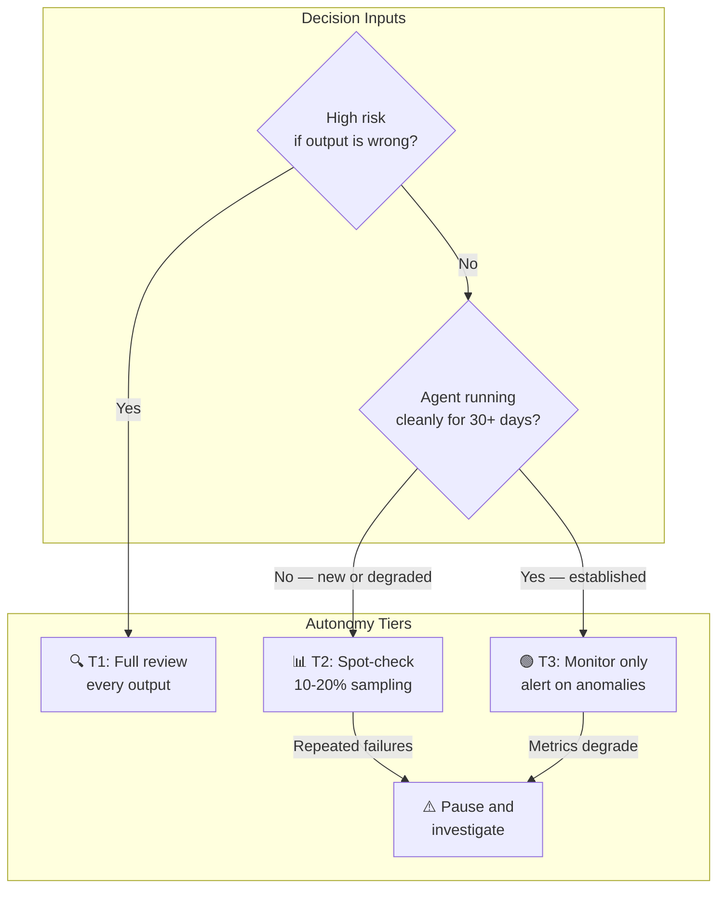

Six months ago, we were running 11 agents across three projects. Every output went through a review queue before it shipped. At peak, that queue had 40-something items sitting in it on a Tuesday morning, and nobody was getting to the back half.

We were turning agents into a slightly faster way to generate work we didn't have the capacity to review. The agents were producing. We weren't consuming. And we kept congratulating ourselves on how much they were "doing."

The problem wasn't the agents. It was that we'd never thought about agent autonomy at all.

## The Two Failure Modes

Most teams fall into one of two patterns. Both are wrong.

**Pattern 1: Review everything.** Every output gets a human eye before it ships. Feels responsible. In practice, it means your agents are only as fast as your slowest reviewer. Three agents, one reviewer: you don't have a system, you have a bottleneck.

**Pattern 2: Trust everything.** Let the agents run. Only look when something breaks. Fast, but blind. You might go weeks before you notice one agent has been producing subtly wrong outputs since its last prompt change.

The mistake isn't choosing the wrong pattern. It's that most teams never consciously choose at all. They just default into one and call it their process.

## Autonomy Is a Dial

Agent autonomy should be a deliberate setting based on two variables: **task risk** and **agent maturity**.

A new agent handling something high-stakes? Review everything. An agent that's run cleanly for three months on a low-risk task? Sample 10%, alert on anomalies, let the rest ship.

Most teams treat all their agents identically — same review rate, same oversight level — regardless of how long the agent has been running or how bad a wrong output would be.

"Full review" and "monitor only" are both valid settings. The key is that they should be set on purpose, not inherited by default.

## What This Looks Like in Practice

Take three agents from a real content pipeline:

- **Agent 1** (blog drafts, 8 months running): Spot-checked 10% weekly. Error rate in the last 90 days: under 2%. Autonomy: high. Review burden: minimal.
- **Agent 2** (product copy updates, 6 weeks running): Still working out the brand voice. Review rate: 100%. This burns time but catches about 1 in 5 outputs that need edits before they're usable.
- **Agent 3** (customer-facing email drafts): High-risk regardless of maturity. Full review, always. One bad email to 10,000 customers isn't recoverable with a "we fixed it."

Three agents. Three different autonomy settings. The thing that made it work: those settings were written down, agreed on as a team, and revisited at the 30-day mark.

The [agent monitoring dashboard](/features/agent-monitoring) in AgentCenter shows error rates and output trends over time. That's the data you need before you can make a smart call about loosening oversight. You can't promote an agent to less supervision if you don't have numbers showing it's earned that.

## The Habit That Fixes This

Every agent you add should answer two questions before it goes live:

1. **What autonomy tier does this agent start at?**
2. **Under what conditions do we move it up or down?**

These aren't hard questions. But teams almost never ask them. They launch the agent and figure it out after something breaks.

A simple version of this in practice: add an autonomy tier to your [task tracking board](/features/task-orchestration) for each agent. T1 = full review, T2 = spot check, T3 = monitor only. When an agent moves between tiers, log why. After a few months, you'll start to see which agents earn trust quickly and which ones keep bouncing back to T1.

That log is more useful than you'd expect. It tells you whether a specific agent's reliability is improving over time, or whether it's just getting lucky in bursts.

## A Note on Sampling

If you move an agent to spot-check mode, your sample has to be random, not curated. The natural instinct is to review the outputs that look suspicious. That's not sampling, that's confirmation of what you already suspect.

Real sampling catches the failures you weren't looking for. Set a rule: every Nth output gets reviewed, regardless of what it is. Tools like [AgentCenter's activity feed](/features/agent-monitoring) make it easier to pull a random slice without digging through logs manually.

## Who This Matters For

This is most relevant for teams with 5 to 20 agents, where reviewing everything is no longer realistic but going fully blind feels irresponsible.

At two agents, review-everything works. It's slow, but manageable.

At 15 agents, it becomes a full-time job for someone. That person becomes the bottleneck for everything your agents produce. Teams start to resent the review process instead of trusting it. Some start skipping reviews entirely, which is worse than having no process at all.

You need a system for deciding, ahead of time, which agents get how much oversight. Not based on your general comfort with AI, but on the specific risk and track record of each agent in your fleet.

## The Honest Caveat

Setting autonomy correctly doesn't fix a broken agent. If an agent has a bad prompt or a dependency that fails quietly, adjusting review rates won't catch that. It just changes how quickly you find out.

Autonomy tiers are a way to spend your review capacity where it matters most. They're not a substitute for actually fixing agents that underperform. If an agent keeps bouncing back to T1 after 60 days, that's a signal the agent itself needs attention, not more oversight.

---

*The dashboard won't fix a broken agent. But it will tell you which one is broken at 3am. [Try AgentCenter free](/pricing).*
