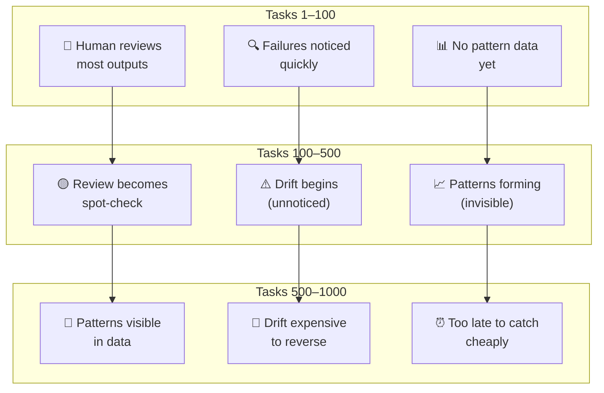

We'd run 1,047 tasks through our research agent before a pattern became too obvious to ignore.

The agent summarized industry reports, tracked competitive pricing, flagged product changes. It had been running for two months. Tasks piled up — 200, 400, 600 — and somewhere around task 700, we stopped reading every output. The agent was working. We had other things to do.

At task 1,047, the head of marketing asked why three consecutive competitive reports had all missed the same mid-market competitor we'd explicitly included in the original setup.

We looked back. The exclusion had started at task 412.

## The Pattern You Can't See at 100

At 100 tasks, you're still watching. You read outputs. You notice when something's off and you fix it. The agent is new enough that you haven't fully trusted it yet.

By task 500, that changes. The agent has a track record. It works. Your attention moves elsewhere.

That's not laziness — it's what happens with any system that performs reliably. The problem is that "reliably" and "correctly" aren't the same thing, and the gap between them only shows up at scale.

Here are four things that almost always surface around the 1,000-task mark.

## Token Usage Drift in Production Agents

At task 100, your agent averages 4,200 tokens per run. By task 800, it's 6,100 with no prompt changes.

Something is growing. Often it's context accumulation: the agent's tool call patterns are getting more verbose, or an upstream API started returning longer responses, and the agent incorporates all of it. Each individual run looks fine. The trend is invisible until you chart it.

Left unchecked, token drift eventually hits a ceiling — context window limits, cost alerts, or quality degradation from an overloaded context. You don't want to find this at task 2,000.

## Time-of-Day Failure Clustering

Run an agent long enough and failure patterns stop looking random. They cluster.

If you run tasks across a full day, you'll likely find that certain failure types cluster in specific windows: rate limit errors in the early afternoon when your team is also active and API usage peaks, context quality issues late at night with fewer retries and less oversight, or tool failures on Mondays from infrastructure maintenance windows you forgot about.

The first 100 tasks won't show you this. You need hundreds of data points before the pattern separates from noise.

## Output Quality Drift

This one hurts the most because it's the hardest to catch with monitoring alone.

The first 50 outputs were reviewed carefully. The format was right — specific headings, consistent sections, the right level of detail. By task 300, nobody was reviewing them at all. By task 600, the format had quietly changed. Summaries got shorter. A section relied on downstream was sometimes missing. The agent wasn't failing. It was just doing less than it used to.

You don't catch this without a baseline. You need to know what "good output" looks like structurally so you can measure deviation from it. Most teams set up error monitoring before they set up quality monitoring. That's backwards.

## Silent Tool Failures

Around task 400, an upstream API your agent uses shifted its response format slightly — a field name changed, a nested object flattened. The agent didn't crash. It adapted.

The adaptation happened to drop a field used downstream. Every output since task 400 was missing that field. The downstream process silently worked around it, or silently failed in a way that didn't trigger an alert.

Silent tool failures are the worst kind because the agent's completion status shows green. The task is "done." What the task produced is a different question.

## How to Track Agent Health Before Task 1,000

The insight isn't that agents are unreliable. It's that agents need measurement infrastructure before you hit 500 tasks, not after you hit 1,000.

Specifically:

- **Token tracking**: Chart average tokens per run over time. Any upward trend without a prompt change is a signal worth investigating.
- **Output schema validation**: Define what valid output looks like structurally and check every output against it. Deterministic checks on format, required fields, and length bounds — not AI-based validation.
- **Error aggregation by time window**: Don't just count errors. Bucket them by hour of day, day of week. Patterns become obvious when you look at the right slice.
- **Tool output logging**: Log what each tool returns, not just whether it succeeded. Format drift from upstream services is invisible without this.

AgentCenter's [agent monitoring](/features/agent-monitoring) surfaces token usage, task duration, and error rates per agent over time — giving you the trend data you need to catch drift early. The output schema validation and tool logging you'll need to build yourself. No dashboard knows what "correct output" means for your specific agent.

## Who This Matters Most For

If you're running one agent and handling 20 to 50 tasks a week, you probably don't have this problem yet. You're still close enough to the work to notice drift.

If you're running an agent that processes hundreds of tasks a week — research, data extraction, content generation, report compilation — and you're not reviewing every output anymore, you're in the window where these patterns accumulate. Especially if you've handed the agent off to a team member who didn't build it. They have no baseline for what normal looks like.

The 1,000-task problem hits hardest when the person noticing it isn't the person who built it.

## The Honest Caveat

None of these problems are unique to AI agents. Automated systems drift. APIs change. Assumptions rot.

What's different with agents is that the output looks right even when it's wrong. A crash is obvious. An output that's 80% of what you needed, formatted correctly, the right length, superficially plausible — that takes longer to catch. By the time you catch it, the bad outputs have already been used.

The [agent monitoring dashboard](/features/agent-monitoring) helps you see operational metrics. It won't tell you the outputs are wrong unless you've told it what "right" looks like. That's your job, before task 200, not after task 1,000.

---

*The dashboard won't fix a broken agent. But it will tell you which one is broken at 3am. [Try AgentCenter free](/pricing).*
