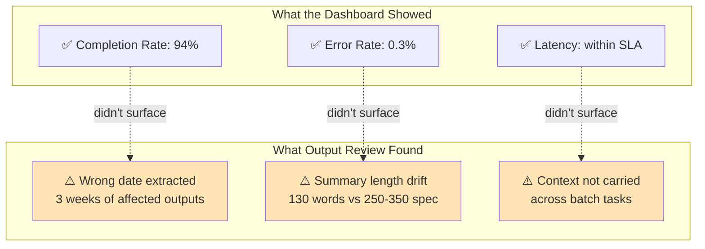

Three weeks in, we had 12 agents running. Every metric was green. Task completion rate at 94%. Error count near zero. Average latency within spec.

We stopped looking at the dashboard one afternoon and started reading the actual outputs.

It took about two hours. What we found took longer to process.

## The Metrics Were Accurate. They Just Weren't Enough.

Nothing was broken. Tasks had completed. Outputs were saved. No timeouts, no API failures, no exceptions in the logs.

But here is what the metrics didn't capture.

One of our extraction agents had been pulling the first date it found in each document — not the document's actual publish date. It had been doing this for three weeks. The outputs looked reasonable, dates formatted correctly and in plausible ranges, unless you checked them against the source. Nobody had.

A summarization agent was producing outputs noticeably shorter than its original spec. Not wrong. Just compressed further than intended. Every task showed "completed." No error was ever logged. The spec said 250 to 350 words. The agent was consistently producing 130.

A third agent had a different problem. The workflow expected it to carry context across a batch of related tasks. The agent was treating each task as independent, answering each one correctly in isolation while producing outputs that didn't fit together the way the downstream process needed.

Three problems. All invisible to standard monitoring. All generating completed tasks with no error signals.

## Why This Keeps Happening

An agent producing the wrong output is not failing. It is completing. The task count goes up. The error count stays flat. The dashboard looks fine.

Your monitoring system watches for things that raise exceptions. Wrong output doesn't raise an exception. It just ships.

This is the gap between [agent monitoring](/features/agent-monitoring) and actually understanding what your agents are producing. Monitoring tells you the agent ran. It doesn't tell you whether it did what you needed.

Most teams set up their basic dashboards early, get comfortable with the metrics, and shift attention to new work. The dashboards give a sense of things being under control. Technically they are — just not the kind of control you think you have.

When something does surface — a downstream team complaining, a report with bad data, a summary that clearly missed the point — the instinct is to look at the last deployment, the last config change, the last model update. The real cause is usually simpler: the agent was always doing this. Nobody read the outputs.

## What You Actually Have to Do

Read the outputs.

Not an automated check. Not a schema validator that confirms the right fields are present. Actually read a sample of what your agents are producing, a few times a month.

This sounds obvious. Almost nobody does it on a schedule. Teams do it reactively, after something breaks badly enough that it can't be ignored.

When you do review, here is what to look for:

- Outputs that completed but don't match the original task spec
- Outputs that look different from a month ago without a corresponding change to the agent
- Cases where the agent did exactly what the task description said, but the task description wasn't precise enough

That third category is the hardest to catch with any automated tool. You have to read the work.

## What This Looks Like in Practice

Pull 10 to 20 outputs from each active agent every couple of weeks. Compare them against the task spec. Ask: if this were the only output this agent produced, would we consider it correct?

If the answer is yes, that is genuinely good to confirm. If the answer is no, you have found something before it became a month-long problem.

The [agent dashboard](/features/agent-dashboard) in AgentCenter makes this easier by giving you direct access to the full output for any completed task without digging through external storage. But access is just the beginning. You still have to do the reading.

One pattern that works: dedicate 30 minutes every two weeks to this review, treat it as a standing item, and rotate which agents you sample. Within a few cycles you get a real sense of how each agent behaves over time versus how you expected it to behave.

## Who This Matters Most For

Teams running more than five active agents, where the volume is high enough that reviewing every output isn't realistic.

If you are still checking every output manually, you have probably caught most drift already. But past a certain volume — it happens sooner than most teams expect — selective review becomes the norm. When that happens, systematic sampling is the only thing standing between you and months of quiet errors.

Solo developers tend to catch problems faster because they stay close to the outputs. As teams grow and agents multiply, that proximity disappears. Work keeps shipping and nobody is reading it.

The teams that handle this well are the ones that treated output review as an operational habit before they needed it. The teams that handle it badly are the ones that discover the problem when someone outside engineering asks why the data looks off.

## The Honest Caveat

A better dashboard doesn't fix this. A dashboard can tell you which agents ran, which tasks completed, and which errored out. It can surface anomalies in cost and latency. It can help you know what happened.

What it cannot do is answer "did this output match what we actually needed." That is a judgment call your team has to make. No tool makes it for you.

The practical benefit of reviewing on a schedule: you catch problems when they are two weeks old instead of three months old. That is a meaningful difference in how much cleanup follows.

---

*The dashboard won't fix a broken agent. But it will tell you which one is broken at 3am. [Try AgentCenter free](/pricing).*
