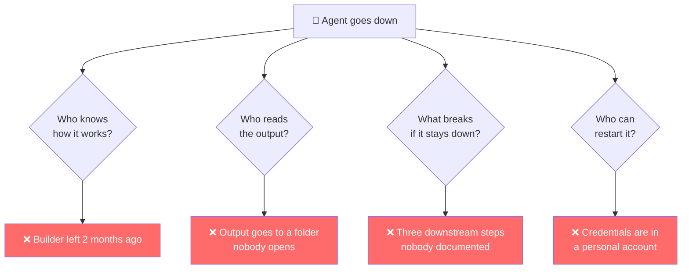

One of our report-generation agents failed at 2am on a Tuesday. It had been running for five months without anyone checking in on it. The failure itself was a bad prompt response — the model started returning malformed JSON and the agent didn't catch it. That part took 20 minutes to fix.

What took three hours: figuring out who owned the agent, where the output was going, whether anyone had noticed it was broken, and how to restart it without breaking something else.

The failure was a one-liner fix. Everything around it was a mess.

## Agent Outages Are Organizational X-Rays

When an agent breaks, the failure exposes what your team actually looks like underneath the process diagrams and Notion pages. Not what you planned for — what actually grew up around the agent while everyone was focused on other things.

This is almost always more revealing than an audit. You can audit processes that people know about. An outage tests the stuff nobody thought to document.

Here's what typically surfaces:

## The Four Things You Find Out

**1. Nobody knows who built it.**

Agents get added fast. Someone solves a problem, ships the agent, moves on. Six months later, that person is on a different team or has left entirely. The agent is still running. When it breaks, you're reading code written by someone who isn't available to explain the decisions they made.

This isn't a failure of documentation. It's what happens when agents are treated as one-time projects instead of things that need ongoing owners.

**2. Nobody reads the output.**

This one is uncomfortable. The agent ran every day for five months. It produced a report, wrote to a database, filled a spreadsheet. You go back and check — and you find out nobody looked at it. Not once in the last eight weeks.

The agent was "working." It was also producing garbage, silently, while everything downstream trusted it was fine.

**3. Dependencies appeared without anyone tracking them.**

Other agents started pulling from its output. An analyst added a dashboard column that read from its database table. A weekly email report included its numbers. None of this was planned. None of it was written down. You find all of it by chasing the error messages that cascade after the agent goes down.

**4. Restart requires permissions nobody has.**

The agent was set up with credentials from the person who built it. Those credentials expired. Or they're tied to an account that requires two-factor auth on a phone that's been reassigned. Or the environment variables are in a `.env` file on a laptop that isn't in the office.

Restarting takes an hour instead of five minutes. Not because the fix is hard — because the infrastructure was personal.

## What an Outage Reveals That a Postmortem Doesn't

A postmortem asks what went wrong with the agent. The outage tells you what went wrong with the team's relationship to the agent.

Those are different problems. The agent bug might be a one-time fix. The team problems will cause the next agent failure too — and the one after that — unless something changes.

You don't need a major outage to surface these things. Before your next agent breaks, you should be able to answer four questions about every agent in your fleet:

1. Who can explain how it works and why it was built?
2. Who reviews what it produces — and how often?
3. What downstream steps depend on it, explicitly or implicitly?
4. Who has the credentials and access to restart it right now?

If you can't answer those in under five minutes, the knowledge doesn't exist in your team. It exists in someone's head, or it doesn't exist at all.

## Turning an Outage Into an Audit

After the incident, we built a simple register for every agent: owner, output destination, consumers, restart runbook. Not a large document — four fields per agent. We put it in the same tool we were already using for task management.

The register itself wasn't the fix. Filling it out was. Doing the work of writing down who reviews the output forced a conversation about whether anyone actually reviewed it. In three cases, the answer was no, and we retired those agents. They were work nobody wanted and results nobody trusted.

The [agent monitoring dashboard](/features/agent-monitoring) helps with the visibility side — you can see which agents are running, how long tasks are taking, and where failures are occurring. But monitoring shows you the signal. It doesn't tell you who should respond to it.

That's the part that has to come from the team.

## Who This Matters Most For

Teams that have been adding agents faster than they've been building process around them. Specifically: you've got more than 5 agents running in production, at least one was built by someone who's no longer responsible for it, and you haven't had a formal review of your fleet in the last quarter.

That's a lot of teams right now. Agents get added in a week. Processes around them take months to form — if they ever do.

The [task orchestration view](/features/task-orchestration) is useful for seeing what's running and what's blocked. But the real gap is usually human, not technical.

## The Honest Caveat

Visibility tools help. Having a dashboard that shows you which agent failed and when saves time during an incident. But none of that tells you who should own the fix, whether the output was trustworthy before the failure, or whether this agent should exist at all.

Those answers require someone to actually think about how the team is running. An outage just forces that conversation to happen on a deadline.

---

*The dashboard won't fix a broken agent. But it will tell you which one is broken at 3am. [Try AgentCenter free](/pricing).*
