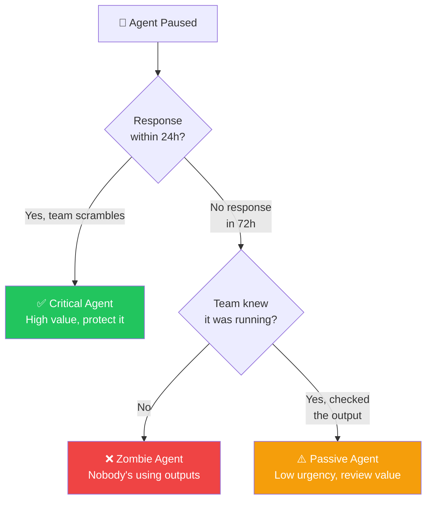

We didn't plan to stop all our AI agents at once. We were migrating infrastructure and had to take them offline for about six days. Eighteen agents, all paused.

I expected chaos. What I got was information.

## The First 24 Hours

Within two hours of the pause, two agents caused immediate problems. One handled daily data reconciliation; a downstream team noticed the gap within 90 minutes and messaged us. The other ran overnight report prep; by 8am the next morning, someone was manually pulling the data it normally processed.

Those two agents were genuinely critical. We knew it conceptually, but we'd never verified it with real evidence. We had our answer in less than a day.

By contrast: we heard nothing about the other sixteen for the first three days.

## The Quiet Agents

After four days, we ran a quick check across all teams. Three agents had been paused for 72 hours and nobody on those teams had noticed. Not "noticed and didn't mention it." Actually hadn't noticed.

One was a competitive monitoring agent that scraped pricing data and dropped it into a shared doc three times a week. When I asked the team about it, someone said "oh, we stopped looking at that doc about two months ago." The agent had been running faithfully, producing output nobody was reading.

One was a weekly digest agent that summarized team activity. The team had started using a different tool for this. The agent was still running in parallel, sending emails into a folder most people had filtered to trash.

One was a data enrichment agent for a sales workflow that had been redesigned six weeks earlier. The new workflow didn't use that enrichment anymore, but nobody had retired the agent.

Three agents. Hundreds of dollars per month in token spend. Zero business value being delivered.

## What the Pause Actually Measured

This is the thing you can't see from dashboards: whether an agent's output is being *used*.

You can track task completion rate, token cost, latency, error rate. Those metrics tell you the agent ran. They don't tell you if running mattered.

The forced pause measured something none of those metrics can: human response. When an agent goes dark, do people notice? Do they scramble? Do they fire up a manual process? Or do they just... continue with their week?

## What We Did With This

We came back from the pause with a clearer picture than six months of monitoring had given us.

For the two critical agents, we added proper alerting: [agent health checks](/features/agent-monitoring) that notify the relevant teams when those agents stop producing output, not just when they stop running. A dead agent and an agent producing wrong output look the same to an uptime monitor. They don't look the same to the downstream human who depends on the output.

For the three zombie agents, we retired them. Took about an hour. Saved us the cost and maintenance burden going forward.

For the remaining thirteen agents, we did something we'd never systematically done before: we documented who uses each agent's output, how often they check it, and what they do when they find something wrong. That documentation forced conversations that surfaced two more agents where the primary consumer had quietly stopped trusting the output several weeks earlier.

## How to Do This Without an Infrastructure Emergency

You don't need a forced migration to get this data. You can run a deliberate audit.

Pick a two-week window. Pause agents in batches, not all at once, and not in ways that break critical workflows. Start with agents you're least confident about. Watch for response. Ask teams directly: "We paused agent X on Monday. Did anyone notice?"

The conversations that follow are more useful than any dashboard. You'll find out which outputs people actually read, which they've learned to distrust, and which ones they've forgotten entirely.

What you're building is an urgency map: which agents create urgent problems when they stop, which create mild inconvenience, and which create no response at all. That map should drive where you invest in monitoring, alerting, and [reliability features](/features/agent-monitoring).

## Who This Matters For

This is most useful for teams that have been running agents for three to six months. Early on, you know what everything does because you just built it. After a year, institutional knowledge has usually caught up with the fleet.

The danger zone is the middle. When agents are running reliably enough that nobody questions them, but not old enough that their value has been formally established, that's exactly when zombie agents accumulate.

If you've never intentionally stopped an agent to see what happens, you don't actually know which ones are critical. You have a theory. The pause tests the theory.

## The Honest Caveat

This approach has limits. Some agents produce value in subtle ways that a short pause won't reveal. They're preventing errors rather than generating outputs, or they run infrequently enough that a week of downtime looks normal. And pausing agents in production workflows carries real risk if you're not careful about which ones you touch.

What a pause tells you is who notices and how fast. It doesn't tell you if the agents that *do* matter are actually doing their jobs well. For that, you still need output review: someone actually reading what the agent produced and asking whether it's correct, not just whether it ran.

The [deliverable review workflows](/features/agent-monitoring) we set up after the migration weren't just about the critical agents. They changed how we thought about the whole fleet. An agent you review regularly is an agent you actually trust. An agent running quietly in the background, unreviewed, is a theory you haven't tested.

---

*The dashboard won't fix a broken agent. But it will tell you which one is broken at 3am. [Try AgentCenter free](/pricing).*
