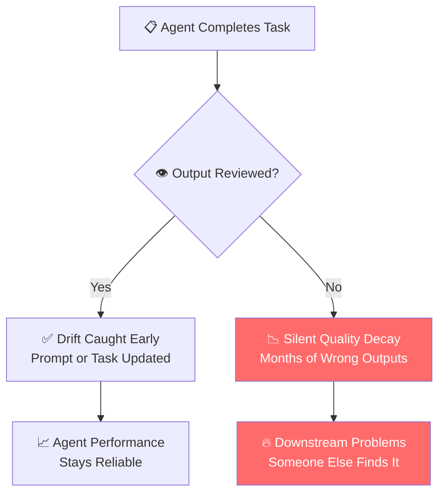

We had a production agent hitting 94% task completion for three straight months. Every status light was green. Then someone from our QA team spent an afternoon reading actual outputs and found that 38% of the "completed" tasks were wrong in ways that needed human correction before they could be used.

The agent hadn't changed. Our inputs hadn't changed. What changed was that we finally looked.

That experience forced us to ask a question we hadn't asked before: not "what's wrong with the agent," but "what did we actually give it?"

## The Team's Side of the Equation

Most conversations about agent failures focus on the agent. Wrong model. Bad prompt. Weird edge case. These are real problems.

But in our experience running agents in production, a larger share of failures trace back to the team. Not laziness — just gaps in how teams set agents up and what they give them to work with.

Here are four things most teams owe their production agents but rarely deliver.

## 1. A Task Definition That's Actually Specific

"Research the competitive landscape" is not a task for an agent. It's a direction.

Agents aren't senior hires who fill in blanks from context. They do exactly what you describe. If you describe it vaguely, you get vague output. If you describe it wrong, you get wrong output — confidently delivered.

A task definition that works looks like: "Identify the three most recent pricing changes by our top five competitors. For each, note what changed, the effective date, and the source URL. Output as a table."

The difference is scope, format, and acceptance criteria. Without those three things, your agent is guessing what "done" means. And it will always guess in favor of looking done.

## 2. Input Quality You Actually Track

Agents degrade when their inputs degrade. This is obvious in theory and invisible in practice.

An agent that processes customer feedback will slowly get worse as your support team changes how they write tickets. An agent that pulls from a database will silently break if a schema changes or a field starts returning nulls. An agent that reads a shared doc will produce different outputs next month if the doc gets quietly reorganized.

Most teams instrument the agent. Almost no one instruments the inputs.

[Agent monitoring](/features/agent-monitoring) can surface output quality signals, but input drift is harder to catch automatically. The minimum viable check: once a week, look at what your agent is actually receiving and confirm it still matches what you designed it for.

## 3. Output Review That Actually Happens

You wouldn't let a new hire submit work for three months without reviewing a single deliverable.

You'd check in. Give feedback. Catch the patterns early before they calcify into habits.

Most teams don't do this with agents. Once the completion rate looks good, outputs stop getting read. That's when drift sets in. The agent keeps completing tasks. The outputs get subtly worse. No one notices until someone outside the team asks why the last two months of work need to be redone.

Build a review ritual. Pick 10 random task outputs per week and read them — not the summary stats, the actual output. This takes 20 minutes and catches more problems than any dashboard.

The [deliverable review features](/features/agent-monitoring) in a control plane help structure this, but the review itself still has to happen. The tool doesn't replace judgment.

## 4. A Way for Problems to Travel Back Upstream

When you catch an agent doing something wrong, that observation needs to go somewhere.

Most teams treat output review as a one-time fix: spot the problem, correct that output, move on. But if the observation doesn't travel back into the prompt, the task template, or the monitoring rules, the same problem will repeat next week.

Teams that run agents well look different here. They have a habit — even an informal one — of turning output problems into upstream changes. The agent that answered a customer question incorrectly doesn't just get that answer corrected. The task definition gets updated to prevent the same miss.

It doesn't need to be a formal process. A shared doc, a tag in your task board, a channel where caught problems land. Something that turns "we caught a problem" into "we prevent it next time."

## What This Looks Like in Practice

The shift isn't complicated. Before asking "why is this agent underperforming," ask four questions first:

- Is the task definition specific enough that the agent knows when it's done?
- Are the inputs your agent is receiving still the inputs you designed it for?
- Has anyone actually read the outputs in the last two weeks?
- When you caught a problem, did anything change upstream?

If the answer to any of those is no, you've found the real problem. And it isn't the agent.

## Who This Matters Most For

Teams past the demo stage. You've got agents running on real tasks, producing real outputs, touching real workflows. The demo threshold ("it mostly works") is no longer enough.

This matters most if your agents run daily tasks unsupervised, if your team has grown to where no single person sees all the outputs, or if you've added agents faster than you've built review habits around them.

The gap between "agents deployed" and "agents managed" is where most production problems live.

## The Honest Caveat

Some agent failures genuinely are model failures. LLM limitations are real. Some tasks are outside what any model can reliably do right now.

But when you trace failures back, the team's side of the equation accounts for more than most teams expect. Vague task definitions. Untracked input drift. Skipped output review. Feedback that never made it back upstream.

AgentCenter won't write better task definitions for you. No tool will. What a [control plane](/features) can do is make the operational gaps visible — which agents are slipping, which tasks keep getting flagged, where outputs are sitting unreviewed. The visibility is there. What to do with it still requires the team.

---

*The dashboard won't fix a broken agent. But it will tell you which one is broken at 3am. [Try AgentCenter free](/pricing).*
