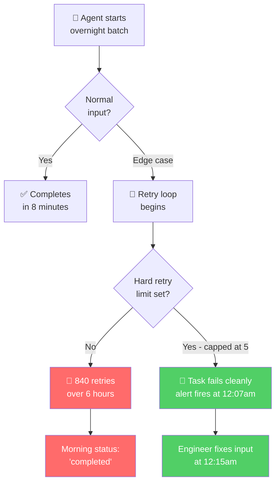

We had a document processing agent set to run at midnight every night. It pulled files from an S3 bucket, extracted structured data, and pushed results to a database. Clean, boring, useful.

One Tuesday morning our API bill was $380 higher than the day before. We dug into the logs. The agent had spent 6 hours retrying one malformed PDF — 840 times. No alert had fired. The morning status summary just read "completed."

That was the moment we understood: we knew what our agents did when we were watching. We had no idea what they did when we weren't.

## The Off-Hours Gap in Production AI

Most teams think about agent reliability in terms of uptime and error rates. There's a different kind of failure that only shows up overnight: unchecked behavior with no human in the loop.

Your agents are well-behaved during the day. You process a few tasks, review outputs, and notice if something looks off. At midnight, they're working through the entire queue, hitting edge cases you've never seen before, running longer than expected, and burning through budget — with nobody watching.

The failure modes that appear at 3am are different from the ones you catch at 3pm.

## What Actually Happens After Midnight

Here are the four failure patterns that show up most in teams running unmonitored overnight agents:

**Retry storms.** An agent hits a malformed input or an upstream rate limit. Without a hard retry cap, it keeps going. We've seen agents send 500-plus API calls on a single task before anyone checked in the morning. By then you've spent real money on work that produced nothing, and the original problem is still there.

**Silent bad output.** The agent finishes on schedule. No errors. The outputs are just wrong. A summarization agent that started hallucinating after hitting its context limit. A data extraction agent that began dropping fields after encountering a new file format. No crash, no alert. Just wrong results sitting in a database until someone looks closely — which might not happen for days.

**Rate limit cascades.** You have 8 agents scheduled to start at midnight. In testing you ran one at a time. In production they all start together, hit the same API rate limits, and start interfering with each other. Some complete slowly. Some fail silently and restart. The status board shows "running" for jobs that should have finished at 1am. Nobody knows until standup.

**State corruption.** An agent runs halfway through a task, hits an unhandled exception, and exits without cleanup. The next morning a different agent picks up where the first one stopped — but the shared state is broken. You now have two agents compounding a problem that started 9 hours ago.

## What Changes When You Add Overnight Visibility

You don't need to watch your agents all night. You need to know immediately when something goes wrong.

**Cost thresholds with immediate alerts.** Not a daily summary. An alert when a single agent exceeds a per-task or per-hour spend limit. If your document processor normally costs $0.40 per batch and it hits $2.00 overnight, you want to know at 12:45am, not 9am.

**Hard retry limits on every unattended run.** A task that retries 5 times and stops is a contained problem. A task that retries until morning is an incident. This is a one-line config change that prevents the most expensive overnight failures.

**Status alerts for long-running jobs.** If an agent is still marked "running" 2 hours past its expected finish time, that's worth surfacing. Agents that go silent — no status updates, no completions, no errors — are often stuck, not working.

**Output review in the morning, not status review.** "Completed" means nothing if the output is wrong. Checking that jobs finished is not the same as checking what they produced. Build the habit of reviewing a sample of overnight outputs before trusting them downstream.

AgentCenter's [agent monitoring](/features/agent-monitoring) surfaces real-time status across all running agents — cost per task, how long each has been running, and current state. The [task management view](/features/task-orchestration) shows you exactly which tasks completed, which are still running, and which failed, without having to dig through logs.

## Who This Hits Hardest

If you run scheduled or recurring agents — nightly data pipelines, batch processing, automated reporting — this is your problem. You set it up, it worked, and you stopped watching.

It compounds when any agent has write access to a real system. An agent that reads data and produces a report can be wrong for hours before anyone notices. An agent that writes to a database or sends emails at scale can create cleanup work that takes days.

Teams that grow from 2 agents to 10 or 15 hit this wall hard. With 2 agents, you check them every morning. With 15, you assume they're fine unless something obvious breaks. That assumption is usually fine — until it isn't.

## The Honest Version

Monitoring your agents at night won't make them smarter. It won't fix the malformed PDF or the context window limit. What it does is shrink the blast radius.

The difference between a 6-hour retry storm and a 10-minute one is not better AI — it's a cost alert and someone with a phone. The tools that matter here are not complicated ones: real-time status, per-agent spend tracking, and hard task timeouts. Basic infrastructure, but it becomes essential the moment your agents run without you.

Your agents are working while you sleep. The question is whether you'd know if they started working against you.

---

*The dashboard won't fix a broken agent. But it will tell you which one is broken at 3am. [Try AgentCenter free](/pricing).*
