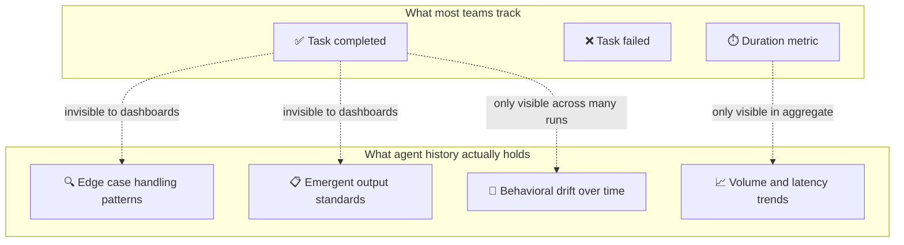

Six months in, we had a problem nobody planned for. One of our document extraction agents had been running fine — or what we thought was fine — and then the engineer who built it left the team. We needed to tune the prompt for a new document format, but nobody knew why it was structured the way it was. The original builder was gone. The docs were sparse. The agent's behavior looked almost arbitrary to the people inheriting it.

So we did something we'd never done before. We read the outputs.

All of them. Six months, 3,200 runs, everything the agent had ever produced. It took three days. What we found was not debugging data. It was institutional memory — the kind that usually lives in one person's head and disappears when they leave.

## The shift

Every agent run is a recorded decision. When your agent parses an invoice and extracts a vendor name, it made a choice about how to handle that particular format. When it hits an ambiguous date and interprets it a certain way, that interpretation is documented. When it silently skips a malformed field, that too is a decision — just not one anyone explicitly made.

Over hundreds or thousands of runs, those decisions accumulate into something that resembles a policy. Not a documented policy. Not a policy anyone formally wrote. But a real, observable pattern of how your system handles edge cases — including edge cases nobody knew would come up.

That is institutional memory. And your agents are generating it constantly, without being asked to.

## What production agent outputs actually contain

Reading six months of output taught us things we could not have found any other way.

**Hidden edge cases being handled correctly.** About 8% of the invoices that came through had a non-standard date format from one specific vendor. The original engineer had tuned the prompt to handle it — we could see it working correctly across 200+ runs. Nobody had documented this. If we'd changed the prompt without reading history first, we would have broken handling for that vendor and never connected the cause to the effect.

**Quiet decisions that became de facto standards.** When line items were ambiguous, the agent defaulted to assigning them to a "General" category. This was not in the spec. It emerged from how the prompt handled uncertainty. Over six months, the downstream accounting team had built their own reconciliation process around this behavior. If we'd changed it, we would have broken something that was not even in our system's documentation.

**Volume patterns nobody tracked.** Looking at run timestamps, we could see a clear pattern: Fridays had 3x the normal volume. The agent handled it, but barely. Average latency crept up, and a handful of tasks timed out during peak periods. No alarm had ever fired. No ticket had been filed. The history showed the stress; the dashboard showed nothing.

**Behavioral drift over time.** Early runs and recent runs looked subtly different. The agent was producing more verbose outputs lately — consistently, across all document types. We traced it to a prompt edit from four months ago that someone had made and forgotten. The intent was to add clarity to edge case handling. The actual effect was that every output got wordier. Looking at outputs in sequence made it obvious. Looking at any individual output, you would never notice.

## What to take away

Your agent's output history is not just debugging data. It is a record of your system's decisions. If you want to maintain an agent, change a prompt, or hand it off to someone new — that history is the ground truth for how the system has actually been behaving.

Three habits worth building:

**Store outputs, not just metrics.** A task completion rate does not tell you how edge cases were handled. The actual output does. Keep a random sample of full outputs per agent, per week. A searchable index is better, but even a stored sample beats nothing.

**Read outputs on a schedule, not just when something breaks.** Once a month, spend an hour reading a random slice of what your agents produced. You will catch drift before it accumulates, find edge cases before they become incidents, and understand your system better than any dashboard will show.

**Read history before you tune.** Before you change a prompt, read 50 recent outputs. Look for patterns. Look for decisions the current prompt handles correctly that your new version might disrupt. Your agent has been managing edge cases you have already forgotten about.

## Who this matters most for

Teams of five or more people, where more than one person has touched agent configuration. Teams where someone has left. Teams that are six months or more into production with the same agents.

Solo founders are not off the hook either. Not because of personnel turnover, but because your own memory of why you built something degrades faster than you think. Six months from now, you will read your own agent's outputs and find decisions you made and stopped thinking about.

If you're early — less than 60 days in — the history is not deep enough yet. File this away and come back.

## Honest caveat

Reading six months of agent outputs is not enjoyable work. Depending on volume, it may be genuinely impractical to do manually. The goal is not to audit every run. The goal is to treat output history as a searchable asset rather than a log you only open when something breaks.

[AgentCenter's activity feed and task history](/features/agent-monitoring) make this a lot easier — you can filter by agent, time range, and status without digging through raw storage. But even without tooling, the principle holds. Outputs are decisions. Decisions accumulate into patterns. Patterns are worth understanding before you touch anything.

---

*The dashboard won't fix a broken agent. But it will tell you which one is broken at 3am. [Try AgentCenter free](/pricing).*
