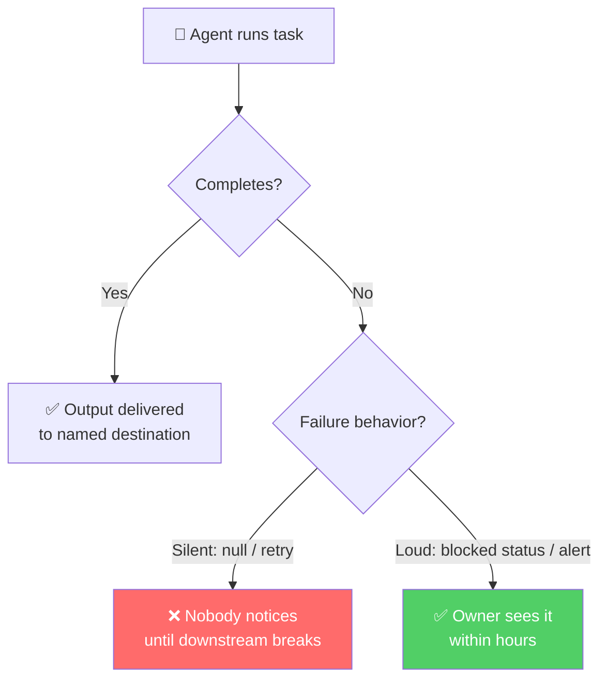

We had 31 agents running. Sat down one Friday to figure out which production AI agents were worth keeping.

It took most of a weekend. I pulled task completion rates, cost per run, and output logs. I talked to the engineers who owned them — and a few who didn't know they owned them.

What I expected to find: the cheapest ones, or the fastest ones. Some number I could sort by.

What I actually found: the best agents didn't share a cost profile or a model. They shared a set of operational habits. Five specific ones.

## The Audit Nobody Wants to Do

By month six with 31 agents, nobody could describe what all of them actually did. Half were producing outputs that may or may not have been useful. A few were running on a schedule that predated the engineer who set them up.

So I made a spreadsheet. Name, owner, frequency, last reviewed, output destination. When I was done, the pattern was obvious.

The agents worth keeping all had the same five traits. The agents we killed or paused were missing at least three.

## Trait 1: One Job

Not "research and summarize." Not "draft and review." One thing.

Every agent we kept was scoped to a single operation. The research agent researched. The draft agent drafted. When we found agents doing two things, they were measurably worse at both.

The failure mode with multi-task agents: they start making trade-offs between objectives, and those trade-offs are invisible. You see the output. You don't see which objective it optimized for that particular run, or what it quietly skipped.

## Trait 2: A Named Output Destination

Every high-value agent sent its output somewhere specific. A task in [AgentCenter](/features/task-orchestration). A Slack channel owned by a specific person. A named review queue.

The agents that posted to "the dashboard" or "the shared folder" with no specific downstream owner degraded within 60 days. Nobody checked them. Nobody caught the drift.

Output with no destination is a signal that nobody agreed the output would actually be used.

## Trait 3: Weekly Human Review

Every agent that stayed healthy had at least one person who looked at its outputs every week. Not automated checks. Not CI assertions. A person.

Once a week, they'd spot-check 5 to 10 outputs. Note anything strange. If nothing was strange for three weeks straight, they'd drop to biweekly. But they never dropped to never.

[Agent monitoring](/features/agent-monitoring) can surface error rates and latency. It can flag when an agent stops responding. It can't tell you when outputs are technically correct but subtly wrong. That takes a person.

## Trait 4: Loud Failures

The agents that worked had failure states you couldn't miss. If they couldn't complete a task, they created a blocked status, threw an alert, or returned an explicit failure with a reason.

The agents that silently retried, returned null, or logged the error and moved on caused the most expensive failures. Not because they crashed, but because nobody knew they weren't working until something three steps downstream stopped making sense.

Loud failures feel annoying until you've spent three hours debugging a silent one.

## Trait 5: The Same Owner After 90 Days

This was the one I didn't expect.

Six months in, I checked ownership records. Every agent still doing useful work had the same person listed as owner since launch. Every agent that had gone quiet or started producing garbage had changed hands at least once, or never had a clear owner to begin with.

This isn't about blame. It's about context. The person who built the agent knows why it's scoped the way it is, which edge cases it handles badly, and what good output actually looks like.

When ownership changes hands, that knowledge doesn't transfer. The new owner looks at the dashboard, sees green status lights, assumes everything is fine. Then it slowly isn't, and nobody knows when the drift started.

## What to Do With This

Run the audit. For each agent, ask five questions:

1. Does it have one job, or two?
2. Does its output go to a named destination with a named owner?
3. Does a person review it at least weekly?
4. Does it fail loudly when it fails?
5. Is the original owner still listed?

If an agent fails more than two of those checks, treat it as a liability until you fix the gaps. Not something to shut down — something that needs attention before the next failure finds you first.

## Who This Matters For

Teams with more than five agents who haven't done a formal review in the last 90 days. Also teams about to add their next agent — this works better as a pre-launch checklist than a post-failure diagnosis.

The earlier you run this, the less expensive it is.

## The Honest Caveat

None of this guarantees an agent will be valuable. A well-scoped agent with a named owner can still produce wrong output consistently. These traits are necessary conditions, not sufficient ones.

But agents that lack them fail in predictable ways: silently, slowly, and without anyone noticing until the damage has compounded. That's the failure mode worth preventing.

---

*The dashboard won't fix a broken agent. But it will tell you which one is broken at 3am. [Try AgentCenter free](/pricing).*
