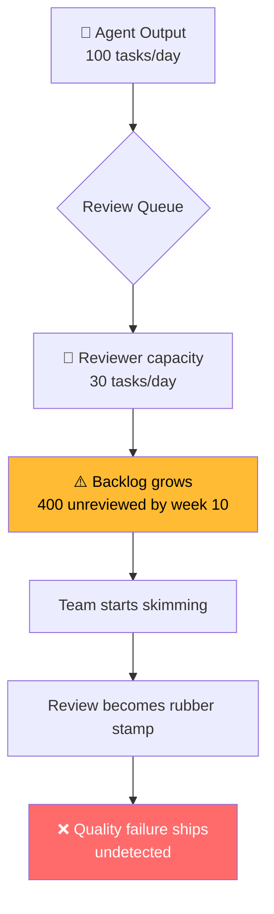

Eight weeks after launch, we had an agent producing about 80 research summaries per day. Two people were assigned to review them. They could realistically review 25 on a normal workday. Nobody had done the math before shipping.

By week ten, we had a backlog of 400 unreviewed summaries. By week twelve, reviewers had started skimming. By week fourteen, they were mostly approving without reading carefully. The agent was still green on the dashboard. The review process had quietly collapsed.

This is one of the less-talked-about ways agent deployments go wrong. Not because the agent fails, but because the human system built around it can't keep up.

## The Throughput Mismatch Problem

When teams plan agent deployments, they usually think about two things: will the agent work, and will it be fast enough? Both are the right questions for the agent itself.

Nobody asks whether the humans downstream can keep pace.

An agent that processes 100 tasks per day sounds like a win. If your review process can handle 30, you're not 3x more productive. You're building a queue of unreviewed outputs, and you're facing a decision every single day: skip the review or fall further behind.

Most teams choose to skip, a few tasks at a time. At first it feels fine because the outputs look reasonable. The agent has been reliable. Obvious problems are easy to catch. But the skimming becomes the habit, and then the habit becomes the process, and then the process fails you the day the agent does something nobody would have caught while skimming.

## Three Ways Teams Handle the Review Gap

**Skip reviews entirely.** This is the fastest response but not really a decision — it's a drift. Teams don't decide to skip reviews; they just stop doing them because the backlog makes the process feel pointless. The outcome is the same as having no review gate at all, except your process documentation still says you have one.

**Add more reviewers.** This works until the agent gets faster or the team shifts to other priorities. You've moved the headcount cost to a harder-to-account-for line item: unplanned review time.

**Match the review process to what the agent actually needs.** This requires you to be honest about what a review is for. Not every output needs the same scrutiny. A research summary going to an internal report needs different oversight than one going directly to a customer. An agent output in a stable, well-understood workflow for six months needs lighter review than one in its first few weeks of production.

## What a Tiered Review Looks Like in Practice

The teams that manage this well split outputs into tiers based on actual risk:

- **Spot check (5-10% sampled):** For agent outputs in stable, well-understood workflows. Reviewers check a random sample each day, not everything.
- **Full review:** For high-stakes outputs or new agent behavior. Every output gets seen before it moves downstream.
- **Auto-approve with audit trail:** For genuinely low-risk outputs where a mistake is recoverable. The agent runs, outputs go through, but everything is logged and traceable if you need to investigate later.

The tier should be based on actual risk, not just how much you trust the agent in general. A reliable agent can still produce high-stakes outputs in specific contexts. One routing mistake in a customer escalation workflow costs more than a hundred clean document summaries. AgentCenter's [approval workflows and task orchestration](/features/task-orchestration) let you set different review gates per workflow, so you're not treating everything as equally critical.

## The Sign Your Review Process Has Already Collapsed

If your reviewers' job has become "approve the queue," the review process is theater. Outputs are passing through a human checkpoint, but the human isn't adding anything except a timestamp.

You can see this pattern in [AgentCenter's activity feed](/features/agent-monitoring): if review turnaround time is consistently under 10 seconds, reviewers aren't reading. They're clicking to clear their queue. That's a signal to either restructure what the review asks them to do, move the agent to a sampled tier, or set up auto-approve with proper logging.

The difference matters for teams in regulated industries. A healthcare team approving 200 prior authorization summaries per day with two reviewers either has a tiered review model or they need to accept that their review process isn't providing the protection they think it does.

## Who This Catches Off Guard

Teams deploying agents for workflows where volume scales faster than headcount. That's most automation use cases. If you're deploying an agent because your current team has too much work, your agent will probably outpace review capacity the moment it works well.

It also catches teams that built the review process at launch based on early throughput numbers. At launch, agents are slow and output quality is inconsistent — reviewers have time to read carefully. As the agent gets tuned and volume picks up, the early review model doesn't scale.

The sign you're in this situation: your reviewers are the ones who flag agent problems, but they do it by accident, not by design. They're approving outputs, not evaluating them. When they catch something, it's because they happened to notice, not because the process was built to catch it.

## The Honest Part

Tiered reviews and sampling aren't a substitute for a well-calibrated agent. If your error rate is high enough that you genuinely need to read every output, the fix is improving the agent, not hiring more reviewers. Visibility tools help you know when outputs need attention. They don't improve the outputs themselves.

A practical starting point: for your highest-volume agent, time how long reviewers actually spend per output. If it's under 30 seconds, they're not reviewing in any meaningful way. Decide whether that's an acceptable risk level or a process that needs to change before something goes wrong.

---

*The dashboard won't fix a broken agent. But it will tell you which one is broken at 3am. [Try AgentCenter free](/pricing).*
