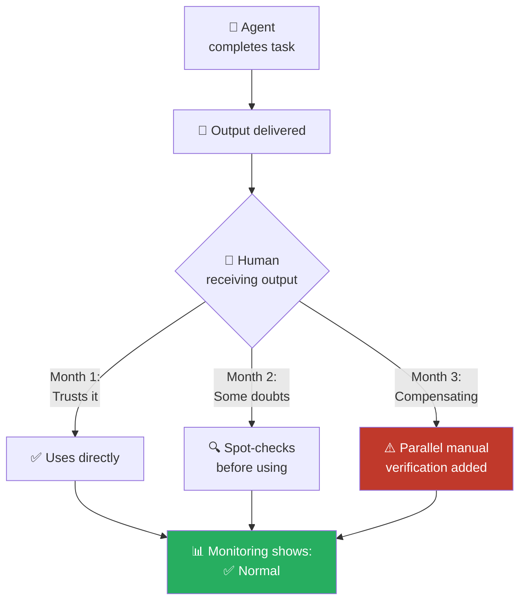

We had eight agents running for about four months. Every [monitoring dashboard](/features/agent-monitoring) was green. Task completion sat above 90%. Token costs were stable.

Then a product manager asked our content writer why she'd been spending extra time on research before submitting her final drafts.

She said, almost casually: "The research agent's summaries have been a bit thin lately. I just double-check them now."

That sentence was the first honest signal we'd gotten in weeks.

## The Pattern Nobody Names

No error had fired. The research agent was completing tasks and submitting deliverables on time. The problem was that its output had drifted. Summaries were shorter. Specific data points were missing. Contradictory sources were being skipped.

The writer adapted. She added a verification step. The pipeline kept moving. And our monitoring saw nothing unusual.

This is the pattern worth watching for: when a human adds extra work around an agent, it usually means the agent is failing.

Not crashing. Not throwing errors. Just drifting enough that the person depending on its output stopped trusting it and started compensating quietly.

By the time we had the conversation with the writer, she'd been running her extra step for six weeks.

## Three Workaround Behaviors to Recognize

Once you know what to look for, these patterns show up across teams.

**Re-verification.** The downstream person duplicates the agent's core task. They don't discard the output, but they don't fully use it either. They spot-check once. Then twice. Then the spot-check becomes a full review because it's faster than trusting and finding problems later.

**Task rerouting.** People start handling certain work manually again. "It's just faster if I do this one myself." Agent avoidance is the clearest signal, but it's also the hardest to see in logs because the agent never gets the task to fail on.

**Parallel pipelines.** Two versions of the workflow emerge: the official one (agent output submitted) and the real one (human-verified version actually used). The official pipeline keeps your metrics green. The real one doubles your team's workload.

At all three stages, your task completion metrics look identical. The human behavior changes. The agent metrics don't.

## Why Standard Monitoring Misses This

Most [agent monitoring](/features/agent-monitoring) tracks whether agents ran, how long they took, and what they cost. It doesn't track whether the people depending on the output actually used it.

That's the gap.

An agent that runs on time, under budget, with no errors looks like a working agent by every measurable standard. If output quality quietly degraded, you won't see it in uptime numbers or error rates. You'll see it in your team's behavior — and only if you're paying attention to behavior.

Teams don't file tickets for this. They absorb the overhead. They adapt. They work around it.

This is how agents accumulate weeks of hidden operational cost before anyone names the problem.

## The Right Question to Ask

The fix isn't a new dashboard. It's a question.

Every few weeks, go directly to the people who use your agent outputs and ask: "Has anything changed about how you're using this lately?"

If the answer is "well, I've been adding a step to check..." or "I've been handling these ones manually" — you have your signal.

You can also look for behavioral evidence in your task data. Look at which agents are receiving fewer assignments over time. Check which deliverables are being revised frequently after submission. Notice which humans are logging more time on tasks the agent was supposed to handle. None of those signals are labeled "workaround," but together they point at one.

The [features dashboard](/features) in AgentCenter surfaces task throughput per agent over time. A gradual decline in an agent's incoming task volume — without a business reason behind it — is often a team quietly routing work away.

## What to Do When You Find a Workaround

Resist the urge to immediately patch the agent.

First, find out how long the workaround has been in place. What it was compensating for. Whether the original agent behavior was defined clearly enough to even know what "drifted" means.

Sometimes the agent didn't drift. The workflow changed around it and nobody updated the task specification. Sometimes input data quality dropped and the agent is doing the best it can. Sometimes the original output quality was never as high as people assumed, and they were compensating from day one without anyone noticing.

Understanding why someone started working around the agent tells you more about the real fix than any error log will.

## Who This Matters For

Team leads managing agents their team members use daily but aren't hands-on with themselves. Engineers who hand off agents to non-technical users. Anyone who built an agent, shipped it, and moved on to the next project.

If you're not the person who depends on the output every day, you're probably not seeing the workarounds. You're seeing the metrics the workarounds are designed to keep green.

## An Honest Caveat

This is as much a people and process problem as a tooling one. You could build output quality scoring and automated drift detection and still miss the early compensation behaviors, because those behaviors show up before output quality degrades enough to trigger an alert.

What catches this is asking the right people the right questions on a regular cadence. The tooling can surface behavioral signals — task volume shifts, revision frequency, time spent per deliverable — but the conversation has to happen.

An agent that looks fine in your dashboard might be costing your team a significant amount of hidden time. The person who knows is the one doing the extra work. Go ask them.

---

*The dashboard won't fix a broken agent. But it will tell you which one is broken at 3am. [Try AgentCenter free](/pricing).*
