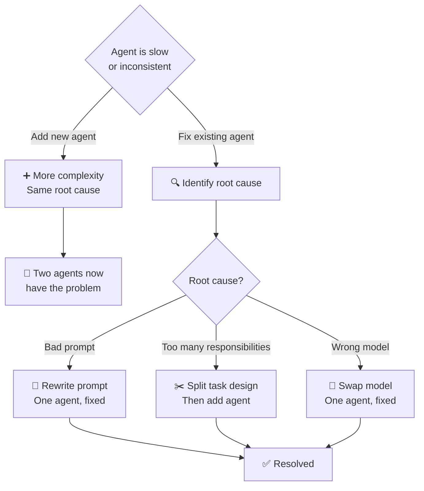

We added a fourth agent to our content pipeline because the third one wasn't keeping up. Smart, right? The third agent was producing two types of content — research summaries and draft outlines — and it was slow and inconsistent.

Our fix: split the work across a new specialized agent.

The actual problem: the third agent had a bad prompt. We had given it too many responsibilities and the prompt was 3,000 tokens of confused instructions. Splitting it into two agents made the system more complex, added a coordination point, and solved nothing because both agents were running on the same bad prompt design.

We figured this out two weeks later, after debugging four agents instead of three.

## The Temptation to Add

Adding a new agent feels like progress. You're building. You're expanding capacity. The multi-agent architecture diagram gets more impressive.

Fixing an existing agent feels like admitting failure. You're debugging. You're going back, not forward.

This is a bias problem. More agents isn't better agents. More agents is more surface area, more coordination points, more failure modes, and more operational overhead.

## The Diagnostic Questions

Before adding a new agent, answer these:

**Is the agent slow because it's doing too much, or because it's doing it badly?**

Slowness from doing too much is a good reason to split. Slowness from a bad prompt or wrong model is a reason to fix, not expand.

**Is the inconsistency random or patterned?**

Random inconsistency usually means model calibration or input variability — a better prompt or evaluation gate fixes it. Patterned inconsistency (always fails on type X, always succeeds on type Y) means the agent is handling genuinely different task types that should be separated.

**Is the agent the bottleneck, or is the task design the bottleneck?**

Sometimes the agent is fast and correct but the task brief is ambiguous. The agent produces variable output because it's filling in underspecified requirements differently each time. A clearer task design, not a new agent, is the fix.

## When Adding an Agent Makes Sense

There are clear cases where a new agent is the right answer:

**Genuinely different task types.** If your agent is doing research AND code review AND content drafting, those are three different jobs for three different agents. The problem isn't execution quality — it's task scope.

**Throughput constraints.** If one agent at its best performance can't meet your volume requirements, you need more agents, not a better agent. This is a scaling problem, not a quality problem.

**Fundamentally different model requirements.** A task requiring deep reasoning does better with a larger model. A task requiring fast, high-volume classification works fine with a smaller, faster model. If your agent is doing both types, the right models for each are different — that's a case for two agents.

**Independent, parallelizable subtasks.** If your task naturally decomposes into parts that don't need to share state and can run concurrently, multiple agents give you a speed benefit.

## The Right Order

1. Identify the failure mode specifically
2. Check if it's a prompt, model, or task design problem
3. Fix the obvious thing first
4. If performance is still insufficient after fixing, then consider adding

This order seems obvious but most teams skip steps 1-3 under time pressure. Fixing things takes time. Adding things feels faster.

## What the Reader Should Take Away

The number of agents is not a metric for progress. The quality of what each agent produces, and the reliability with which it produces it, is.

Before adding a new agent, spend 30 minutes diagnosing the existing one. Check the task history in [AgentCenter's dashboard](/features/agent-dashboard). Look at the rejection rate trend. Look at duration outliers. Often, the problem is in one of these obvious places, and 30 minutes of diagnosis saves two weeks of debugging a more complex system.

## Who This Matters Most For

This matters for teams with enough momentum to keep shipping, but not enough operational discipline to stop and diagnose. Startups, small engineering teams, anyone who's under pressure to show progress. The "add more agents" impulse is strongest when delivery pressure is highest — which is exactly when you can least afford to increase system complexity.

## Honest Caveat

There's no formula. Sometimes the right call really is to add an agent because the task scope is genuinely too broad. The point is to make that choice deliberately, not by default.

_The dashboard won't fix a broken agent. But it will tell you which one is broken at 3am. [Try AgentCenter free](/pricing)._
