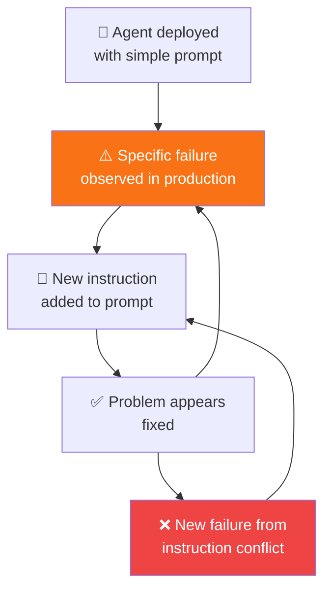

We had an AI agent routing customer emails to the right team in production. It worked well enough in month one. Then it started misclassifying billing questions as sales inquiries, so we added a rule: "If the email mentions billing, treat as support." Fixed.

Two weeks later, the same problem. So we added another rule. Then another one for refunds. One more for pricing questions. Six months in, the routing prompt had 47 lines of exceptions and accuracy was lower than it had been at deployment.

We thought we were improving the agent. We were making it confused.

## The Instinct That Breaks Production Agents

When an agent does something wrong, the natural response is to write a new instruction. It feels like the right fix. You saw the failure. You wrote a rule addressing it. You deployed.

But AI agents don't process instructions sequentially. They try to satisfy all constraints at once. When two instructions conflict, the model doesn't pick the one you wrote most recently. It picks an average of everything.

That average is rarely what you want.

The 47-rule routing prompt had three instructions that directly contradicted each other. One said to prioritize the subject line for routing. Another said to read the body for the final decision. A third said to treat any mention of "pricing" as a sales inquiry, except for renewal emails, except when the customer was on an enterprise plan. The agent was trying to reconcile all of them simultaneously. No wonder it was misrouting.

## How Prompts Accumulate Over Time

Here's what the cycle looks like in most teams:

Each cycle adds a rule. Most fix the immediate problem. Some create new ones. After enough cycles, you have a prompt encoding a complex decision tree in natural language, which is exactly what language models handle poorly.

Decision trees in code are explicit. Branch A here, branch B there. Decision trees in prompts are implicit. The model infers the logic from text, and it doesn't always infer what you intended. Two instructions that seemed unrelated when you wrote them six months apart may be directly contradictory from the model's perspective.

## What Happens When You Strip It Back

After month six with the routing agent, we ran an experiment. We deleted everything except four lines: the agent's job, the three teams it could route to, what each team handles, and what to do when it's unsure.

Accuracy went from 71% to 89%.

The 47 rules weren't helping. They were noise. The base model understood email routing well enough. We had been overriding its judgment with encoded assumptions, many of which were wrong or contradictory.

This isn't an argument for minimal prompts in all cases. It's an argument that before adding an instruction, you should test whether the model already handles the case correctly without it. Add a constraint only when you have a specific, reproducible failure the base behavior doesn't cover.

A useful filter: if you can't explain in one sentence why a specific instruction exists and what failure mode it prevents, it probably shouldn't be in the prompt. Instructions you can't explain are usually the ones causing problems.

## When Additional Context Actually Helps

There are cases where more context genuinely improves performance:

**Information the model can't infer.** Internal product names, company-specific terminology, unusual abbreviations. If the model doesn't know what your product is called, tell it. That's not noise, it's necessary signal.

**Hard constraints.** "Never respond in a language other than English." "Don't route to the compliance team on weekends." These are explicit rules the model couldn't infer from its training data and won't violate accidentally if told clearly.

**High-stakes decision trees.** A contract review agent classifying clauses across 40 categories needs detailed context. The cost of an error is high enough to justify the complexity. But this is the exception, not the baseline.

The common thread: you're providing information the model genuinely lacks, not encoding decisions you're hoping it will make differently.

## The Source of the Real Problem

Most teams reach for the prompt when the actual issue is somewhere else.

If an agent is misrouting emails, ask whether the emails themselves are the problem. Unstructured input, inconsistent formatting, missing context in the email body. More routing instructions won't fix a bad input. You need to fix what's feeding the agent.

Before you edit the prompt, look at [agent monitoring data](/features/agent-monitoring) for the failing tasks. Are they failing on a consistent input pattern? Specific senders? A particular category of request? The failure pattern tells you where to intervene. Most of the time, it's not the prompt.

## The Maintenance Habit That Prevents Accumulation

Treat prompt changes the way you treat code changes. Before adding an instruction, consider removing one. If the net instruction count is growing every month, you're building debt.

Some teams run prompt audits every four to six weeks. They read every instruction in their production agent prompts and challenge each one: Does this still apply? Is it contradicting something else? Has the failure mode it was addressing been fixed elsewhere? Most find two or three instructions they can remove without affecting performance.

This is easier with versioned prompts. When you can see the history of changes alongside performance metrics, you'll catch accumulation before it compounds into the 47-rule situation. You'll also know exactly which instruction to revert when something breaks after a change.

Your [agent monitoring setup](/features/agent-monitoring) should make it straightforward to correlate prompt changes with output quality trends. If it doesn't, that's worth fixing before the next change you push.

## Who Hits This Pattern First

Teams with agents that have been in production for three months or more. Month one, the prompt is clean. Month two, there are a few edge cases. Month three, the prompt has turned into a wall of exceptions and the original task description is buried somewhere in the middle.

You'll recognize the cycle when: the agent is doing something wrong, you add an instruction, behavior improves for a few days, then something new breaks. The two-week improvement window is the tell.

Solo developers hit this hardest because there's nobody else reading the prompt. No code review equivalent. No one to ask "why is this instruction here?" The prompt grows in silence until it stops working in a way that's hard to diagnose.

## The Honest Caveat

Some agents genuinely need long, detailed prompts. A medical record classification agent working with ambiguous cases needs explicit guidance. A customer support agent operating under legal constraints needs clear rules.

But most production agents are doing more constrained work than teams believe. Routing, summarizing, extracting, classifying. These are tasks base models handle reasonably well with minimal instruction. The tendency to add context is often a response to a different problem: unclear task scope, bad input quality, or an agent that's taken on too much. Fix those first.

Before you add the 48th rule, ask whether the problem is actually the prompt.

---

*The dashboard won't fix a broken agent. But it will tell you which one is broken at 3am. [Try AgentCenter free](/pricing).*
