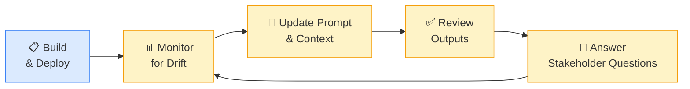

Three weeks after we shipped our first production agent, the team lead asked a question nobody could answer cleanly: "Is it still doing good work?"

The agent was running. Tasks were completing. The status light was green. But nobody had read its outputs in two weeks, the upstream data it depended on had changed twice, and one of the tools it used had a new rate limit we hadn't noticed.

We had planned the deployment carefully. We had planned nothing for what came after.

## The Mental Model That Gets Teams in Trouble

Most teams picture agent deployment as a before-and-after event. You build it, you ship it, you move on to the next thing. The agent is "in production" now. Done.

What you actually shipped was a commitment to ongoing work that nobody put on the roadmap.

Teams spend most of their planning time on the blue box. The yellow boxes are where the actual time goes, week after week, for as long as the agent runs.

## What That Ongoing Work Actually Looks Like

**Context drift.** The agent was built around your processes as they existed at launch. Your processes changed. The agent did not get the memo. You probably won't notice until someone reads an output and asks why it's doing something unexpected.

**Prompt maintenance.** The prompt that worked in week 1 needs adjustment by week 6. Not because you wrote it wrong — because you understood the job better after watching 500 outputs. That understanding needs to go back into the prompt. Someone has to do that, on a schedule.

**Output review.** Someone needs to read what the agent produces. Not every output, but enough to catch systematic errors before they stack up. Without a process for this, you're relying on luck or an angry stakeholder to surface problems. Tools like [agent monitoring dashboards](/features/agent-monitoring) can flag anomalies automatically, but a human still has to decide what to do about them.

**Failure handling.** What happens when an upstream API rate-limits the agent? What happens when a task exceeds the timeout? What happens when output doesn't match what the downstream system expects? These situations happen, and "we'll handle it when it comes up" is a plan that guarantees a bad Tuesday.

**Stakeholder questions.** Someone in finance, legal, or product will eventually ask: "Why did the agent do X?" If your answer is "I don't know, let me dig into the logs," you're about to spend two hours on a question that should take two minutes.

**Credential and permission management.** API keys rotate. Tool access gets adjusted. Someone changes a permissions setting and forgets the agent depends on it. This happens more than you'd expect, and it almost never gets caught until the agent silently stops working on the tasks that require it.

## The Ratio Nobody Writes Down

Building and shipping an agent takes days to weeks, depending on complexity. Keeping it useful takes hours per week — spread across a person's schedule, often invisibly — for as long as the agent runs.

For most production agents, building and deploying is roughly 10 to 15% of the total work. The rest is maintenance, oversight, and the small decisions that keep an agent aligned with what you actually need from it.

That's not a knock on agents. It's just the reality of running any service in production. The difference is that software services have decades of tooling, culture, and expectation-setting around this. Agent operations are new enough that teams are still surprised by it.

## Who Actually Owns This Work

That's the question most teams skip, and it's what usually breaks things.

After deployment, agent maintenance tends to fall to whoever built it — informally, without any explicit scope or time allocation. They feel a vague sense of ownership. But there's no SLA, no on-call rotation, no review cadence, no assigned time for any of it.

When agent maintenance is nobody's explicit job, it doesn't happen. Not because the team doesn't care. Because explicit work beats implicit work, every time.

The teams that run agents well long-term treat them like running services, not scripts they wrote once. They have named owners. They have regular review meetings or async check-ins. They have a way to answer the question "is this agent still doing what it was designed to do?" without a 30-minute investigation. A [multi-agent workflow dashboard](/features/multi-agent-workflows) makes this visible across the team rather than living in one person's memory.

## Who Hits This Hardest

If you're deploying your first or second agent, this is the pattern to watch for. Everything feels good at launch. Curiosity is high. Outputs are being read. The team is engaged.

At month two or three, that curiosity fades. The agent becomes background infrastructure. That's precisely when the maintenance work becomes critical — and when most teams accidentally stop doing it.

Engineering managers should plan for this as concrete scope: time, ownership, and process. Not a vague "we'll keep an eye on it" commitment.

## The Honest Part

Agents are worth building. The maintenance load for a well-scoped agent is manageable when you plan for it. The mistake is treating deployment as the finish line and then being caught off guard by everything that comes after.

AgentCenter gives you task history, output records, [real-time agent status](/features/agent-dashboard), and activity logs in one place — which removes a lot of manual digging. But the judgment calls still need a human: Is this output good enough? Has this agent drifted from what we need? Those questions need someone scheduled to answer them, not just the ability to find the data when something goes wrong.

---

*The dashboard won't fix a broken agent. But it will tell you which one is broken at 3am. [Try AgentCenter free](/pricing).*
