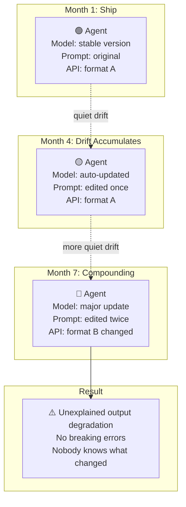

We shipped 8 agents in Q1. By April we were running 11. One of the original 8 started returning outputs that were slightly off. Correct format, wrong emphasis, missing context in spots where it used to fill things in well. We logged it in a "watch later" note and kept moving.

By July, three agents were behaving oddly. One was actively causing problems. We spent two days trying to figure out what changed, because nothing had. At least nothing we could remember.

The answer was: everything had changed, slowly, over 16 weeks. Model versions. API responses from upstream services. Prompt edits nobody remembered making. Small config tweaks nobody thought to document. None of these were breaking changes on their own. Together, they compounded.

That's agent maintenance debt.

## Why Agent Maintenance Debt Is Harder to See Than Code Debt

Developers understand technical debt because it's in the code. You can see it in a PR review, in a linter warning, in a test that slowly gets harder to pass.

Agent debt is harder to see because it lives in behavior, not source code.

Your prompt is code. The model version you're running against is a dependency. The upstream API your agent calls is an external service. All three can drift under you, and none of them will throw an error when they do. They'll just quietly shift what your agent outputs.

And your monitoring won't catch quiet shifts. It's watching for crashes and timeouts, not for "the tone of these summaries got slightly more verbose."

## What Compounding Looks Like in Practice

Here are three patterns we've seen repeatedly.

**Model drift.** In February you tested your summarization agent against a specific model version. By May, your provider auto-updated to a newer release. The outputs are still technically correct, but the summaries are longer now. A downstream agent that expected short summaries started occasionally truncating in the wrong place. Nobody filed a bug. The downstream agent was just "failing intermittently."

**Prompt drift.** Someone edited a prompt in March to fix a formatting bug. The fix worked. But the prompt had an implicit dependency: it relied on a specific output pattern that a downstream agent was parsing. That parsing silently broke for edge cases. Six weeks later, a batch of 40 outputs came through in the wrong format, and nobody could trace it back to the March change.

**Dependency drift.** An upstream data API changed its date format from `MM/DD/YYYY` to `YYYY-MM-DD` in a minor update changelog nobody read. Your agent still runs successfully and returns a 200. But the dates in its output are now in the wrong format for the humans who rely on them downstream.

The painful part: each of these changes was reasonable on its own. The compounding is what creates the problem. And the compound effect usually only becomes visible at exactly the wrong moment: during a high-stakes run, or when a client notices something you didn't.

## The Asymmetry of Agent Failures

Code failures are usually loud. An exception gets thrown. A service goes down. CI catches it.

Agent failures are often quiet. The agent completes. The status shows green. The output is plausible-looking. But it's wrong in a way that takes a human to notice. And by the time a human notices, the output has already been used.

This is why deferred maintenance hurts more with agents than with most software. You don't get a crash at 2am that wakes up on-call. You get 200 tasks completed with subtly degraded output, and you find out when a team member asks why the reports have been slightly off for the last month.

## What a Maintenance Window Looks Like

Schedule one. Not a war room, not a bug hunt. A regular, boring calendar block. Once a month is enough for most teams running fewer than 10 agents. Every two weeks if you're running more, or have agents chained to each other.

What to do in it:

1. Re-run your golden test suite against current agent output and compare to baseline samples from 60 days ago
2. Check your LLM provider's model update notes for any versions that changed since your last review
3. Pull 20 random outputs from the past 30 days and read them (not skim them)
4. Review any prompt changes made since the last maintenance window
5. Check the changelogs for upstream APIs your agents call

None of this is exciting. That's the point. The goal isn't to find fires. It's to find smoke before it becomes one.

If you're using [agent monitoring](/features/agent-monitoring) that captures output samples over time, this review gets faster: you can diff output distributions instead of reading individual tasks by hand.

## Who This Matters Most For

If you're in your first 90 days with agents, this probably isn't urgent yet. Your agent behavior is fresh enough that you'd notice significant drift. You know what "normal" looks like because you just built it.

If you're past month 4 and have never done a scheduled audit, you have debt. The question is how much.

The highest-risk group: ML engineers who built agents and handed them off to an ops team. The person who built the agent knows what normal output looks like. The person now running it doesn't. When drift happens, ops sees "it runs fine" and doesn't know what they're missing.

Platform and DevOps teams managing [multi-agent workflows](/features/multi-agent-workflows) across departments have this problem at scale. One drifted agent in a chain can corrupt inputs for every agent downstream, and the root cause is invisible unless you're sampling output at each stage.

## The Honest Caveat

A maintenance window doesn't fix a fundamentally broken agent. If your agent was producing low-quality output from day one, periodic reviews will confirm it but won't cure it. The root cause in those cases is usually the task definition or the prompt architecture, not accumulated drift.

And scheduled maintenance doesn't help if nobody has authority to act on what they find. If your review surfaces three agents with degraded output and the answer is "we'll fix it later," you're just generating a more formal version of the watch-later note that got you here.

The value of a maintenance window is only as high as the team's willingness to act on what it surfaces. That's a process problem, not a tooling problem.

---

*The dashboard won't fix a broken agent. But it will tell you which one is broken at 3am. [Try AgentCenter free](/pricing).*
