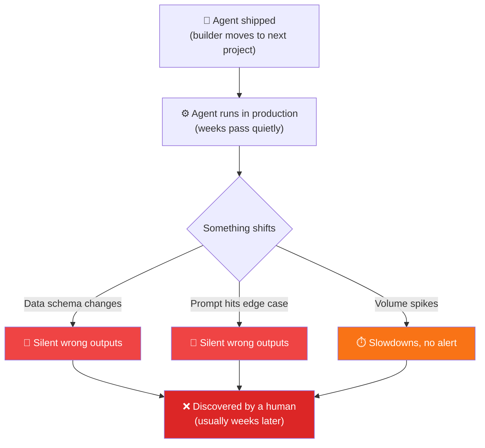

Six weeks after a team shipped a document-summarization agent, it started returning summaries that looked right but were missing key contract clauses. Not always. About 30% of the time. The engineer who built it had moved on to another feature. Nobody in ops knew the agent existed. There was no alert configured. There was no assigned owner.

A paralegal caught it during a quarterly audit.

This isn't unusual. It's the default lifecycle for an agent that had a great demo but no ownership plan.

## The Builder-Owner Gap

When you build an agent, you understand it completely. You wrote the prompt. You tested it against your data. You watched it run 50 times and felt confident.

Then you shipped it and moved on.

The problem is that production agents aren't static. The data they process changes. Edge cases appear in month 3 that didn't exist in month 1. The model behind the API can behave differently after a provider update. None of this surfaces during a demo. All of it surfaces in production.

Most teams have builders. Very few have owners.

An author is whoever wrote the agent. An owner is whoever answers when something goes wrong. That's a completely different job — and at most organizations, nobody is explicitly doing it.

## What Happens Without an Owner

The agent doesn't fail loudly. It fails quietly. Outputs look plausible. Nobody gets paged. Logs show green. The real cost accumulates before anyone notices.

That's the pattern that hurts teams most: not dramatic failures, but quiet drift that takes weeks to catch.

## What "Ownership" Actually Means

Owner isn't a title. It's a set of concrete responsibilities.

**Who gets notified when the agent goes silent?** An agent that normally produces 40 outputs per day and produces zero should trigger an alert within the hour. Someone needs to be assigned to receive that alert.

**Who reviews flagged outputs?** Not everything needs human review, but your riskiest outputs do. The owner defines what gets flagged and stays current on what's passing through. Without a defined owner, flagged items pile up in a queue that nobody watches.

**Who updates the prompt when the world changes?** The agent's instructions were written for the data you had at build time. Data drifts. Instructions need to track with it. That's not a build task — it's an ongoing ownership task.

**Who decides when to roll back?** When an agent starts producing questionable results, someone has to make the call to pause it or revert to an earlier version. That's not an automated decision. A person has to own it.

**Who kills it when it's no longer useful?** Agents that nobody needs still cost money to run. An owner makes an active decision to keep or cut, rather than letting an orphaned agent run indefinitely.

## What Good Ownership Looks Like

The teams that get this right assign ownership before the agent ships — not after the first incident.

They use a simple rule: every agent in production has a name attached to it. That person gets notified when the agent errors, goes idle, or produces outputs that need review. They're not necessarily the one reviewing every output. They're the one responsible for making sure the review process exists and runs.

With [agent monitoring](/features/agent-monitoring), you can see which agents are active, what they're producing, and how often they error. That visibility is genuinely useful — but only if someone is looking at it. Monitoring tools show you the signal. Ownership ensures someone acts on it.

In [AgentCenter's task board](/features/task-orchestration), you can assign deliverables to a specific owner and set review thresholds per agent. When an output needs sign-off, it goes directly to the responsible person rather than sitting in a general queue. That structure forces the question of ownership at setup time, before you need it.

## The Handoff Is a Deliberate Step

One pattern that works: before any agent ships, run a 30-minute handoff session. The builder walks the owner through the prompt, expected outputs, known edge cases, and failure modes. The owner gets added to the monitoring alerts. A review threshold is defined — above a certain error rate, the owner gets paged.

This sounds basic. Very few teams actually do it.

Most teams ship the agent, the demo was great, the pipeline ran. Then two months later, someone finds the problem during an audit.

The difference between those two outcomes is one conversation that takes 30 minutes.

## Who This Matters Most For

If you have 3-4 agents and the same person who built them is still actively working on them, you probably don't have this problem yet. You're the builder and the owner. You're watching.

Once you hit 8-10 agents across 2-3 projects, the gap opens fast. People move between projects. Agents get inherited by team members who didn't write them. The original context for why a prompt was written a certain way gets lost.

This matters most for team leads, engineering managers, and technical founders who have shipped agents they're no longer actively reviewing. If you can name 5 of your production agents but can't name the owner of each one, you have this problem.

## An Honest Caveat

Assigning an owner doesn't guarantee an agent works correctly. Owners get busy. Review thresholds drift. People leave teams.

What ownership does is make accountability visible. When something goes wrong, there's a clear first call. That's not a trivial thing — it's the difference between discovering a problem in 6 hours and discovering it in 6 weeks.

AgentCenter can show you which agents are active, what they're producing, and where outputs are sitting in a review queue. But if nobody is assigned to watch those signals, the visibility doesn't help. The tool surfaces the information. Ownership ensures someone acts on it.

Before your next agent ships, ask one question: if this produces garbage outputs on a Tuesday morning, who's the first person I'm calling?

If you don't have an answer, you don't have an owner.

---

*The dashboard won't fix a broken agent. But it will tell you which one is broken at 3am. [Try AgentCenter free](/pricing).*
