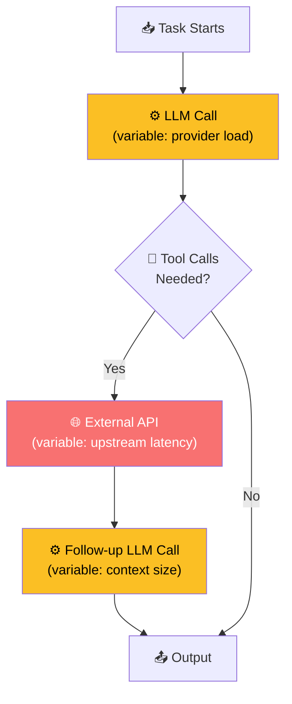

Our agent task timeout was 60 seconds. Agent performance in testing averaged 8 to 12 seconds per task, so we thought we were being generous.

Then one Thursday, 23 tasks backed up in the queue. Each one had hit the 60-second limit. Not because anything was broken. The tasks had just run for 70 to 90 seconds that day. Same prompts. Same inputs. Same agent. Different Thursday.

We'd built around the average. Production doesn't care about averages.

## When Agent Performance Gets Inconsistent, You Won't See It Coming

When an agent crashes, you know. The error surfaces. The task fails. You get an alert. You fix it.

When an agent is slow on Fridays, or takes 10x longer on large inputs, or performs differently at 2pm versus 2am, you don't know at first. The task might still complete. The output might still be correct. But your timeout fires, your SLA misses, your user waits longer than expected, and you have no clear signal why.

This is the variance problem. It doesn't read as a bug. It reads as "occasionally slow" until you dig in and find out how often "occasionally" actually happens.

Outright failure is binary. You can alert on it, count it, fix it. Inconsistent agent performance is a distribution. You have to decide where in that distribution your system breaks, and that line is almost never where teams think it is.

## What Drives Agent Performance Variance

Several causes compound on each other, which makes individual task variance hard to isolate.

**Input size.** A task with 200 words of context takes 6 seconds. A task with 3,000 words takes 40. If your agent handles documents of wildly different lengths, your runtime distribution is bimodal. Your average is somewhere in the middle, representing neither case well.

**LLM provider load.** The model your agent calls is a shared service. When it's busy, responses take longer. You're not in control of this. A 4-second task becomes a 25-second task without any change on your end. This is especially visible during peak hours for US-based providers: late afternoon Eastern, or early morning UTC.

**Tool call chains.** If your agent calls external APIs, and one of those APIs slows down due to rate limits, upstream degradation, or network issues, the agent waits. That wait adds directly to total task time.

**Context accumulation.** Agents with memory or agents running long task sequences take longer as context grows. An agent that runs fine for its first 100 tasks might run 40% slower by task 500.

Each step adds variance. The total runtime is the sum of several uncertain quantities, not one predictable number. And when they all run slow on the same task, the outlier is far worse than your average suggests.

## Why Your Average Runtime Metric Is Lying to You

Most monitoring setups show average task runtime. Maybe median. That number looks fine most of the time.

But what matters in production is the tail.

If your p95 runtime is 8 minutes and you've set a 60-second timeout, you're silently failing 5% of tasks. If you're running 200 tasks a day, that's 10 failures a day that don't look like failures because the task status is "timed out" rather than "error."

If your SLA promises results in under 2 minutes, the 3% of tasks that take 4 minutes are SLA violations, even if your average is 30 seconds.

Costs cluster in the tail too. The expensive tasks tend to be the slow ones. An agent that runs at average cost 99% of the time but goes 15x over on 1% of inputs can still blow your monthly budget.

A team I know discovered that their average task runtime was 11 seconds but their p95 was 8 minutes. They'd set a 30-second timeout. Every week, roughly 5% of tasks were silently failing. They'd been debugging "flaky behavior" for two months before realizing it was just tail latency hitting a wrong timeout.

## What to Track Instead

Replace "average runtime" with a set of percentile breakdowns:

- p50 (median) for a baseline
- p90 and p95 for timeout calibration
- p99 for worst-case planning
- Timeout rate as a percentage of total tasks

Also track:
- Runtime by input size bucket (small, medium, large)
- Runtime by time of day (reveals provider load patterns)
- Runtime trend over time (are tasks getting slower as your agent fleet grows?)

[Agent monitoring](/features/agent-monitoring) in AgentCenter breaks task duration down across these dimensions so you're not relying on a single number that hides the tails. When a task runs 10x slower than usual, it shows up as an outlier rather than disappearing into an aggregate.

## What to Do With the Numbers

If your timeout is set to average runtime times 2, change it to p90 or p95 runtime. Then watch the timeout rate. If it's above 0.5%, either the timeout is still too short or your agent genuinely breaks on certain inputs.

For SLAs: commit to your p90, not your average. If p90 is 45 seconds, saying "under 60 seconds" gives you a real buffer. Saying "under 15 seconds" based on average will get you burned.

If your agent handles inputs that vary significantly in size, separate them. Different task types, different timeouts, different SLAs. A document-processing agent that handles both two-page contracts and 200-page reports should not have a single timeout covering both.

## Who Needs to Think About This

Teams building user-facing features on top of agents feel this most directly. The median user has a fine experience. The 95th-percentile user waits 8x as long. That gap is invisible until it becomes a support ticket.

On-call engineers dealing with agent incidents find variance harder than failure. "It was slow yesterday" is almost impossible to diagnose after the fact without per-task traces. Consistent failures leave obvious artifacts. Slow tails don't.

Teams setting internal expectations for what agents can deliver also run into this. The agent that takes 8 seconds is fine. The agent that takes 8 minutes three times a week, for reasons nobody can explain, is the one that gets escalated to leadership.

## The Honest Caveat

Measuring variance tells you it exists. It doesn't tell you which cause is dominant for any specific task. Figuring out whether the issue is LLM load, input size, tool latency, or something else requires per-task tracing, not just aggregate metrics. Start by measuring. Then trace the outliers.

Some variance is also irreducible. LLM response time is not something you fully control. You can set expectations around it, alert when it spikes beyond your p99 baseline, and route around provider issues. But you can't make it constant. Planning for variance, rather than ignoring it, is the realistic posture.

---

*The dashboard won't fix a broken agent. But it will tell you which one is broken at 3am. [Try AgentCenter free](/pricing).*
