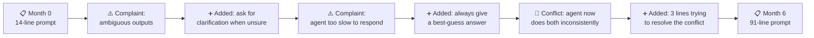

Six months ago, our data extraction agent had a 14-line prompt. Clean, deliberate, easy to read. Today that same prompt is 91 lines. Nobody planned that.

Every line past 14 was added because something went wrong. A customer complained about output format. An edge case produced garbage. A new integration needed special handling. Someone added a line, the problem stopped, and everyone moved on. Ninety times.

This is how production agent prompts actually grow.

## How Agent Prompts Accumulate Debt

You don't sit down one day and decide to write a 91-line prompt. You write 14 lines. Then you spend six months adding sentences.

"Always cite the source document by page number." Added after a legal team complaint in month 1.

"If the source is a table, summarize before extracting values." Added after three extraction failures in month 2.

"Do not include values that appear in headers only." Added after one specific incident with a client spreadsheet.

Each line solved a real problem. But by month six, we couldn't answer a basic question: which of these instructions are still needed? The problems that triggered them — were they rare incidents or recurring patterns? We had no idea. We never wrote it down.

## How Instructions Start Contradicting Each Other

Traditional code debt accumulates in functions that do too many things, in variables named `temp2`, in logic nobody wants to delete. Prompt debt looks different but feels the same.

Here is what happened to ours:

Month 2: We added "when the query is ambiguous, ask the user for clarification."

Month 4: Clarification requests were slowing things down. We added "when uncertain, provide your best answer with a confidence note."

Month 6: The agent does both. Sometimes it asks. Sometimes it guesses. Sometimes it does both in the same response. We have no idea which instruction wins in which situation, because we never thought through how they interact.

That is the real problem with prompt accumulation. The instructions do not just pile up. They start contradicting each other. And because the model resolves contradictions probabilistically, behavior becomes unpredictable in ways that are genuinely hard to reproduce.

## The Deletion Experiment

Three months ago, we ran a test. We picked a section of the prompt that looked redundant — five lines about handling nested JSON structures — and deleted it.

Output quality changed noticeably on 38% of inputs.

Not in one direction. Some outputs got better. Some got worse. We had no idea those five lines were load-bearing. They had been added by someone who left the team months earlier. No context, no reason in any document. We added them back.

This is what prompt tech debt actually costs you: you cannot safely refactor. Every line is potentially load-bearing. The prompt becomes something you are afraid to touch, even when you know it needs work.

## What Teams That Avoid This Do Differently

The teams that manage prompt debt well do one thing: every time they change a prompt in production, they write one sentence about why.

- What failure caused this change?
- Is this failure likely to happen again?
- Does this new instruction interact with any existing instruction?

That is it. If you version prompts alongside your code — which is covered in detail at [how to version AI agent prompts like code](/blogs/how-to-version-ai-agent-prompts-like-code) — those sentences become commit messages. Searchable. Attributable. Deletable when the original context disappears.

Teams with this habit can look at a 60-line prompt and tell you why every line is there. Teams without it end up with 91 lines and a quiet fear of changing anything.

Pairing that with [agent monitoring](/features/agent-monitoring) gives you one more thing: a way to detect when a prompt change causes a behavioral shift you did not expect. Output pattern changes, error rate spikes, task duration changes — these are the signals that tell you a prompt edit had downstream effects before users notice.

## Who This Matters Most For

If your agent has been in production for more than three months, this is already happening to your prompt. If more than one person on your team has ever edited a prompt, it is definitely happening.

The earlier you catch it, the less painful the cleanup. A prompt with 30 lines and clear provenance for each one is maintainable. A prompt with 91 lines and no history is a black box you are responsible for but cannot confidently change.

Solo founders running agents face a different version of this problem: the context lives only in their head. When something breaks at month 8, they cannot always remember what they were solving for when they wrote a particular line.

## An Honest Caveat

Prompt hygiene will not make your agent perfectly predictable. Models update, behavior drifts, and new edge cases arrive constantly regardless of how clean your prompt is. You are managing a moving target.

The goal is not a perfect prompt. It is knowing what you have, why you have it, and being able to make changes without breaking things you do not understand. That is a lower bar, and it is achievable.

The alternative — 91 lines, no history, a team afraid to edit — is not a stable state. It just feels stable until something breaks.

---

*The dashboard won't fix a broken agent. But it will tell you which one is broken at 3am. [Try AgentCenter free](/pricing).*
