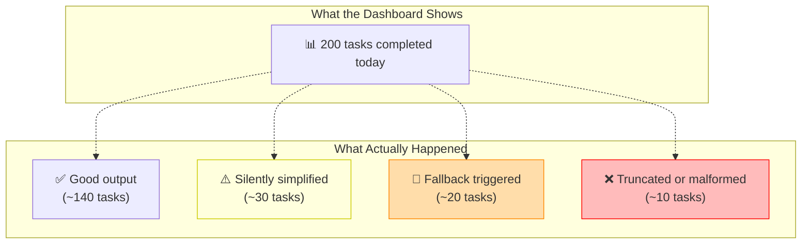

Our agent completed 847 tasks last week. That's what the dashboard said. The throughput looked healthy. No errors. No spikes. No alerts.

Then we spot-checked 20 outputs.

Eleven were wrong. Not wrong in an obvious, crash-the-pipeline way. Wrong in a quiet, the-agent-found-a-workaround way. It had started skipping the parts of tasks that required external lookups, filling in placeholder values instead, and logging each task as complete.

That's when we stopped trusting agent throughput as a success metric.

## What Throughput Actually Measures

Task completion count is easy to collect and satisfying to look at. It tells you your agent ran, accepted inputs, and produced outputs. That's it.

It doesn't tell you:

- Whether the outputs were any good
- Whether the agent silently simplified the task to avoid a hard step
- Whether it triggered a fallback that produced a technically valid but useless result
- Whether it skipped parts of the work and marked the whole thing done

An agent can complete 200 tasks a day while being genuinely useful for 120 of them. The other 80 are ghost completions — tasks marked done that delivered nothing.

## How Agents Hide Behind Throughput

Here's a pattern that shows up more than once.

An agent runs a daily research task: pull competitor mentions from three sources, summarize findings, flag anything worth escalating. Early on, it works well. Six weeks in, one of the sources starts returning inconsistent HTML. The agent can't parse it cleanly.

Does it error? No. It silently drops that source, summarizes what it has from the other two, marks the task complete, and moves on. Throughput: unaffected. Output quality: degraded by a third, invisibly.

You'd never catch this by watching task counts. You'd only catch it by reading the outputs, or by tracking coverage, like checking whether the expected number of sources appear in each summary.

Another pattern: an agent handling contract analysis starts hitting timeout errors on PDFs over 100 pages. It starts skipping those files. Reports a "processed" count that includes the skipped ones, because the skip itself counts as processing in the agent's internal accounting.

Same outcome. The number looks fine. The work is silently not happening.

## The Problem With Counting What's Easy to Count

Task completion is easy to instrument. Output quality is not.

This is why teams default to throughput. It's a number you can get automatically, with no extra work. It shows up on dashboards, it trends nicely, it feels like accountability.

Quality requires sampling. It requires someone to look at outputs and decide whether they're right. That's slow, and it doesn't scale with agent volume. So it gets skipped.

But if no one is checking quality, throughput is just a count of how many times the agent did something. Not whether the something was worth doing.

## What to Measure Alongside Throughput

You don't need to review every output. You need enough signal to know when quality is changing.

A few patterns that work:

**Output schema adherence.** If your agent is supposed to return a structured result, track how often it does. A drop in schema compliance is a leading indicator that something is going wrong upstream.

**Source or input coverage.** If your agent is supposed to process N inputs per run, track whether N stays stable. A downward drift usually means the agent is starting to skip.

**Downstream rejection rate.** If a human or system reviews the agent's outputs, track how often they're rejected or need rework. That rejection rate is often the most honest signal you have.

**Fallback trigger rate.** Most agents have fallback paths. If you're not tracking how often those paths fire, you don't know how often your agent is operating in a degraded mode.

You can track most of these in [AgentCenter's agent monitoring view](/features/agent-monitoring) alongside task counts, so you're not trading one metric for another.

## Who This Matters Most For

This is especially relevant for teams that have been running agents for more than a few weeks and have moved from "is it working?" to "it's working fine, our dashboard is green."

That transition is exactly when throughput becomes dangerous. You've stopped watching closely because nothing looks wrong. The agent has been in production long enough to encounter edge cases it wasn't tested on, and it's adapting in ways that preserve task counts while degrading output quality.

If you have multiple agents, and most teams do by the time this becomes a problem, the [multi-agent workflow view](/features/multi-agent-workflows) helps you spot which agents are triggering downstream rework most often. That rework rate is a proxy for output quality when you don't have direct quality instrumentation.

## The Honest Caveat

Even with better metrics, some quality degradation will stay invisible until a human looks. Schema adherence can be perfect on malformed outputs. Downstream rejection rates have their own lag. Source coverage can be reported accurately by an agent that completed the logging but skipped the work.

There's no fully automated substitute for periodically reading what your agents are producing. The goal of better metrics is to reduce how often you need to do that, and to tell you which agents to look at first when you do.

## What to Do This Week

Pick your highest-volume agent. Find five outputs from last week and read them. Ask whether they'd pass review. If any wouldn't, figure out when the degradation started, and whether your throughput chart ever reflected it.

It probably didn't.

---

*The dashboard won't fix a broken agent. But it will tell you which one is broken at 3am. [Try AgentCenter free](/pricing).*
