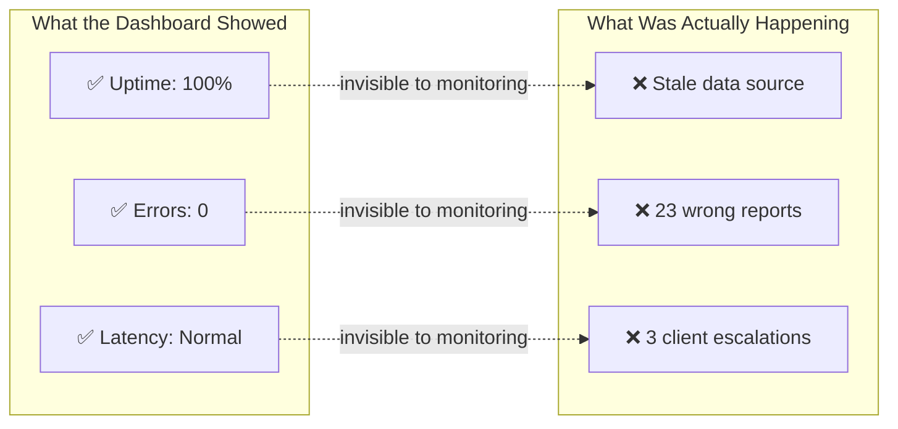

Twelve agents. All green. Last month: 99.4% uptime, 0.4% error rate, average response time under 5 seconds. Your agent monitoring dashboard says the fleet is healthy.

Then your product manager asks why three client-facing summaries from last week read like they were written for the wrong product. Not errors. Not timeouts. Just wrong. Technically complete, structurally valid, and completely useless.

The agents ran. They returned outputs. They hit zero error thresholds. By every metric you were watching, they did their jobs.

They didn't.

## The Gap in Agent Monitoring

Uptime tells you whether an agent ran. It says nothing about whether it ran well.

This is the core blind spot in how most teams monitor production agents. The metrics we inherited from web services — uptime, error rate, latency — were designed to answer one question: is the system responding? For a web server, that's the right question. For an agent producing decisions, reports, or content, it's only half of one.

An agent can have perfect availability and still produce outputs that need hours of rework. It can have a 0% crash rate and a 40% revision rate. Those two numbers are completely unrelated, and most monitoring setups only track one of them.

## What Actually Happened

Here's a failure pattern worth studying. A team was running a content generation agent as part of their client reporting pipeline. The agent pulled structured data from an internal API and generated weekly summaries.

For six weeks, everything looked fine. No errors. Completion rate: 100%. Latency: within SLA.

What nobody noticed: the internal API changed its response format in week two. The agent adapted — it kept producing valid outputs — but it was now reading from a deprecated field that was no longer the source of truth. The summaries looked correct. They weren't.

By week six, 23 reports had gone out with stale data. Three clients escalated. And nothing in the monitoring fired because the agent never failed. It just did the wrong thing, successfully, 23 times.

This isn't a monitoring failure in the traditional sense. It's a measurement problem. The team was measuring the wrong thing entirely.

## Why Uptime Feels Like Enough

Infrastructure engineers have spent decades building intuition around availability as the primary signal of system health. A server that's up and responding is a healthy server. That framing is deep in how we think about operations.

Agents break that model. An agent's health is not just about whether it's running — it's about whether its outputs are useful. Those are different properties, and they can diverge significantly without any alert firing.

A web server returning 200 is doing its job. An agent returning a response has only done part of its job. The rest — producing something accurate, relevant, and actually useful — is invisible to availability metrics.

## What to Measure Instead

You don't need to stop tracking uptime. Availability still matters. But it needs to sit alongside output-level signals.

Teams that catch these problems early are tracking at least three things traditional monitoring doesn't cover:

**Output review rate.** What percentage of agent outputs are reviewed by a human before going downstream? If that number is zero for certain agents, you have unreviewed deliverables flowing into production with no quality gate. [Approval workflows in AgentCenter](/features/task-orchestration) give you a structured place to put human review back into the pipeline without requiring it for every task.

**Revision rate.** When an agent output reaches a human, how often do they change it before it ships? Even rough tracking here — a flag, a rejection count — gives you signal that availability metrics can't. An agent with 99% uptime and 35% revision rate is not a healthy agent.

**Cost per useful output.** [Agent monitoring in AgentCenter](/features/agent-monitoring) shows you what each agent costs per task. The more useful number is cost per *accepted* task — filtered by whether the output was used or revised downstream. An agent that's cheap and consistently wrong is more expensive than it looks.

None of these are hard to add. They mostly require a review step somewhere in the workflow. But most teams skip them because infrastructure metrics are fast to set up, and output-quality tracking requires a review process you haven't designed yet.

## Who Gets Burned Most

Two situations create the most exposure here.

The first is agents producing long-horizon outputs — reports, summaries, documents, code diffs — where a mistake doesn't surface until a human reads it carefully. These outputs can sit in pipelines for days before anyone notices they're wrong.

The second is teams that moved fast on agent adoption. When you're wiring up agents quickly, monitoring follows the path of least resistance: you instrument the infrastructure layer because that's the easy part, and you defer output tracking because it requires a review process you haven't designed. Most teams never go back to add it.

The result is a fleet that looks healthy on every dashboard and is quietly shipping unusable work.

## The Honest Caveat

Output-quality tracking isn't easy to get right. Defining "good" for an agent output requires domain judgment that can't always be automated. You'll end up with a mix of human review, structured spot checks, and downstream feedback signals. None of it is as clean as a single uptime number.

But the alternative is worse: running agents in production for months while measuring only whether they ran, not whether they helped.

Uptime is a floor. It tells you your agent didn't crash. It doesn't tell you it did its job.

---

*The dashboard won't fix a broken agent. But it will tell you which one is broken at 3am. [Try AgentCenter free](/pricing).*
