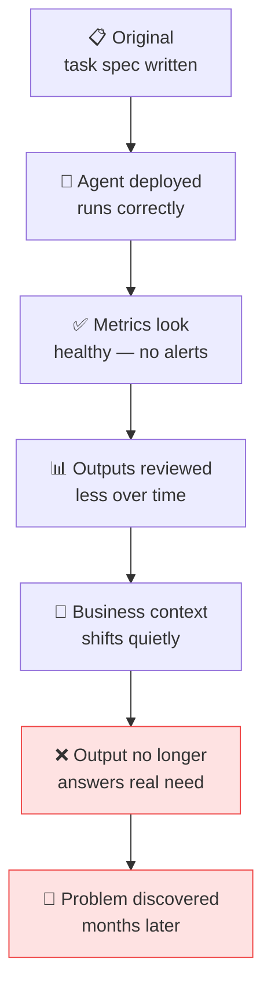

Three months after we had an AI research agent running daily summaries in production, a product manager pulled me aside. "These reports keep passing our review checklist," she said, "but we've stopped reading them." I asked why. She shrugged. "They're always technically correct. But they never answer what we actually needed to know."

The agent was doing exactly what we told it to do. Every task marked complete. Zero errors logged. Success rate: 100%.

Wrong question. Perfect execution.

## The Failure Mode Nobody Monitors For

There are two kinds of agent failure. The first is obvious: the agent crashes, times out, or returns garbage. You notice it. You fix it.

The second is quiet. The agent runs, outputs look clean, and no alert fires. But the output isn't useful. The question you gave the agent is not the question you needed answered.

Teams get good at catching the first type. They set up [agent monitoring](/features/agent-monitoring), track error rates, alert on retries. The second type slips through because every metric looks healthy. Task completion is 100%. Errors are zero. Nothing in your dashboard tells you the work is pointless.

## What This Looks Like in Real Teams

A content team builds a tagging agent. It reads articles and assigns category tags based on keyword matching. Runs every day, tags correctly 98% of the time, zero complaints.

Six months later, the marketing team says the tags are useless for their campaigns. Keyword matching is not how they segment content. The agent answered "which keywords appear in this article" correctly every single time. The question they needed answered was "how would a reader describe this article's purpose."

Same failure pattern shows up everywhere:

- A support agent classifies tickets by product area. Works well. But the ops team needed grouping by urgency and root cause, not product line.
- A pricing agent returns the lowest listed competitor price. Technically accurate. But procurement needed the *available* lowest price, which required a different source entirely.
- A document summarizer produces clean 3-paragraph summaries. Reviewers wanted key decisions and open questions, not a condensed version of what was already written.

Precise execution. Imprecise specification.

## Why the Drift Happens

Task specifications get written once and run for a long time.

When you first deploy an agent, you think carefully about what it should do. You test it, refine the prompt, confirm it works. Then it goes live, you move on to the next agent, and the specification sits unchanged.

But the context around that agent keeps shifting. The business question it was built to answer evolves. The people using the outputs change. Edge cases from month one become the majority of cases by month six.

Meanwhile, the agent keeps answering the original question. Correctly.

There is no alert for this. Your [agent dashboard](/features/agent-dashboard) shows a healthy agent. The failure is upstream of the agent entirely, and it compounds slowly.

## The Habit That Catches This Early

Teams that avoid this problem do one thing differently: they review agent outputs qualitatively, not just quantitatively.

Not "did the agent complete the task" but "is the output actually being used the way we intended."

Three practices that work:

**Attach an owner to each agent's outputs, not just its operation.** Someone should ask once a month whether these outputs still answer the right question. That's not a technical review. It's a business alignment check. It takes 20 minutes and prevents months of wasted compute.

**Watch output consumption, not just output production.** If an agent generates 30 reports per week and your team opens 4 of them, that's a signal. It won't show up in any monitoring alert, but it's a real failure mode you can catch if someone is paying attention.

**Revisit specifications when context changes.** New team member? New product direction? Changed process? Go back to the agents feeding those workflows and ask whether the task definitions still match what's actually needed. The spec you wrote in month one may not survive month six.

## Who Hits This Hardest

Teams that scaled quickly from 2 agents to 12 run into this the most. When you have 2 agents, you stay close to the outputs because they're novel. When you have 12, you trust the ones that aren't throwing errors.

The agents that have been running the longest and most quietly are the ones most likely to be answering stale questions. They've had the most time to drift, and nobody is looking at them closely anymore.

There's also an organizational gap: the engineers who built the agent infrastructure often aren't consuming the outputs. The analysts and ops leads consuming the outputs don't have access to change the task spec. The feedback loop is broken by default, and you have to build it deliberately.

## The Honest Caveat

A management platform like [AgentCenter](/features) helps you catch many agent problems early: failed tasks, cost spikes, blocked runs, unreviewed deliverables. It won't automatically detect whether you asked the right question in the first place.

That requires someone paying attention to whether outputs are actually useful. No tool replaces that conversation. But you can get closer: surface outputs to more people, make it easy to leave feedback on deliverables, and build a review habit before the cost of being wrong has been running for three months.

The agent isn't broken. The specification might be.

---

*The dashboard won't fix a broken agent. But it will tell you which one is broken at 3am. [Try AgentCenter free](/pricing).*
