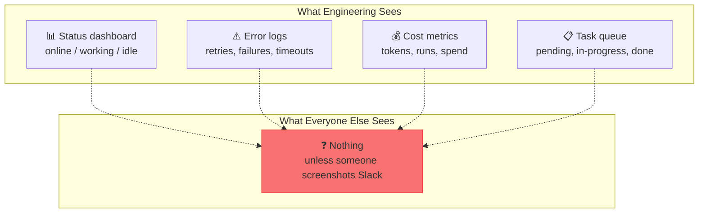

We had eight agents running. Engineering had a dashboard with live status, error counts, token costs, and a task queue. On any given morning, someone from the team would check it, see everything green, and move on.

Then our operations lead asked a simple question: "What did the agents actually produce last week?"

Nobody had an answer they could share in under five minutes. Everything was in Slack. Some of it was in a Notion doc that hadn't been updated in three weeks. The actual outputs? Scattered across task comments, buried in the dashboard UI that only two people knew how to read.

This is an agent visibility problem. And it's different from a monitoring problem.

## Monitoring Is for Engineers. Visibility Is for Everyone.

Your monitoring setup tells you whether agents are running, how often they fail, and what they cost. That's real and useful. But it tells you almost nothing about what agents *did*, what the outputs looked like, or whether the work was any good.

The people who need that second kind of information are rarely the ones watching the engineering dashboard. Product managers need to know what research an agent produced before they can act on it. Operations leads need to understand what an automation actually changed. Executives need to know what the $800/month in LLM spend is buying.

When that information isn't somewhere accessible, two things happen.

First, people start asking engineers for status updates. A five-minute Slack question once a day is more disruptive than it looks, especially when the answer is always "let me check the dashboard."

Second, and worse: people start working around the agents. They add manual checks "just to be sure." They verify outputs before acting on them. Not because the agents are failing — because nobody outside engineering can tell whether they are or not.

## Three Places This Gets Expensive

**Status updates become informal.** When there's no shared place to check what agents did, the default channel is Slack or email. Context lives in DMs, gets duplicated across threads, and disappears after a few weeks. When someone joins six months later, none of that history is findable.

**Trust defaults to "I'll verify manually."** If a product manager can't see an agent's output history, they're not going to rely on that output for a decision. They'll check it themselves. Every time. That's not a bad process — it's a rational response to a visibility gap. The verification isn't wrong. It's just unnecessary overhead once visibility exists.

**Cost questions become impossible to answer.** "What are we getting for $1,200 in agent spend this month?" is a fair question from any non-technical lead. If the honest answer is "you'd have to look at 40 task threads in the engineering dashboard," that's a problem. Agent costs that can't be explained to the people who approve them eventually get cut — sometimes before anything is actually wrong.

## What You Actually Need

The engineering dashboard you're running is probably fine. The gap isn't better monitoring. It's a structured way to surface what agents produced to the people who need to see it.

A few things that move the needle:

**Deliverable review workflows.** Instead of agent outputs landing in a task comment or a Slack thread, route them through a review step. This gives non-engineers a single place to see what was produced, approve or flag it, and leave comments. [AgentCenter's deliverable review](/features/agent-monitoring) works this way: a task doesn't close until its output has been reviewed, and that review is visible to anyone with access to the board — not just the engineer who set up the agent.

**A shared task board people can actually read.** A [kanban view of agent tasks](/features/task-orchestration) that non-engineers can parse isn't just useful for coordination. It gives your whole team a baseline: agents are running, tasks are moving, things are getting done. That baseline alone reduces the "what's actually happening?" questions significantly.

**A weekly summary per agent.** This doesn't have to be elaborate. What it ran, how many tasks completed, anything flagged. Five minutes to produce, answers 80% of the status questions that would otherwise land in someone's inbox.

## Who This Hits Hardest

This is most common in teams of 4-12 people where engineering built the agent setup and everyone else is consuming the outputs. The engineers know exactly what's happening. The non-engineers have a vague sense that "the agents are running" but no window into what they're producing.

Solo founders who own the whole system don't hit this problem. Large orgs with dedicated AI ops teams usually have some version of reporting built in. The dangerous middle is the small cross-functional team where agents power decisions that affect people who never see the dashboard.

If a team member who relies on agent output can't answer "what did the agent do yesterday?" without going to an engineer — that's the tell.

## The Honest Caveat

More visibility doesn't fix bad agents. If an agent is producing low-quality output and you build a clear window into that output, you'll see the quality problem faster. That's actually good. But be ready for it. Sometimes the reason agents are invisible is because nobody wants to look closely.

The goal isn't visibility theater. It's making sure the people who rely on agent work can actually see what they're relying on — and that the agents doing useful work get credit for it instead of staying invisible until something goes wrong.

---

*The dashboard won't fix a broken agent. But it will tell you which one is broken at 3am. [Try AgentCenter free](/pricing).*
