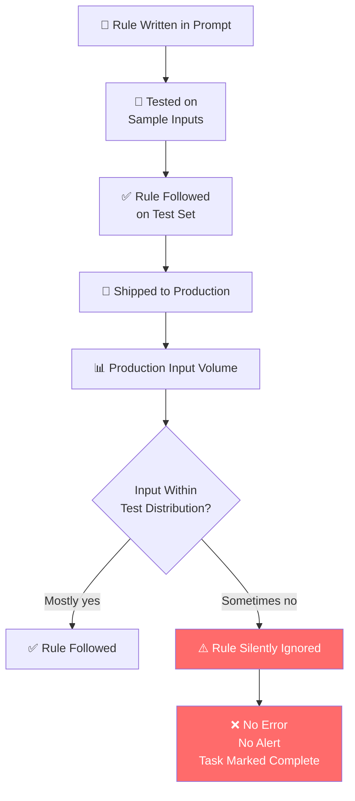

You spent two days writing the prompt. You tested it against 40 sample inputs. Everything looked right. You shipped it.

Six weeks later, someone on the legal team flags three outputs. The agent was supposed to add a disclaimer to every summary it generated. It had been skipping it — not every time, but often enough to matter, and never on any of the inputs you tested.

The agent ran clean the whole time. No errors. Good throughput. Every task marked complete.

## The Gap Between "Tested" and "Follows the Rules"

Most teams think about instruction following as a binary: the agent either gets it or it doesn't. You test it, it works, you ship it. What you're measuring is whether the agent follows the rules on your specific test set. That's not the same thing as following them in production.

LLMs don't follow rules. They predict likely outputs given inputs. Your instructions shift those predictions in the right direction — but how far they shift depends on the instruction, the input, the context length, and how that specific combination interacts with the model's training.

An agent that follows a rule on 97% of inputs will silently violate it on the other 3%. In production, that's not a rounding error. If your agent processes 500 tasks a day, that's 15 violations daily — none of them flagged, none of them visible unless someone is actively looking.

## The Three Failure Patterns

There are a few patterns that show up consistently across teams running agents in production.

**Context crowding.** When an agent receives a long, complex input, short instructions near the top of the prompt get progressively less weight relative to the input. An agent that reliably follows "output JSON only" on 200-word inputs will start returning prose when the input hits 3,000 tokens. The rule didn't disappear — it got buried.

**Implicit override.** Some inputs look like instructions. If your agent is a summarizer and the input is "Tell me everything you know about X in plain English," the agent may start generating instead of summarizing. The user's phrasing resembles a directive, and the model responds to it.

**Distribution drift.** Your agent was tested on a specific range of inputs. When production inputs fall outside that range — shorter inputs, unusual formatting, different languages — it falls back to more general behavior. The specific constraints you added get dropped silently.

## What You Can Do About It

**Test the constraints directly, not just the output.** For each rule in your prompt, write at least 5 adversarial inputs designed to trigger the violation. If the rule is "never mention competitor names," test with inputs where competitors are directly relevant. If the rule is "always return JSON," test with ambiguous inputs that read like prose requests. You're not testing whether the agent is smart — you're stress-testing the specific constraint.

**Separate instruction testing from functional testing.** Most teams test both at once: does the agent do the job? But "does the job" and "follows the rules" are different questions. Build a test layer that checks constraints independently, even on outputs that look correct at a glance.

**Monitor for violations in production, not just errors.** If your agent is supposed to do X, build a check for "did it do X." This can be a regex for required fields, a secondary LLM call that evaluates rule adherence, or a structured output schema that forces compliance. The [AgentCenter monitoring dashboard](/features/agent-monitoring) lets you flag outputs that match — or fail to match — patterns you define. You can surface violations without reviewing every output manually.

**Treat long-context inputs as a separate risk tier.** If your test inputs averaged 300 words and your production inputs regularly hit 2,000 or more, re-test at production length specifically. Rules that hold at short context lengths often break at longer ones. This isn't something to work around — it's a real constraint to design for.

**Keep instructions short and specific.** Every word in a prompt competes with every other word for the model's attention. A 200-word instruction block competes directly with a 2,000-word input. Specific, short rules get followed more consistently than long explanations of why the agent should do something. If you've written three paragraphs of rationale, replace it with one sentence of what to do.

## Who This Bites Hardest

If your agent's outputs go directly to customers, clients, or any compliance review without a human checkpoint, instruction following is not an optional quality check. It's a production risk.

This hits hardest in a few specific cases: content agents with brand or legal constraints, support agents where specific language matters, document review agents with required output formats, and any agent where a "looks fine at a glance" output could be subtly wrong downstream.

The [AgentCenter deliverable review workflow](/features/agent-monitoring) is built for this. You can require approval for specific output types, route flagged outputs to a review queue, and track approval rates per agent over time. It doesn't make your agents more obedient. It makes their disobedience visible — which is the first step to managing it.

## The Honest Part

There's no way to fully solve this. LLMs aren't rule engines. Instruction following will never be deterministic, and that's a property of the underlying system — not a bug you can patch with a better prompt.

What you can do is know where your rules break and at what rate. That means testing constraints deliberately, monitoring for violations in production, and deciding which rules matter enough to put a human reviewer in the loop. Most teams don't get there until after the first real failure. The teams who set this up before shipping have a different relationship with their agents — they know what the agents are doing, not just what they were built to do.

---

*The dashboard won't fix a broken agent. But it will tell you which one is broken at 3am. [Try AgentCenter free](/pricing).*
