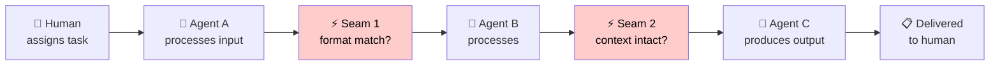

We had eight agents and they all worked.

That was the problem.

Each one had been tested individually. Outputs looked correct. Evals passed. We had agent-level logs, error counts, latency metrics. By every measure we tracked, everything was fine.

But our multi-agent pipeline kept producing wrong results. Not always. Not dramatically. Just off — summaries that missed key points, reports that skipped sections, analysis that referenced data we couldn't find in the source.

It took three weeks to find the problem. It wasn't in any agent. It was between them.

## The blind spot in most multi-agent setups

When you build a multi-agent pipeline, you naturally focus on the agents. You tune prompts, test outputs, monitor error rates. What you don't build monitoring for — at least not at first — is the spaces between them.

Those spaces are where most of the actual failures live.

In our case, Agent A generated a structured JSON object as output. Agent B consumed it. The issue: Agent A used inconsistent key names depending on which code path ran first — `source_url` in some cases, `sourceUrl` in others. Agent B looked for `source_url`. When it got `sourceUrl`, it found nothing. It moved on without logging anything. It didn't fail. It just had empty data to work with.

Downstream, Agent C summarized that empty data. Agent D produced a report from Agent C's output. Everyone signaled success. The final result was garbage.

## The four ways seams fail

After debugging a few pipeline failures, the failure modes start to look familiar:

**Schema drift.** Agent A produces output that's valid JSON but uses different field names, nesting, or types than what Agent B expects. This often happens after a prompt change, a model upgrade, or natural variation in model output. Agent B doesn't crash. It silently uses the wrong value, or no value at all.

**Context that doesn't travel.** A human assigns a task to an agent with partial context, assuming the agent knows something it doesn't. Or Agent A completes a step and marks itself done without passing along the file path, session ID, or reference number that Agent B needs to continue. The next agent starts from incomplete information.

**Timing gaps.** Agent A marks a task complete before its output artifact is fully written. Agent B starts reading immediately. This one is rare, but when it hits, Agent B processes an empty or partial file and produces nonsense. No error is raised anywhere.

**Silent drops.** The most dangerous variant. A handoff fails — a file write errors out, a network call drops — and no one notices because each agent only reports on its own scope. The pipeline continues, the failure propagates forward, and per-agent monitoring never flags it.

The highlighted nodes are where most pipelines have no monitoring.

## What this looks like at scale

We ran 240 tasks through a five-agent pipeline over two weeks. Tasks completed. Deliverables were delivered. No errors logged anywhere.

When we dug into a random sample of outputs, about 12% had something wrong — not always obvious, but wrong enough to matter. When we traced those tasks back through the pipeline, nearly all of them had a seam failure somewhere in the chain.

The agents were all green. The pipeline was producing bad results.

Adding validation at each handoff point found those failures before they reached users. The fix was not complicated: check that the expected fields exist and are non-null before passing work to the next agent. If they're not, raise an alert instead of continuing silently.

The second change was logging inputs, not just outputs. We had always logged what each agent produced. We started also logging what each agent received. When a task came out wrong, we could compare what Agent A produced to what Agent B actually received. Sometimes they were different.

## The frame to carry forward

Stop thinking of your pipeline as a series of agents. Think of it as a series of handoffs, with agents handling the work in between.

For each handoff, ask:

- What does the receiving agent need?
- Does the sending agent guarantee that format?
- What happens if the handoff arrives empty, malformed, or late?
- Is the handoff itself logged anywhere?

[AgentCenter's agent monitoring](/features/agent-monitoring) tracks task state across pipeline stages, not just per-agent status. That makes seam failures visible — you can see what a task looked like at each transition point, not just whether the agents on either side reported success. For teams running [multi-agent workflows](/features/multi-agent-workflows), cross-agent visibility is where debugging actually happens.

## Who this affects most

Teams going from one or two agents to four or more, fast. The jump from a single agent to a pipeline feels small — you're just connecting things. But the failure surface multiplies. Each new seam is a place where something can go wrong without raising a visible error.

ML engineers building orchestration workflows hit this pattern constantly. DevOps teams instrumenting pipelines hit it when per-agent metrics look clean but end-to-end results don't match what users see.

The monitoring approach that works for one agent does not scale to five. The seams are where you find that out.

## The honest part

Adding seam validation adds things to build and maintain. For a two-agent setup running light tasks, it might be overkill. For four or more agents handling real business output, it probably isn't — and you will likely discover that the same way we did, by debugging something that should not have been wrong.

Per-agent logs and per-agent health checks don't tell you what happens between agents. Pipeline-level visibility does.

---

*The dashboard won't fix a broken agent. But it will tell you which one is broken at 3am. [Try AgentCenter free](/pricing).*
