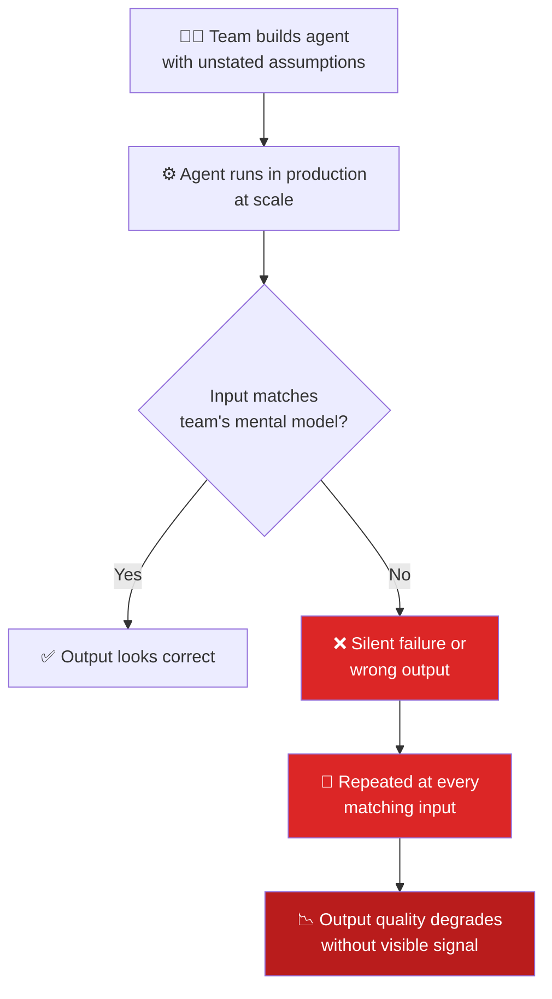

The first time one of our agents missed an edge case, we fixed the prompt. The second time, we added a rule. By the fifth time, we realized it was always the same *kind* of thing it kept missing — not the same exact case, but the same category.

Every miss was in territory our team had never thought to specify. We'd never thought to specify it because it was invisible to us. We all shared the same blind spot — and we'd built it into the agent without realizing it.

This is the part nobody warns you about when you start running agents in production. Agents don't just follow your instructions. They follow your assumptions. The unstated ones. The ones so obvious to your team that you never bothered to write them down.

## Agents Are Shaped by Who Builds Them

When you write a prompt, you make dozens of implicit decisions. You assume inputs will be structured a certain way. You assume certain terminology means what it means in your context. You assume the output matters to the people you think it does.

Those assumptions are invisible to you because they're obvious. And they're obvious because you and your team share them.

An agent built by backend engineers will handle API-shaped, structured inputs better than messy free-form text. An agent built by your customer support team will prioritize tone over technical precision. Neither group realizes they're encoding a preference. They're just writing what makes sense to them.

This works fine for a while. Agents perform well inside the boundaries of what your team imagined. But production is full of inputs your team never imagined.

## How Blind Spots Compound

A human with a blind spot makes a mistake occasionally. An agent with the same blind spot makes it every time, consistently, at whatever throughput you're running.

The real problem is that these failures tend to be quiet. The agent doesn't crash. It produces output that *looks* mostly right. And because your team reviews it — the same people who built it, with the same assumptions — they're likely to read past the gaps just like they wrote past them.

We had an agent summarizing customer feedback tickets. For months, it handled short, structured reports well. Nobody noticed it was consistently misclassifying multi-part complaints that opened with a compliment — because none of us had thought to test for that pattern, and the reviewers never filtered for it either.

The agent wasn't broken. It was running exactly the logic we'd given it. We just never thought about that category of input.

## Three Ways Blind Spots Get Baked In

**Task definitions written by the person who owns the task.** When one engineer writes all the agent task specs for their area, those specs reflect their mental model. Other valid interpretations don't make it in. Rotating task authors — having someone outside the area write a spec from scratch and compare — reveals the gaps fast.

**Review done by the same team that built the agent.** If the people reviewing outputs are the same people who defined what good output looks like, they're checking for what they already expect. You need at least one regular reviewer who didn't write the requirements and doesn't share the same context.

**Prompts tuned on the most common cases.** When you iterate on a prompt, you're usually improving it against the inputs you see most often. That's efficient. It also means the prompt gets sharper at the median case and stays unchanged for the edge cases your team never ran into. Those are the cases that bite you later.

## What to Do About It

You're not going to eliminate team blind spots. That's not the goal. The goal is to surface them before they silently scale.

**Cross-team output review.** A few times each quarter, have someone from outside the owning team do a random sample review of agent outputs. Don't tell them what the agent is supposed to produce — just ask what they notice. You can pull output samples from [agent monitoring in AgentCenter](/features/agent-monitoring) without manual digging through logs.

**Edge case catalogs.** Every time an agent fails on something unexpected, record it before you fix the prompt. Three unrelated failures in three months might be the same category. Patterns show up faster when you write them down rather than fix-and-forget.

**Rotated task definitions.** Before you ship a new agent, give someone from a different team only the goal description and ask them to write what the task spec should look like. Compare their version to yours. The differences are worth examining — not because one is right, but because the gaps show assumptions you've both been making from opposite directions.

None of this is slow or expensive. Most teams skip it because the agent is *mostly* working and it doesn't feel urgent. "Mostly working" is exactly where blind spots hide.

## Who This Matters Most For

If you're running 5 agents or fewer, you probably read most of the output yourself. You'll notice patterns eventually.

If you're at 15 or more agents and your team has started trusting outputs without reading them closely — this is where blind spots start costing you real things. Not crashes. Not obvious failures. Just a gradual narrowing of what your agents actually cover, invisible until someone outside the system points it out.

The moment your team stops reading outputs critically is the moment your blind spots start compounding unchecked. That's worth knowing before it's been going on for six months.

## One Honest Caveat

Cross-team review and edge case tracking will catch a lot. They won't catch everything. Some blind spots are organizational — your whole company shares the same assumption — and rotating internal reviewers won't surface those. External feedback, user reports, or outright failures are sometimes the only signal you get.

The goal isn't to eliminate blind spots. It's to know roughly where yours are so you can watch for them intentionally.

That's harder than it sounds, and easier than discovering it through a production failure.

---

*The dashboard won't fix a broken agent. But it will tell you which one is broken at 3am. [Try AgentCenter free](/pricing).*
