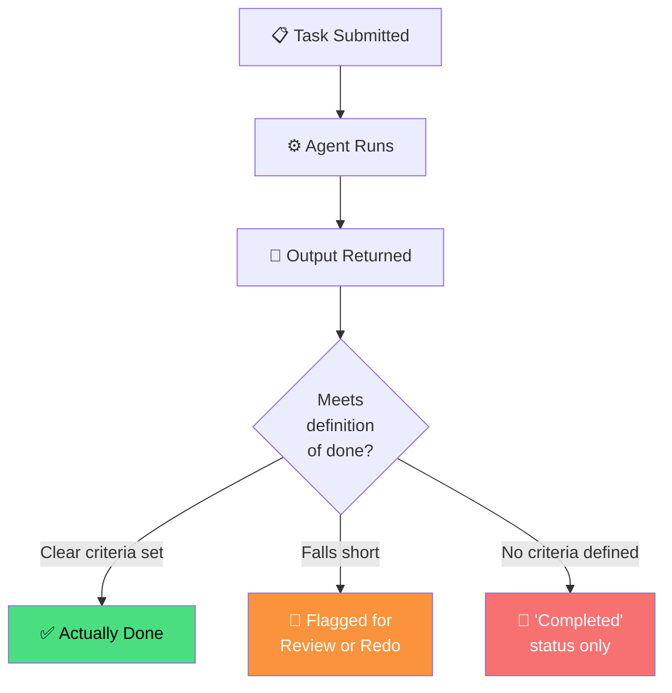

Six weeks in, you notice the pattern. Your research agent has completed 340 tasks. Every one shows "done" in the dashboard. But when you sample the outputs, maybe 30% are genuinely useful. Another 40% are technically correct but miss what you actually needed. The rest are borderline.

You wrote a careful prompt. You tested the agent before shipping it. You forgot to define what "done" meant.

This is one of the most common gaps in production agent deployments, and it's almost never caught before it costs you something.

## The gap between "completed" and "actually finished"

Agents are very good at finishing. They return an output, mark the task complete, and move on. That's what they're built to do.

What they're not good at, without explicit guidance, is knowing when their output meets your actual standard. This isn't a model problem. It's a specification problem. You gave the agent a task. You didn't give it acceptance criteria.

Here are three patterns that come up constantly:

**The summary agent with variable depth.** You ask an agent to summarize a document. Sometimes it returns three sentences. Sometimes three paragraphs. Both are technically "summaries." You never said which one you needed — or which situation called for which.

**The research agent with no minimum.** You ask it to gather competitive intelligence. It returns 2 examples on Tuesday and 31 on Friday, with no explanation for the variance. You never told it how many sources met the bar, or which ones didn't count.

**The enrichment agent that stops too soon.** You ask it to fill in a lead record. It finds a LinkedIn profile, marks the task complete, and moves on. You needed phone number, company size, and recent activity — but it found *something*, so it stopped.

In each case, the agent did exactly what you asked. It just didn't do what you needed.

## What a definition of done actually looks like for agents

In software development, a definition of done is a shared agreement about what "finished" means for a given piece of work. It's not the task description. It's the acceptance criteria.

For agents, a definition of done answers questions like:

- What must the output contain at minimum?
- What makes an output good enough to use vs. good enough to flag for human review?
- What are the failure conditions that should produce a flag instead of a "completed" status?
- What does a partial result look like, and how should it be handled?

This doesn't have to be a formal document. It might be three bullet points at the end of your agent's task template. But without it, "done" means "the agent stopped" — not "the output is ready to use."

## Why most teams skip this step

The common assumption is that a good prompt handles this. Write detailed instructions, give examples, specify the format, and the agent will know what "done" looks like.

Sometimes that works. For straightforward tasks with predictable outputs, a well-written prompt can carry most of the weight.

But in production, tasks vary. Inputs vary. Edge cases keep appearing. And when your prompt doesn't account for a specific situation, the agent makes a judgment call. That call is usually "close enough."

The other reason teams skip this: defining done feels like overhead. You want to ship the agent and see how it performs. You'll iterate based on feedback.

The problem is that without a definition of done, you don't have a baseline to iterate against. You can see that outputs are inconsistent. You can't easily tell why, or when they cross the line from acceptable to not.

## What this costs you in practice

Inconsistent output quality is manageable at 10 tasks per week. It gets expensive at 200.

When "done" means different things at different times:

- Review rates go up. Someone has to check everything, because there's no reliable signal about what needs checking.
- Team trust erodes. People start assuming agent outputs need to be redone, even when they don't.
- Edge cases compound. The agent handles a corner case in a way that kind of works, so it never gets caught and fixed.

AgentCenter's [agent monitoring features](/features/agent-monitoring) show you what your agents are completing — but "completed" is only meaningful if you know what "completed" actually means. Without a definition, you end up reviewing everything or nothing. Neither holds up as the fleet grows.

## The habit worth building before you deploy

Before you ship an agent, write down three things:

1. What does a good output look like? (Include required fields, format, length, or whatever "good" means for this task.)
2. What would make you reject an output and ask for a redo?
3. Under what conditions should the agent flag the task as uncertain instead of marking it done?

You don't need a formal spec. A few lines in the task description is enough. The point is to make the standard explicit before the agent starts running, not after you've reviewed 300 outputs and spotted the pattern.

The [task orchestration features](/features/task-orchestration) in AgentCenter let you build this into task templates — so every agent task starts with a consistent definition of what finished looks like, not just what needs to happen.

## Who this matters most for

This matters most for teams running agents on work with real stakes: content that customers see, data that informs decisions, reports that get presented to leadership. The higher the cost of "almost right," the more important it is to define "actually right" before you start.

If your agents run low-stakes, high-volume tasks where occasional variance is fine, you might get away without a formal definition. But the moment your team starts asking "wait, is this actually done?" — that's the signal.

## An honest caveat

A definition of done won't make your agents perfect. They'll still miss requirements they weren't built to handle. New edge cases will keep appearing.

What it does is give you a reference point. When an output fails, you know exactly where it fell short. When your team reviews outputs, they're checking against a known bar instead of relying on individual judgment call by judgment call. Over time, that reference point becomes the baseline for improving your agents in a consistent direction.

The agents that perform well in year two of production are almost never the ones with the most sophisticated prompts. They're the ones where someone took the time, before shipping, to write down what "done" actually meant.

---

*The dashboard won't fix a broken agent. But it will tell you which one is broken at 3am. [Try AgentCenter free](/pricing).*
