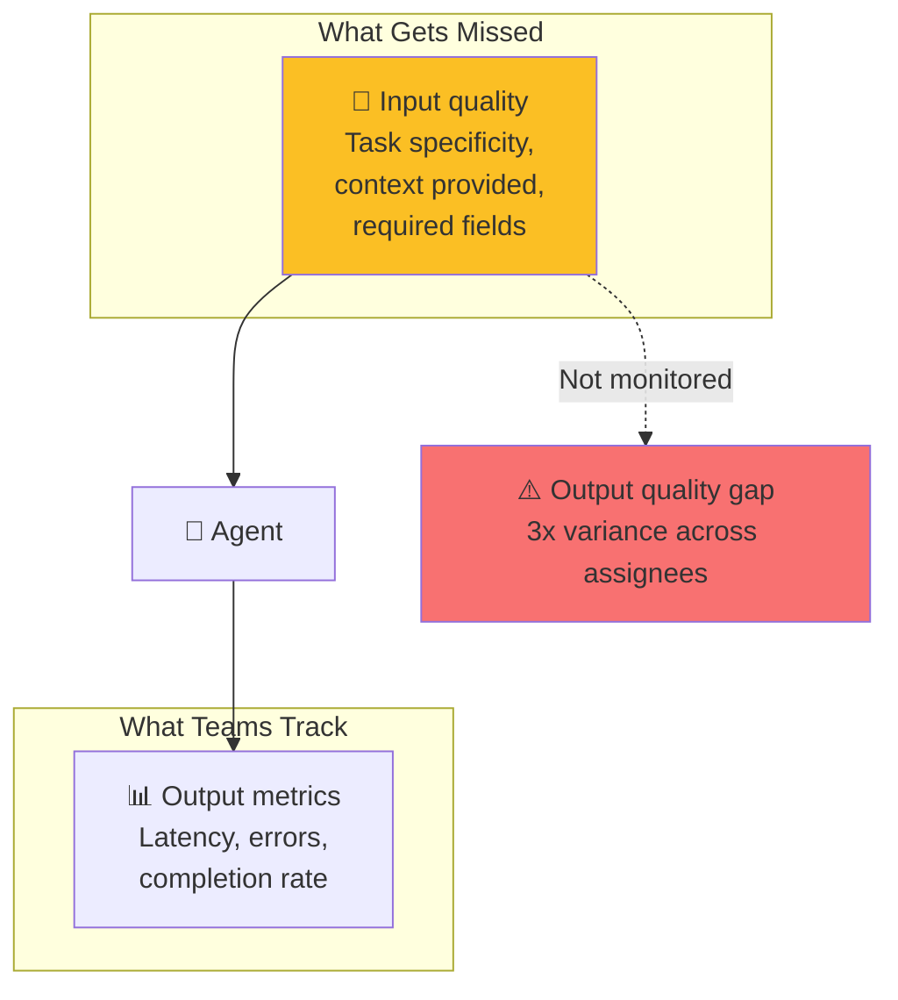

We had 8 agents handling the same task type. "Review customer support tickets and flag priority issues." Four engineers were assigning tasks to these agents throughout the week.

Two months in, we started comparing outputs. Same agents. Same underlying prompt. But the output quality varied enough that we ran the numbers. Tasks assigned by one engineer had a 68% "rated useful" score when reviewed by the team. Tasks assigned by another engineer had 22%.

The difference wasn't the model. The difference was the input.

## The Part Nobody Measures

Most agent monitoring focuses on the output side: did the agent finish? Was the response slow? Did it throw an error?

Very few teams track what goes into the agent. The task descriptions. The context provided. The level of specificity in the request.

But that's where most of the quality variance lives.

Here's what those two engineers' tasks actually looked like:

**Engineer A's task:**
> "Review last week's support tickets and summarize the main themes."

**Engineer B's task:**
> "Review support tickets from July 7 to July 11. Identify the top 3 recurring complaint types. Flag any ticket that mentions billing, login failures, or missing features. List them with ticket ID and a one-sentence description."

The same agent processed both. The difference in output usefulness wasn't subtle. Engineer A got a 6-line paragraph that could have described any product. Engineer B got a structured list of 11 flagged tickets, sorted by category, that the support team could act on that afternoon.

## Why Teams Miss This

When an agent produces bad output, the first instinct is to look at the agent: update the prompt, swap the model, add retry logic.

That's the right instinct maybe 40% of the time. But in our experience, more than half the cases where output quality dropped traced back to the input — how the task was written.

The problem is that task inputs don't generate alerts. Your [agent monitoring dashboard](/features/agent-monitoring) shows you completion rate, latency, and error count. It doesn't tell you "this task description was too vague for the agent to do useful work."

So the feedback loop breaks. An agent produces mediocre output. The person who assigned the task accepts it because it looks complete. Nobody connects the output quality to the input quality.

The result is a slow, invisible degradation. The agent looks fine on every dashboard. The team knows something is off but can't point to the cause.

## What Actually Helps

**Task templates.** This sounds boring. It is boring. It works.

When we built templates for our most common task types — with required fields for date range, output format, and specific flags to look for — the variance collapsed. The gap between our best and worst assigners went from 3x to about 1.4x. Not zero. But manageable and debuggable.

AgentCenter's [task orchestration](/features/task-orchestration) lets you create templates and enforce required fields before a task gets sent to an agent. That single change had more impact on output consistency than any prompt tuning we did in those two months.

**Reviewing inputs, not just outputs.** We started spot-checking task descriptions as part of our weekly review. Not all of them — just a sample from each person who regularly assigns tasks. We found patterns within the first two weeks. One engineer consistently skipped date ranges. Another never specified the expected output format. These were fixable habits, not broken agents.

**Tracking output quality by assignee.** This feels uncomfortable the first time you suggest it. But it's the only way to know whether your input quality problem is systemic or concentrated in a few people who need different guidance. You're not grading people — you're finding a gap in your process.

## Who This Affects Most

If you're a solo developer running your own agents, this probably isn't your biggest problem. You know how to talk to your own agents. The quirks are in your head.

If you're part of a team where more than three people assign tasks to the same agents, this is almost certainly happening to you right now. The output quality variance is there. You're likely blaming the model.

The transition from "one person who knows the agents" to "a team where anyone can assign tasks" is where this pattern emerges. It happens somewhere between 5 and 15 team members. It happens faster in teams that scale quickly and don't build handoff documentation before they need it.

## The Honest Caveat

Fixing input quality doesn't fix a genuinely broken agent. If your prompt is wrong, or your model isn't suited for the task, standardizing inputs will just give you consistently mediocre output instead of randomly mediocre output.

That's still better. Consistent failures are debuggable in ways that random ones aren't.

But the real value of controlling input quality is that it removes one major source of noise. Once inputs are consistent, you can actually see whether the remaining variance comes from the input, the agent logic, or the task definition itself. Those are three different problems. You can't distinguish them until you control for one.

---

*The dashboard won't fix a broken agent. But it will tell you which one is broken at 3am. [Try AgentCenter free](/pricing).*
