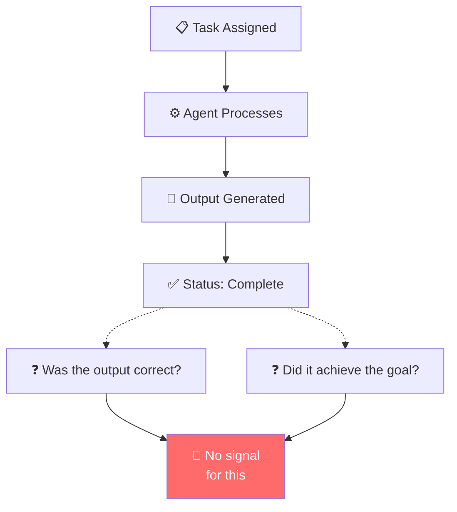

We deployed a research agent to gather competitive intelligence. It ran 40 tasks a week. Completion rate: 98%. The team was pleased.

Three months in, a sales rep mentioned the outputs looked thin. We pulled a week's worth of reports and read through them. The agent was completing every task. But 30% of the outputs were missing key sections, citing sources that had disappeared, or summarizing content that had nothing to do with the competitor in question.

Completion rate: 98%. Usefulness rate: closer to 65%.

That gap was the thing we hadn't instrumented for.

## The difference between agent done and agent correct

An agent marks a task done when it finishes processing. It follows a control flow, not an evaluation of its own output. When it reaches the end of the function, the status flips to complete. Whether the output was useful, accurate, or met the actual goal is a separate question the agent doesn't answer.

This creates a systematic blind spot. Every status light is green. Every task is complete. But the underlying question ("did this actually work?") stays unanswered.

Most agent monitoring setups stop at the "complete" step. The outcome questions go unasked.

## Why this failure mode is so hard to catch

The pattern repeats itself. Teams that hit this wall tend to follow the same timeline:

**Week 1:** Agent runs. Tasks complete. Team is satisfied.

**Month 2:** Someone notices something feels off with the outputs. Hard to articulate. Nothing is obviously broken.

**Month 3:** A specific failure surfaces. The team investigates and finds the problem has been present for weeks. The agent was completing tasks the entire time.

The failure window is almost always longer than people expect. Sometimes months. For a content operations team running 200 tasks a week, a 20% silent failure rate means 40 bad outputs going downstream per week. That's not a monitoring problem. It's an instrumented blind spot.

## Three ways teams accidentally hide this from themselves

**Using task count as the primary metric.** "We processed 840 tasks this month" is an activity metric. It tells you the agent ran. It says nothing about whether the outputs were any good.

**Sampling but not acting.** Some teams manually review 5% of outputs. But without a defined standard for what "good" looks like, reviewers apply inconsistent judgment. The review confirms the agent ran, not that it ran well.

**Trusting downstream systems to surface failures.** If the agent's output feeds another system, teams assume that system will catch bad data. Often it doesn't. Downstream systems accept whatever arrives and process it silently.

## What outcome signals actually look like in production

The monitoring question to ask isn't "did the agent complete the task?" It's "what signal tells me the output was useful?"

For some tasks, the signal exists naturally:
- An email draft agent's output gets a reply rate
- A report agent's output gets opened and acted on
- A data transformation's output gets accepted by the downstream system, or rejected

For others, you have to build it:
- A quality rubric that any reviewer can apply consistently
- A model-based eval that scores output against defined criteria
- A human approval step on high-stakes outputs before they go downstream

AgentCenter's [deliverable review workflows](/features/agent-monitoring) let you set approval gates so outputs wait in a queue for human sign-off before they count as done. You can also use the [agent monitoring dashboard](/features/agent-dashboard) to track completion separately from quality, which is exactly where this distinction starts to matter.

The point isn't to review everything. It's to have a sample-based signal that tells you when quality is drifting before a sales rep or a customer tells you instead.

## Separating process health from outcome health

Teams that get this right split their monitoring into two categories:

**Process health:** Did the agent run as expected? Latency, error rate, retry count, timeout frequency. Most agent setups already track this.

**Outcome health:** Did the agent produce useful output? Quality, accuracy, downstream impact. Most agent setups don't track this at all.

You need both. Process health tells you the engine is running. Outcome health tells you whether the car is actually going somewhere.

Making outcome health explicit is harder than it sounds. "Good" is often implicit knowledge sitting in someone's head. Writing it down, turning it into a rubric or a review checklist, forces a level of clarity that most teams skip when they're moving fast.

## Who this matters most for

This matters most for teams running agents on tasks that produce content or analysis humans consume downstream: research agents, report agents, email draft agents, summarization agents. The failure mode is invisible because humans don't immediately reject bad output. They work around it, or trust it when they shouldn't.

If you're running agents on structured, verifiable tasks like data transformation or API calls, you likely have natural feedback signals already. The risk is lower.

For everything else: assume you don't know how well your agents are performing unless you've measured it explicitly.

## The honest caveat

Outcome measurement adds overhead. Not every team has bandwidth to build a quality rubric and a review process on top of their agent infrastructure. Starting with process metrics is fine. Just don't stop there.

A green completion status is one data point. It's not a guarantee the work was done right.

---

*The dashboard won't fix a broken agent. But it will tell you which one is broken at 3am. [Try AgentCenter free](/pricing).*
