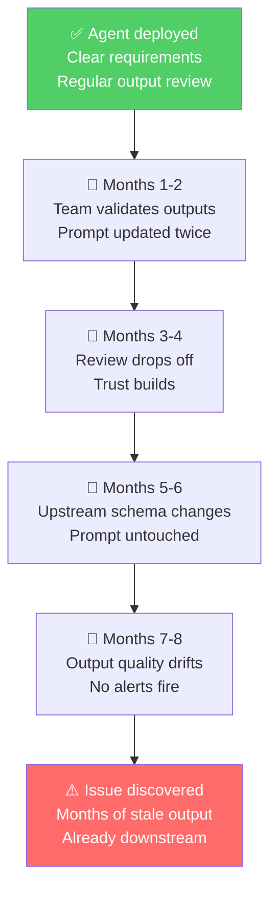

We had a content processing AI agent running in production every weekday without a single alert for eight months. Team loved it. "That one just works," someone said in a planning meeting. Nobody touched it. Nobody reviewed its outputs regularly. It was boring, and boring was good.

Then a new hire joined and spent her first week reading through the agent's output backlog. She came back with a spreadsheet. The first two months of outputs looked great. The last three months were noticeably worse: shorter summaries, missing key fields, categories that didn't match the labels we'd switched to in Q3. The agent was running. The agent was failing. We just weren't looking.

## The Drift That Trust Creates

Here's what I've noticed about production AI agents: they degrade in proportion to how much your team trusts them.

That sounds backwards. Trust should mean things are going well. And they were, at the start. But trust changes behavior. When an agent has a good reputation, the following things happen:

- Review cadence drops. "It's always fine" becomes "I'll skip this week."
- Prompt updates stop. The original author moves on. Nobody else knows what to change.
- New edge cases get absorbed silently. The agent tries to handle them. Sometimes it does. Often it doesn't, but nobody checks.
- Stakeholders stop asking questions, which means they've also stopped reading outputs carefully.

None of this shows up in your monitoring. Task completion rate stays at 97%. Error rate stays near zero. The agent is doing exactly what it was told. It's just that what you told it no longer matches what you need.

## What Hidden Drift Looks Like in Production

Three specific patterns come up repeatedly:

**Schema drift.** The agent was written to extract data from API responses with a specific structure. Six months later, an upstream service changed its response format slightly: a renamed field, a new nesting level. The agent doesn't crash. It just returns empty values for the renamed field. If you're not validating outputs against your current schema, you won't know for weeks.

**Vocabulary drift.** Your product launched in March with five status categories. By August, you had eleven. The agent still classifies everything into the original five. It's technically correct by the original spec. It's also useless for anyone making decisions based on current taxonomy.

**Scope drift.** The original agent was designed for a specific subset of tasks. Over time, teams started routing similar-but-different work through it because "it handles that kind of thing." The agent processes them. Output quality for the original use case stays high; quality for the extended cases is poor. Aggregate metrics look fine because the original tasks still dominate the count.

## Why This Is Different From Code Rot

Code that drifts from its requirements usually breaks visibly. Compilation errors, test failures, type mismatches. You get a signal.

An agent that drifts from its requirements keeps running. It produces output. The output looks plausible. It shows up in your [agent dashboard](/features/agent-dashboard) as completed tasks. Nothing alerts.

That's the core difference. Code fails loudly. Agents fail quietly, and often helpfully — they give you something, just not the right thing. Wrong output is harder to catch than no output, because you have to read it to know it's wrong.

## What to Actually Do About It

The fix is straightforward, but it requires treating agent maintenance as a scheduled activity, not a reactive one.

**Set a review date at deployment.** When you ship an agent, decide when you'll next review its outputs in detail. Not "when something breaks." A specific date. Six weeks. Eight weeks. Whatever fits the task frequency and stakes.

**Track upstream dependencies explicitly.** Every agent depends on something: an API format, a set of categories, a data schema, a vocabulary. When those dependencies change, someone needs to update the agent. This doesn't happen automatically. You need to know what the agent depends on and have a way to flag when those dependencies shift.

**Separate output health from task health.** Your [agent monitoring](/features/agent-monitoring) should track more than completion rate. Track output patterns: field fill rates, category distributions, output length over time. When those shift without a deliberate change, you have a signal that something has drifted, even if no error fired.

**Give it to one person, not a team.** Every agent that matters should have a named owner. Not a team. A person. Someone who will notice if the outputs stop being useful and has the context to fix it.

## Who This Is For

If your agents have been running without complaints for more than three months, read this again. Not because something is definitely wrong. Because "no complaints" usually means "nobody's looking closely."

The teams most at risk are the ones who shipped agents successfully early. Success builds confidence. Confidence reduces scrutiny. Reduced scrutiny is where the problems accumulate.

Solo developers are actually better at this than teams. When you're the only one watching, you tend to notice. It's when responsibility spreads across five people that nobody actually owns the review.

## The Honest Caveat

This isn't a knock on AI agents specifically. Any automated system drifts without maintenance. The difference is the failure mode.

A scheduled job that breaks tells you it broke. An agent that drifts tells you everything is fine right up until someone digs in. That gap between quiet failure and discovered failure is where the most damage happens, because every day of undetected drift means more downstream decisions made on bad data.

AgentCenter gives you task completion visibility, real-time status, and cost tracking per agent. But output quality review still requires human judgment on a schedule. The dashboard tells you the agent ran. Only you can tell whether what it produced is still useful.

---

*The dashboard won't fix a broken agent. But it will tell you which one is broken at 3am. [Try AgentCenter free](/pricing).*
