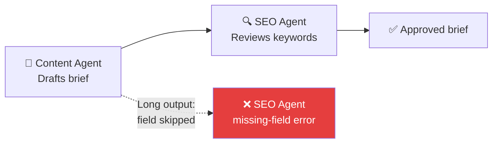

We had two agents running cleanly in isolation for six weeks. One drafted weekly content briefs. One reviewed them for keyword gaps. Both tested well. Both had green status every morning.

Then we wired them together into a pipeline.

The SEO review agent started failing. Not every run — maybe 1 in 20. The error pointed to a missing field. Which made no sense, because running the content agent manually always produced that field. It took two weeks of inconsistent output and a lot of confused people to figure it out: the content agent occasionally omitted one JSON key when its output ran long. The SEO agent assumed that key would always exist.

Neither agent was broken. The handoff between them was.

## Individual Testing Proves Nothing About Combinations

When you test an agent in isolation, you're answering one question: does this agent do its job? Does it process input correctly and produce reasonable output?

That's a good question. It's just not the question that matters when you connect two agents together.

Integration is where assumptions live. Agent A assumes something about what it receives. Agent B assumes something about what A sends it. Neither assumption is written down. Both work fine in testing because the test inputs are clean, controlled, and predictable.

Production inputs are not.

The pipeline above looked fine for most runs. When Agent A's output ran long, one field dropped. Agent B failed silently. Both agents reported healthy status. The only signal was inconsistent pipeline output — which nobody checked daily because the pipeline "worked."

## Three Ways the Combination Breaks

**Format assumptions.** Agent A produces JSON. Agent B reads specific keys. Agent A's output schema is right 95% of the time — but under certain conditions (long inputs, high model temperature, edge cases), it skips an optional key that Agent B treats as required. This doesn't show up in unit testing because the tests don't cover that edge case. It shows up in production after weeks of intermittent failures.

**Timing assumptions.** Two agents are supposed to run sequentially — A completes, then B starts on A's output. Nobody enforced that order explicitly. Under load, B occasionally reads the previous run's output. B completes. The output is for the wrong content. Both agents report success.

**Output drift after model updates.** Agent A's output format shifts slightly after an LLM provider update. Field ordering changes. A value that was quoted is now unquoted. Agent B's prompt was written against the old format. Agent B starts producing wrong results. Nobody connects the behavior change to the model update because both agents still show 200 status.

All three failure modes are invisible in isolation testing. All three appear in production within weeks.

## Agent Output Is an Implicit API Contract

Here's the mental model shift that helps: the output of Agent A is an implicit API contract with Agent B. When you change Agent A — even slightly — you may break Agent B.

Software teams learned this the hard way with microservices. You don't change a service's response schema without versioning. You don't assume downstream consumers will handle undocumented edge cases. You write contract tests.

Agent pipelines need the same discipline, but almost nobody applies it because the agents don't feel like API endpoints. They feel like tools.

They are API endpoints. Every time Agent A produces output that Agent B consumes, there's a contract. Make it explicit:

- Document exactly what Agent A must always output — not what it usually outputs
- Validate that schema before passing it to Agent B
- Write a contract test: 50 varied inputs to Agent A, check that the output schema is consistent across all of them
- Treat any change to Agent A's output format as a breaking change requiring Agent B to be updated

[Task orchestration](/features/task-orchestration) in AgentCenter lets you see exactly where in a multi-agent pipeline a task is stuck or failing. That visibility helps you catch pipeline failures fast. But the interface definition has to exist somewhere before you can catch violations of it.

## Before You Wire Two Agents Together

The conversation that almost never happens before connecting two agents:

1. What does Agent A actually output across a wide range of inputs?
2. What does Agent B actually require as input?
3. Where do those two things not match?
4. Who owns fixing that gap?

The last question is the one that matters most in teams. When Agent A belongs to one engineer and Agent B belongs to another, the interface between them belongs to nobody. Both engineers are responsible for their agent. The handoff is a shared problem that often doesn't get addressed until it breaks.

Before wiring agents together, pick someone to own the interface spec. Have them run 50 representative inputs through Agent A and document what the output actually looks like. Then have them check Agent B's prompt for what it assumes. Close the gaps before they go to production.

## Who Gets Surprised by This

Teams moving from one or two standalone agents to a pipeline. The jump from "each agent works" to "the pipeline works" is not automatic.

If your agents are completely independent — each one takes its own input, produces its own output, touches separate systems — this isn't your problem.

If any agent's output becomes another agent's input, you have an implicit contract. Right now it's probably working because you're in the early stages and the inputs are predictable. Six weeks from now, when input volume increases and edge cases appear, the pipeline will start misfiring. And because both agents show green status, you'll spend a week looking in the wrong place.

## The Honest Part

[Agent monitoring](/features/agent-monitoring) will tell you that something in the pipeline failed. You'll know within minutes that Agent B stopped progressing. That's real value — catching failures fast instead of reviewing output three days later.

What monitoring won't tell you is that the failure happened because Agent A dropped a field under load. That's diagnosis, and it still requires someone who understands the interface between the two agents.

The teams that handle this best treat their multi-agent pipelines the way platform teams treat internal services: typed interfaces, contract tests, and version discipline. Not because they're careful by nature. Because they shipped a broken pipeline once and spent two weeks finding the seam.

---

*The dashboard won't fix a broken agent. But it will tell you which one is broken at 3am. [Try AgentCenter free](/pricing).*
