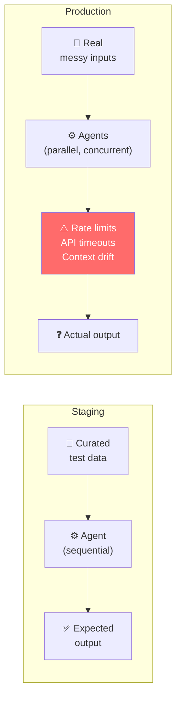

We ran our document processing agent in staging for two weeks before pushing to production. A hundred test documents. All passed. The outputs looked clean. We were confident.

In the first 48 hours of production, it failed on 23% of real documents. Not hard failures — it returned outputs, just wrong ones. The agent was "working" by every metric our staging tests measured. The actual results were garbage.

That's when we stopped treating green staging tests as a proxy for production-readiness.

## Staging Lies, But Not on Purpose

Staging doesn't lie because it's broken. It lies because it's controlled.

You build your test suite from examples you know about. You write inputs that exercise the paths you thought to test. You don't write tests for the inputs you haven't seen yet.

Production is everything else.

Real users send documents with unexpected formatting. Real APIs return slightly different schemas than the documentation promised. Real load means multiple agents running at the same time, competing for rate limits, hitting timeouts that never triggered in your careful sequential test runs.

Staging is a controlled world. Production is the actual one.

## Five Things That Break in Production That Staging Won't Catch

Here's what we've seen fail repeatedly, and what's usually behind each one.

### 1. Input data is messier than your test set

Staging test data is curated. Someone on your team wrote it, or pulled a clean sample from a database. It doesn't include the edge cases real users actually send.

We had an agent that extracted structured data from contracts. Staging tests used well-formatted PDFs. Production included scanned documents, contracts in foreign languages, images mistakenly uploaded as PDFs, and three-page documents where someone had copy-pasted the text five times. None of those showed up in staging. All of them caused the agent to produce bad output.

### 2. Rate limits appear at production scale

Ten staging test runs won't trigger rate limits. When 200 agents run concurrently in production, every API limit you didn't account for becomes a live failure.

This is especially bad because the failure mode is often silent. The agent hits a rate limit, retries in 60 seconds, succeeds, and logs a success. The task took 90 seconds instead of 3 seconds. If nobody is watching latency, nobody notices.

### 3. Parallel execution creates race conditions

In staging, agents usually run one at a time or in small batches. In production, they run in parallel.

Two agents that both write to the same shared resource, read from the same cache layer, or call the same downstream API in tight succession can step on each other. Staging never surfaces this because the load isn't there.

### 4. Multi-step agents accumulate context drift

A multi-step agent that works fine in isolation can fail when an earlier step returns data that's slightly different from the test case you built around.

If step one extracts a field and step two depends on that field being in a specific format, any variation in step one's output breaks step two. In staging, step one always returned the format you expected. In production, it returned something subtly different 8% of the time, and step two didn't handle it.

### 5. Third-party APIs behave differently under load

APIs that respond in 200ms in staging might consistently return in 2,000ms in production because you're calling them at peak hours. Timeouts that never triggered in staging become routine production failures.

Here's what the gap between the two environments actually looks like:

## The First 48 Hours in Production Are a Rollout, Not a Launch

The shift we made was treating the first days in production as a monitored observation period, not a done-and-deployed handoff.

We started watching four things we had never tracked in staging:

- **Input variety**: what are real inputs actually looking like? How far do they deviate from test data?
- **Output correctness spot-checks**: are outputs actually right, not just structurally valid?
- **Latency percentiles**: p50 and p99, not just average runtime
- **Error class distribution**: what kinds of errors are appearing, not just how many

This isn't about running more tests before pushing. It's about treating production as a learning environment for the first week, not a trust-and-forget one.

AgentCenter's [agent monitoring](/features/agent-monitoring) makes this easier — you get real-time status, error rates, and output history per agent without wiring up a custom logging pipeline. But the instrumentation alone doesn't catch bad outputs. That still requires someone reviewing a sample of what the agent actually produced.

## Who Gets Burned by This the Most

Solo developers and small teams deploying their first production agents. They've spent weeks building and testing in a controlled environment. The agent works. They push it. They move on.

Three days later, a user reports bad outputs. Nobody was watching.

The pattern isn't unique to AI agents. Any system that processes real-world input will hit edge cases staging doesn't cover. What's different with agents is that bad outputs often don't cause hard errors. The agent finishes, returns a result, and logs a success. The failure is invisible unless you're sampling outputs.

## The Honest Caveat

No tool prevents staging-to-production failures completely. You're always going to encounter inputs in production that your tests didn't anticipate.

What you can control is how fast you find them. Teams that catch production failures quickly are watching the right signals from the moment they go live — not just error counts, but output quality, input distribution, and latency percentiles. Watching your [agent dashboard](/features/agent-dashboard) in the first 48 hours isn't paranoia. It's the job.

---

*The dashboard won't fix a broken agent. But it will tell you which one is broken at 3am. [Try AgentCenter free](/pricing).*
