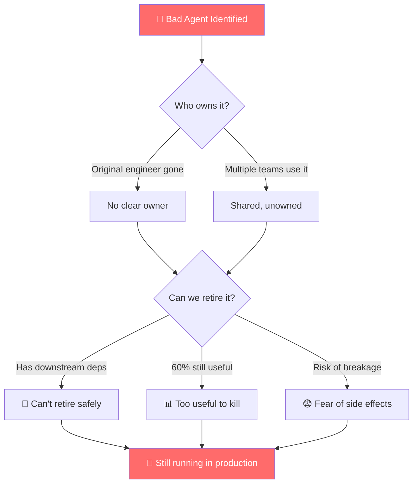

Six months after deploying our first batch of agents, we did a fleet review. The engineer who ran it came back with a list. Twelve agents total. Three were performing exactly as designed. Four needed minor fixes. Two were borderline — useful sometimes, unreliable often.

And three were genuinely bad. Slow. Inconsistent. Producing output that someone had to check every single time because you couldn't trust it otherwise.

We fixed the ones that needed minor work. We left the bad ones running.

That was a year ago. Two of those three bad agents are still running today.

This is not a story about failure to prioritize. It's about something more specific: the organizational gravity that keeps underperforming agents in production long after everyone agrees they shouldn't be there.

## The Technical Problem Is the Easy Part

The technical problem of a bad agent is usually solvable. You know what's wrong. You could fix it. The harder problem is that fixing it isn't anyone's job this sprint. Or last sprint. Or the sprint before that.

Here's what happens instead.

## Four Reasons Bad Agents Stay Alive

**Dependency.** You deployed the bad agent as part of a larger workflow. Three other agents downstream depend on its output. Retiring it means rewriting those dependencies, touching code nobody fully understands anymore, introducing risk. So you push it to next quarter.

**Partial utility.** A bad agent that is 60% correct is not the same as a broken one. It does some useful work. Someone, somewhere, is getting value from it. That makes it hard to pull the plug. There is no clear moment where the agent stops being worth keeping. It just keeps limping.

**No owner.** When you ask who owns the bad agent, you often get a long pause. The engineer who built it moved to a different team. The team that uses it doesn't understand the internals. The platform team didn't build it and doesn't feel responsible for it. Nobody wants to claim something that's already broken.

**Fear of breakage.** Production agents can have silent dependencies: tools, APIs, downstream systems that nobody documented. Retiring the agent might break something nobody knew was connected. It feels safer to leave it running badly than to cause an unexpected outage.

Every path leads back to the same place.

## What This Actually Costs

Every bad agent has a real cost. The review overhead when someone has to check its output because they can't trust it. The cognitive overhead when engineers know it's wrong and live with the background discomfort of unresolved debt. The cost of the tasks it gets wrong, which someone usually has to fix manually.

None of these costs show up in your standard monitoring. Agent uptime doesn't capture "output that required three rounds of human correction." Token spend doesn't capture the engineer-hours spent downstream cleaning up.

A bad agent that runs 10,000 tasks a month at 60% accuracy generates 4,000 bad outputs a month. If each one costs 5 minutes to catch and correct, that's 333 hours. At a senior engineer's hourly rate, that's real money being quietly spent every month. It just doesn't appear on a dashboard anywhere.

## What Good Agent Retirement Looks Like

The teams that handle this well treat agent retirement as a first-class operation, not an afterthought.

They maintain a short list of agents with explicit health status: not just uptime, but output quality. Any agent that fails a quality threshold for three consecutive weeks goes on the retirement shortlist.

They designate an owner for every agent before it deploys, with a handoff protocol when that person moves teams. The successor is named, not implied.

They document dependencies explicitly. Every agent has a list of what it connects to, so retirement risk can be assessed quickly when the question comes up.

And they timebox retirement work. Not "we'll do it when we have bandwidth." A specific sprint, a specific scope, a specific definition of done.

None of this requires fancy tooling. It requires treating agents like the production systems they are, with the same ownership, maintenance expectations, and retirement discipline you'd apply to any other critical component.

[AgentCenter's agent monitoring](/features/agent-monitoring) makes the quality signal part of this easier. You can track output trends and flag agents that are drifting. But the organizational part is on your team.

## Who This Matters Most For

This matters most for teams that have moved past the experimental phase. If you have five or fewer agents, you probably know them individually. If you have twenty or more, the odds are high that at least two of them are operating in bad-agent limbo right now.

It also matters for anyone about to scale. The habits you build around agent retirement at ten agents determine how much technical debt you carry at fifty. Start [pricing a plan](/pricing) before you're deep enough in the weeds that retirement becomes a crisis.

## One Honest Caveat

There is no dashboard that forces a team to retire a bad agent. That's a human decision. The tooling can surface the signal: poor quality, high correction rate, no clear owner. But someone still has to make the call and do the work. If your team doesn't have a culture of acting on that signal, better monitoring won't change the outcome.

The bad agents you have today aren't proof your monitoring is weak. They're proof your process for acting on what your monitoring shows hasn't been built yet.

---

*The dashboard won't fix a broken agent. But it will tell you which one is broken at 3am. [Try AgentCenter free](/pricing).*
