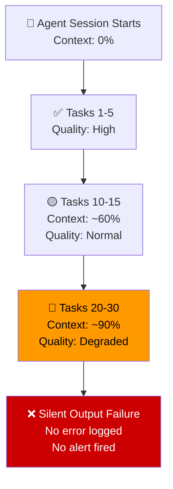
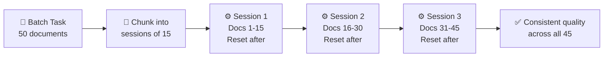

We had an agent that processed research briefs. It worked well for the first few tasks each day. By mid-afternoon, something changed. Outputs got vaguer. Summaries started missing details that were clearly in the source material. We filed it under "model inconsistency" and kept moving.

Three weeks later, we figured out it wasn't the model. It was the context.

## What Actually Happens at High Context Load

Long-running agents accumulate context. Every task, every tool call result, every prior message in the session adds tokens. Once you're at 80-90% of the context window, the model starts compressing earlier inputs and prioritizing recent ones. The agent keeps running. No error. No warning. The quality just isn't the same.

The specific failure depends on the task:

- A document summary agent handling 40 briefs in one session produces noticeably shorter summaries by brief 25. By brief 38, key details are missing.
- A customer support routing agent that runs all day starts making routing mistakes in the late afternoon that it wouldn't have made at 9am with a fresh context.
- A code review agent in batch mode gives detailed feedback on the first 8 files. By file 20, it's down to one-liners.

None of these produce errors. Nothing fails. The agent just gets worse.

## Why This Goes Undetected

Teams usually monitor whether agents complete. Did it run? Did it return something? Those checks pass even when quality has dropped significantly.

What they don't monitor is output quality as a function of session length. A deliverable that's 40% shorter than the baseline for that task type is a signal. A routing decision that's statistically different from what the same agent made 3 hours ago is a signal. But those patterns aren't visible unless you're tracking them.

The other problem is that context pressure looks like a judgment call. The agent made a vague summary. The agent routed this case to the wrong queue. Without context utilization data alongside the output, it looks like the agent was wrong, not that it was running out of room.

Most [agent monitoring](/features/agent-monitoring) setups catch crashes and timeouts. They don't catch gradual quality degradation tied to session state.

## What to Look For

The number that matters isn't "this agent used 2.4 million tokens this month." That's budget tracking. The useful number is "this agent was at 88% context load when it produced this output." That's quality tracking. They're completely different signals and most teams only have the first one.

A proxy you can use now: track output length per task over the course of a session. Consistent downward trends in deliverable size during a long batch are worth investigating. It's not a perfect signal, but it flags the pattern before you have to debug individual outputs.

In AgentCenter's [activity feed](/features/agent-monitoring), you can see which agents have been running longest without a session reset and compare deliverable size across tasks in the same session. That comparison is often where the pattern shows up first.

## The Fix Is Simpler Than You Think

Break batch work into explicit session chunks. If an agent processes documents, don't let it run 50 in one session. Set a hard limit — 15 documents, then a reset. Not because the model needs a break. Because the context window does.

For long-running orchestration agents, the equivalent is periodic context compaction: summarize what's happened into a tighter representation, discard the raw history, and continue with more room. Some agent frameworks support this natively. Others need it built in deliberately.

This isn't a complex infrastructure change. It's a task design decision. The agents that run into this problem most often were designed without thinking about session boundaries at all.

## Who This Hits Hardest

Teams doing batch processing: document review, code review, data enrichment, content generation at volume. Anything where a single agent session handles multiple items back-to-back.

The longer the session, the more likely context pressure is degrading your outputs somewhere in the middle of the batch. If you've never compared output quality from the first third of a batch against the last third, that's worth doing once. Run it. The difference is usually visible without any tooling at all.

Solo technical founders and small teams are especially exposed here because they rarely have someone reviewing agent outputs systematically. The degradation builds up silently across hundreds of tasks before anyone notices the pattern.

## The Honest Caveat

Some models handle context pressure better than others. Some tasks degrade slowly enough that it doesn't matter for your quality bar. This isn't a universal failure mode — it's a common one that most teams haven't explicitly checked for.

The point isn't that your agents are definitely doing this. It's that context window state isn't tracked as a quality signal in most monitoring setups, and if you're running bulk agent workloads without session boundaries, you've probably already shipped some degraded outputs without knowing it.

---

*The dashboard won't fix a broken agent. But it will tell you which one is broken at 3am. [Try AgentCenter free](/pricing).*
