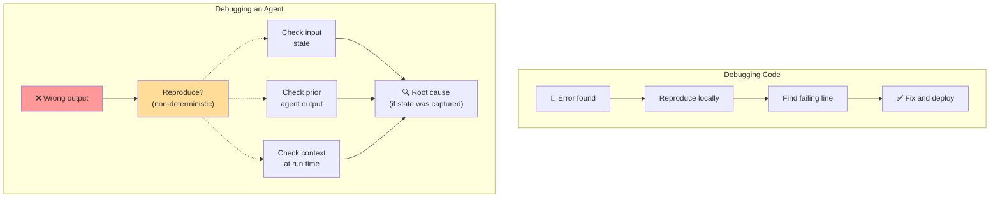

You've been fixing bugs in production systems for years. Something breaks. You reproduce it locally. You add a print statement. You step through the logic. You find the line. You fix it.

Then you run an AI agent that worked fine last Tuesday. Today it's returning wrong answers. You open the logs. The code is identical. The input looks right. You add a print. The code runs without errors.

The output is still wrong.

This is where most engineers hit a wall when they start debugging AI agents in production. The skills transfer, but the mental model doesn't.

## Code Fails Deterministically. Agents Don't.

Line 47 throws a TypeError because `result` is None. Every single time you feed it that input, you get the same error. That's the contract you've worked with your whole career.

Agent failures don't follow that contract. The "bug" might be in the prompt. It might be in how a prior agent's output got passed as context. It might be that the model hit its token window and silently truncated the reasoning chain. It might be that the same input, on a different day, at a slightly different model temperature, produced a different intermediate result that cascaded into wrong output three steps later.

None of this shows up in a stack trace.

## Three Ways Agent Debugging Breaks Your Instincts

**The reproduce problem**

When you reproduce a code bug, you give it the same input and you get the same output. When you try to reproduce an agent failure, you call the LLM again. Sometimes you get the same wrong answer. Sometimes you get a different wrong answer. Sometimes you get the right answer.

Now you're not even sure there was a bug.

This is genuinely disorienting at first. The tools and habits built around deterministic reproduction stop working. You can't bisect a model response the way you bisect a git history.

**The silent context problem**

Say you have a two-agent pipeline. Agent A parses a document, Agent B analyzes the output. Agent B starts returning garbage. You look at Agent B's code. Fine. You look at its prompt. Fine. Then you realize Agent A quietly changed its output format two days ago. Maybe it got a slightly different input document. Agent B has been receiving input it wasn't designed for. It has no error to throw. It just does its best with bad data.

From Agent B's perspective, nothing is wrong. From your perspective, everything is wrong. The bug is in the gap between them.

**The state invisibility problem**

In code, you can usually reconstruct what happened: the logs, the inputs, the outputs. With an agent, the "what happened" includes the exact context window the model received, the token count at each step, the intermediate reasoning before it produced its response, and whatever state was passed from the previous agent in the chain. Most of that is gone by the time you notice the wrong output.

You're debugging with the crime scene already cleaned up.

## The Debugging Unit Changes

Stop looking for the buggy line. Start looking for the task run.

When an agent produces wrong output, the first question isn't "which line is broken." It's: what did this agent actually see? What state came in from the previous step? What exactly did the model receive as context? What did it return, and how long did it take to get there?

That means you need task-level history before you need anything else. Not code logs. Not error traces. The full context of what each agent received and returned, tied to the specific task it was working on.

[AgentCenter's agent monitoring](/features/agent-monitoring) captures this at the task level: input state, output, run time, token cost, and error context per run. When an agent produces wrong output, you're looking at what actually happened rather than reconstructing it from fragments. The [task orchestration view](/features/task-orchestration) also shows you where in a multi-agent pipeline the state diverged, which is often more useful than looking at any individual agent.

## Who Feels This Most

Engineers in the first 3-6 months of running agents in production. You've shipped working agents, they're producing value, but you've started hitting failures you can't trace. Your instincts are good. They're just calibrated for a different problem.

Teams who've scaled past 5-6 agents are usually where this gets painful. At 2 agents, failures are obvious. At 10 agents passing state to each other, a failure in Agent 3 might not surface until Agent 8, and by then the original signal is buried under four intermediate transformations.

## An Honest Caveat

Capturing task state doesn't make agents deterministic. It won't prevent a model from having a bad run. What it does is give you enough history to diagnose failures faster.

The root cause might still be a bad prompt. It might be a model behavior you didn't expect. It might be a data quality issue two steps upstream. Task history just gets you to that answer in 20 minutes instead of 3 hours of re-running jobs and staring at logs.

Debugging agents is genuinely harder than debugging code. That's not a sales pitch for tooling. It's just the nature of non-deterministic systems. The best you can do is make sure you're capturing state at every step so you have something to work with when things go wrong.

---

*The dashboard won't fix a broken agent. But it will tell you which one is broken at 3am. [Try AgentCenter free](/pricing).*
