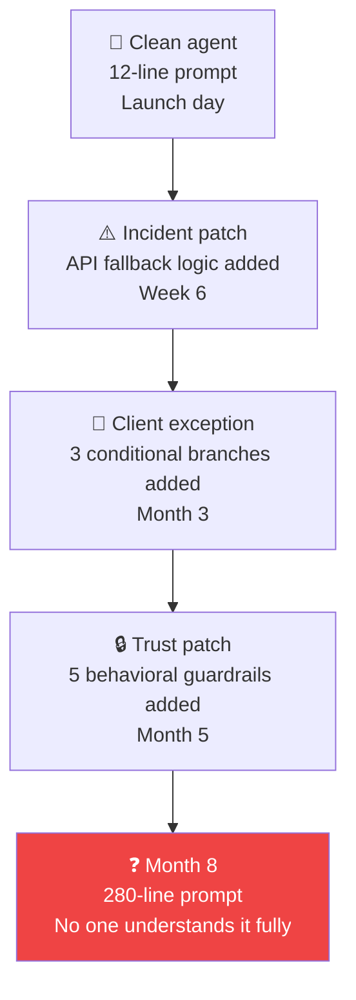

The agent we built for weekly client reporting started with a 12-line prompt. By month eight, that same prompt was 280 lines. There were conditions for specific clients, fallbacks for when an upstream API returned null, a block for reports run on the last business day of the month, and about 40 lines someone had added after an incident in March — an incident nobody on the current team had been around for.

We hadn't planned any of that. We'd just survived some things.

## Agents Don't Break. They Accumulate.

When a bug shows up in code, you fix it and the fix holds. When a production agent does something wrong, you usually fix it by adding something: a new instruction, a conditional, an exception block. The fix works. You move on. Months later, nobody remembers why it's there.

This isn't code debt in the usual sense. Code has tests that break when behavior changes. Agents have runs that mostly work. The accumulation happens quietly, during incidents, during "we'll clean this up later" moments that never arrive.

The result is an agent that nobody fully understands anymore. Not because it's complex by design — but because it reflects every fire its team ever put out.

## The Three Patterns

Most accumulation shows up in one of three forms.

**The incident patch.** One Friday night, an agent returned malformed output because an upstream API changed its response structure. Someone added a check: if the response doesn't include field X, assume the default value. It worked. The API was fixed three weeks later. The check stayed in the prompt for six more months — and started suppressing errors you actually needed to see.

**The client exception.** One customer has a quirk. Their data is structured differently, or they need outputs formatted a specific way. You add a condition. Then another customer has a different quirk. Then three more. A general-purpose agent now has seven client-specific branches. Changing the core logic means checking all seven branches first.

**The trust patch.** After a few incidents where the agent made judgment calls you disagreed with, you added guardrails: never include financial projections unless explicitly asked, do not recommend third-party tools, always summarize before listing specifics. Reasonable in isolation. But they stack. The agent now navigates a constraint graph that spans two screens of text, with no record of why any constraint was added.

## Why This Is Hard to See

The accumulation is invisible without a record of how the agent was originally designed versus how it runs today. You don't notice the prompt has grown from 30 to 200 lines until you're mid-incident and someone asks "wait, why does it do that?"

Standard [agent monitoring](/features/agent-monitoring) tracks performance, cost, and error rates. It doesn't track logic drift. An agent can run with normal latency and zero errors while doing something completely different from what you intended — because what you intended got buried under eight months of patches.

This is part of why teams that manage more than a handful of agents start to lose confidence in them. Not because the agents are failing. Because nobody is sure what they're actually doing anymore.

## Three Habits That Help

**Version your prompts like code.** If you change an agent's prompt, commit it with a message that explains why, not just what. "Added fallback for null API response after incident #42 — revert when API is stable" is useful six months from now. "updated prompt" is not. Treating the prompt as a first-class artifact, with a history attached, is what makes it possible to reason about it later.

**Read the diff every 90 days.** Pull up your agent's prompt from three months ago versus today. Read every change. If you can't explain why a line exists, it's a candidate for removal. Agents that get reviewed regularly stay coherent. The ones nobody touches quietly become unmanageable.

**Separate the layers.** If your prompt mixes the core task with guardrails with client-specific exceptions, you've made all three harder to reason about. Keep those in clearly labeled sections or separate prompt blocks with a composition layer. The structure doesn't need to be elaborate. It just needs to make the intent legible.

## Who Hits This Hardest

Teams with long-running agents — ones in production for more than three or four months without a structured review. If you inherited an agent someone else built, the accumulation came with it. You're running a system that reflects every incident its previous team survived, minus the context of why each patch was needed.

It also hits teams running more than 10 agents, where no single person owns more than two or three. The drift in each agent is manageable. The drift across 15 agents, with ownership scattered, is how you end up with a fleet nobody is confident in.

Using your [agent dashboard](/features/agent-dashboard) to review task history and output patterns regularly gives you a surface-level signal that something has shifted. But the prompt audit still has to be a deliberate act, not an automatic one.

## The Honest Part

No tool will read your 280-line prompt and tell you which lines are still earning their place. AgentCenter surfaces performance signals — error rates, latency, cost, output volume. It can tell you something has changed. It can't tell you whether your agent's instructions still make sense.

The cleanup is a discipline problem first. The monitoring just gives you an earlier moment to notice you need to do it.

---

*The dashboard won't fix a broken agent. But it will tell you which one is broken at 3am. [Try AgentCenter free](/pricing).*
