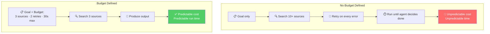

We had a research agent that was supposed to produce competitive intelligence briefs. The spec was clear: give it a company name, get back a 3-paragraph summary — what the company does, who their customers are, and how they price.

The agent was doing it. The output was good. We were running 200 briefs per day.

Then we got the invoice. The agent was consuming 40,000 tokens per request. It was cross-referencing 8 to 10 sources, verifying its own claims, expanding on tangents. Everything was technically correct. Total cost: $0.90 per brief. $180 per day. $5,400 per month — for 200 summaries that a human researcher would have written in 10 minutes each.

Nobody had told it to stop.

## The Goal Was Not Enough

When we built the agent, we gave it a goal: produce a concise competitive brief. We assumed "concise" would carry the constraint.

It didn't. Concise is a quality judgment. The agent was maximizing output quality, which is exactly what we told it to do. It had no reason to stop early. From the agent's perspective, doing more research was always better than doing less.

The fix took about 20 minutes. We set a token budget, capped sources at 3, and added a tool call limit. The revised agent costs $0.12 per brief. The output is 90% as useful. We saved $4,860 per month.

The budget didn't just save money. It forced a conversation we had been avoiding: which sources actually matter, when is output "done enough," and what trade-offs between depth and speed the team was willing to make.

When you skip the budget, you're not avoiding those decisions. You're letting the agent make them.

## Three Patterns Where Missing Budgets Cause Real Damage

**Research agents with no source limit** will consult 15 sources when 4 would produce equivalent output. At scale, one extra source per request across 500 daily runs adds thousands of extra tokens before anyone looks at the numbers.

**Workflow agents with no retry cap** are a different problem. One external API returns a 503 for 90 seconds. Your agent retries every 5 seconds. Now your [task queue](/features/task-orchestration) has tasks stacking up while one agent burns time on one recoverable error. A retry limit of 3 with exponential backoff would have escalated this in under 30 seconds.

**Orchestration agents with no timeout** are the worst case. A coordinating agent with no maximum run time will hold the entire pipeline when a sub-agent gets stuck. You'll see tasks sitting "in progress" for hours with no way to tell if the agent is doing slow but valid work or spinning on something completely broken.

## What a Budget Actually Forces You to Answer

Before you ship an agent, you should be able to answer three questions:

1. What is the maximum cost per run?
2. How long is too long for this task?
3. How many external calls is too many?

If you can't answer these, you don't yet fully understand what the agent is doing. The constraint forces the conversation with your team. That conversation is usually more valuable than the constraint itself, because it surfaces assumptions nobody had written down.

This also changes how you evaluate agent behavior in production. An agent that hits its budget and stops cleanly is not failing. It is working as designed. An agent that runs until it decides it's done is making resource decisions on your behalf, with no oversight.

[Agent monitoring](/features/agent-monitoring) will show you after the fact which runs went over budget. That matters. But a constraint set before deployment stops the problem from happening in the first place.

## Who This Bites First

This is specifically a problem for engineers who are past the first agent and moving to the third or fourth.

The first agent gets watched closely. You're reading the logs, checking outputs, noticing cost spikes. You catch the expensive run because you're paying attention.

By agent four, you're not watching anymore. The agent runs autonomously. Nobody is checking token counts per request. This is exactly when an unbounded agent starts doing expensive work that nobody asked for, on a schedule, without anyone noticing until the monthly bill arrives.

Teams that hit this problem at 30 agents have a much harder time fixing it than teams that build the habit at 3. You can go back and add budgets retroactively, but it's slow, and you have to retune each agent individually based on real usage data you should have been collecting from the start.

The pattern is consistent: teams that add budget constraints early don't have "budget conversations." Teams that skip them do, and those conversations happen at the worst possible time.

## An Honest Caveat

Tight budgets can make agents worse. Set a token limit too low and your agent will produce shallow, incomplete work. Set a timeout too short and it will give up on tasks that needed more time to complete correctly.

The goal is not to minimize budgets. It's to make them explicit and intentional.

"Unlimited" is a budget. It just happens to be one that nobody on your team agreed to, nobody reviewed, and nobody is responsible for when costs spike.

Start with a broad budget based on what a single manual attempt would cost in time and tokens. Then tighten after you've seen what real production runs actually consume. Most agents use 20 to 30% less than teams expect when they look at actual data from the first few weeks.

Set the budget, monitor it, revisit it. That's it. Just don't leave it blank.

---

*The dashboard won't fix a broken agent. But it will tell you which one is broken at 3am. [Try AgentCenter free](/pricing).*
