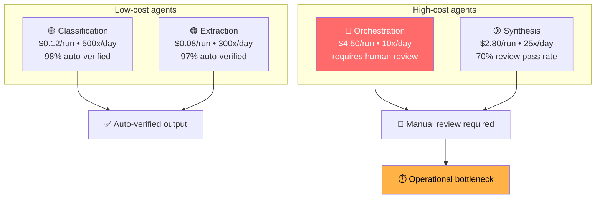

We had 12 agents running. The one the team was most proud of was an orchestration agent that pulled from six data sources, made somewhere between 40 and 80 tool calls per run, and cost about $4.50 each time it fired.

Nobody trusted it.

Not because it was broken. It ran fine. It completed tasks. It returned outputs. But nobody could tell you whether those outputs were actually good. Reviews piled up in the queue. Engineers checked it when they had time. Most outputs shipped without a second look because the outputs were long and the reviewers were busy.

Meanwhile, a classification agent hummed along in the background. $0.12 per run. 500 runs a day. Error rate under 2%, tracked automatically. Nobody thought about it. It just worked.

That gap — between the agent that costs the most and the agent that delivers the most reliable value — showed up again and again when we looked across the fleet.

## The Pattern No One Warns You About

Expensive agents are expensive for a reason: the task is hard. Open-ended research synthesis. Multi-step reasoning across ambiguous inputs. Generating outputs that need to match a vague brief. These are genuinely difficult tasks.

But when humans do hard tasks, they can also judge whether the output is good. When an agent does a hard task, you need another human to evaluate the output, and that evaluation takes real time.

Simple, bounded tasks are different. Classification with a defined taxonomy. Extraction from structured documents. Summarization with a fixed template. These are cheap to run and cheap to verify. You can write test cases. You can spot-check automatically. You can measure accuracy over time and catch degradation before it compounds.

The result: your cheap agents have measurable performance. Your expensive agents have vibes.

## Where Teams Spend Their Attention (and Where They Shouldn't)

When something feels off with an expensive agent, you feel it. The outputs are long. The failures are dramatic. The cost per run shows up in every billing report. So teams instrument it, discuss it in standups, and watch it closely.

The cheap agents that are actually failing? Those get discovered six weeks later when someone traces a downstream bug back to a classification error that had been happening for a month.

This is backwards. The agents running hundreds of times a day are the ones where a 3% error rate has real consequences. A 3% error rate on 500 daily runs is 15 wrong outputs per day. On a 10-run-per-day agent, it's less than one wrong output every three days.

In the [agent monitoring dashboard](/features/agent-monitoring), most teams sort by cost. Sort by volume and error count instead. The expensive agent will catch your eye every time. But the quiet, high-volume agent with a creeping error rate is the one silently sending bad inputs downstream.

## The Review Bottleneck You Don't See Coming

Expensive agents create a second problem: human review becomes the constraint.

If every output from your orchestration agent requires 20 minutes of expert review, and you're running it 20 times a day, you've just created a 7-hour-per-day review job. That job either gets done, meaning an engineer is doing it instead of building things, or it doesn't, meaning outputs ship without review.

Most teams end up somewhere in the middle. They review the outputs that look risky. They skim the rest. Over time, the agent accumulates unreviewed outputs and quality drifts without anyone catching it.

This is where a structured approval workflow changes things. In AgentCenter's [task management view](/features/task-orchestration), you can set mandatory review gates before output ships. It forces an explicit decision: review it now, or mark it as auto-approved. That visibility changes behavior quickly. Teams start asking whether the task actually needs an expensive agent, or whether a cheaper, more constrained agent would be easier to verify and just as useful.

## What to Actually Do

Before adding another orchestration agent, look at your existing fleet sorted by run volume.

Find the agents running hundreds of times per week. Pull a sample of their outputs. Read them. If you can't tell whether an output is correct, that's a problem. If outputs are wrong 5% of the time, 5% of your downstream pipeline is running on bad data.

Ask whether the expensive agent is actually the bottleneck. Sometimes the thing dragging down quality isn't the orchestration layer. It's a classification agent upstream routing tasks to the wrong workflow. Fixing the $0.08 agent fixes everything that runs after it.

And when you do build expensive agents, build the review process first. Decide in advance: what does a good output look like, who reviews it, how long review should take, and what happens when it fails. If you can't answer those questions, you're not ready to run the agent at scale.

## Who Hits This First

Teams that have been running agents for three months or more. At that point, you have enough data to see the cost and error distributions clearly. You also have enough operational experience to know which agents cause the most friction.

If you're in your first month, everything is hard to measure. But come back to this in month four, when you're tracing a downstream failure and realize it started in an agent you stopped thinking about.

## An Honest Caveat

Some tasks genuinely need an expensive agent. Complex research synthesis, multi-step reasoning over ambiguous inputs, open-ended generation with high quality bars — these can deliver real value when the task is scoped well and the review process is in place.

The issue isn't expensive agents. The issue is building them without building the operational structure around them: review gates, quality metrics, error tracking, escalation paths for when outputs are wrong.

Without that structure, an expensive agent is just an expensive way to produce outputs nobody knows how to evaluate.

---

*The dashboard won't fix a broken agent. But it will tell you which one is broken at 3am. [Try AgentCenter free](/pricing).*
