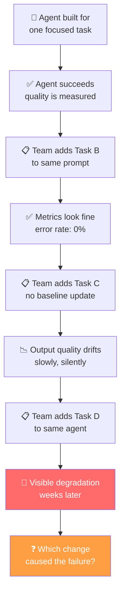

The agent was built to summarize customer feedback tickets. Ten tickets per run, every hour, output a brief summary of themes and tone. It worked. So after four weeks, someone added: also flag anything urgent. Then: also check if a competitor gets mentioned. Then: also score sentiment on a 1-to-5 scale. Then: also suggest a Slack notification category.

No single person made all those decisions. Each addition looked reasonable in isolation. The agent kept running. The error rate stayed at zero.

Six weeks after the third addition, the summaries started getting vague. Occasionally missing whole categories. The team noticed something was off but the agent was still completing tasks and returning results, so nobody opened an incident. Two weeks passed before someone actually read a batch of outputs side by side and realized the agent had quietly stopped doing its original job well.

## The Promotion Problem

This is what happens when an agent proves itself at a focused task and gets assigned more responsibilities — one small addition at a time — until it's mediocre at many things.

It follows the same pattern as the Peter Principle in management: someone does their job well, gets promoted, gets more responsibility, eventually reaches a level where they're out of their depth. The difference with agents is they don't ask for the new work. Humans give it to them, one instruction at a time, without updating the acceptance criteria that defined what "working" meant.

The result: by the time quality drops visibly, the original scope and the current scope are two different jobs. And nobody can agree on what the agent was supposed to do anymore because nobody wrote it down.

## Three Ways Scope Creep Enters

**Task stacking.** The original instruction is still there, but now it's followed by three more. Each addition changes the reasoning load, what the model prioritizes, and often the output format. Nobody intended any of this. The prompt just grew.

**Scope inflation without baseline updates.** When you first deployed the agent, you measured quality. You ran test cases, saw good results, shipped it. Now the agent has a different job than when you measured. Your baseline is six weeks old and covers a task the agent no longer does exclusively. Your monitoring compares current output to a benchmark that no longer applies.

**The vague-mandate trap.** Instead of adding specific tasks, someone rewrites the agent's core instruction with more general language. "Summarize feedback tickets" becomes "process customer feedback and extract relevant insights." That word "relevant" is doing a lot of work. The agent starts making judgment calls it was never designed for, and there's no acceptance criteria covering what "relevant" actually means.

## Why Standard Monitoring Misses It

Most monitoring tracks whether an agent ran and whether it returned a result. That tells you almost nothing about whether the output is useful.

An agent that ran, returned text, and didn't throw an error looks identical to an agent that ran, returned poor-quality text, and didn't throw an error. If you're not reading the output regularly, you won't see the degradation.

Teams using [agent deliverable review](/features/agent-monitoring) catch scope creep earlier than teams relying only on error metrics. Not because a dashboard automatically flags it, but because having a review gate means someone reads outputs on a regular cadence. That reading is the only reliable signal.

The other place it shows up: [agent monitoring dashboards](/features/agent-monitoring) that track per-task completion metadata will show the agent running longer, returning larger outputs, or hitting more retries as scope grows. Those are signals that something changed — not necessarily that quality dropped, but they're worth investigating when you see them on an agent that used to be consistent.

## What to Do About It

Run a monthly scope check on every agent in production. Not a technical audit. A five-minute question per agent: what was this agent built to do, and is that still what it's doing? Write both answers down. If they've diverged, you've already started the promotion spiral.

Before adding any new instruction to an existing agent, answer three questions:

1. What does the agent currently do?
2. What does the new instruction add?
3. How will you know if the change hurt quality?

If you can't answer the third question, don't add the instruction yet. Set up measurement first.

Task ownership matters here too. An agent with a named owner gets reviewed more often. The owner notices when scope changes. Unowned agents accumulate responsibilities because nobody is watching the original job description. If you're using AgentCenter, [tying each agent to a project owner](/features) is part of the initial setup — and it's one of the few habits that actually prevents this problem rather than just catching it after the fact.

## Who Runs Into This Most

Teams that moved fast on initial deployment. If you launched agents quickly and then expanded scope in small increments, you're at risk. The agent isn't wrong. The job description grew and nobody told the evaluators.

This hits harder with agents that produce unstructured text output. Scope creep in structured-output agents gets caught faster because format breaks are visible. Text output degrades silently — the team just starts trusting it less without understanding why.

## One Honest Caveat

Some agents genuinely need broad mandates. A research agent that makes judgment calls about relevance can't be reduced to three bullet points per output without losing the point of using an agent at all. The concern here is about agents built for a narrow job that expanded without intentional design, not agents designed for generality from day one.

The goal isn't minimal scope for its own sake. It's knowing what scope you intended, checking whether that's still what you have, and making deliberate decisions when it changes.

---

*The dashboard won't fix a broken agent. But it will tell you which one is broken at 3am. [Try AgentCenter free](/pricing).*
