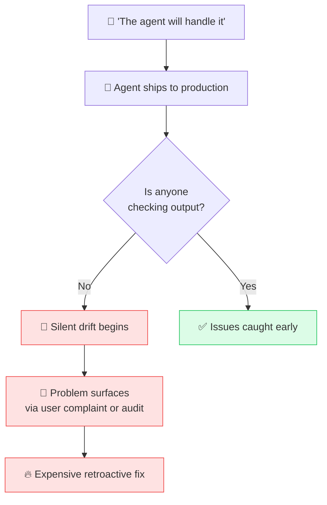

We shipped our third agent in January. It handled incoming support ticket classification: read the ticket, assign a category, set priority. It ran for 11 days before anyone noticed it was miscategorizing roughly 23% of tickets.

Nobody caught it because nobody was looking. The engineer who built it had said, right before moving on to the next project: "It's fine. The agent will handle it."

That phrase is worth paying attention to.

## The Phrase That Kills AI Agent Reliability

After that incident, I started noticing how often "the agent will handle it" appeared in team conversations.

In standups: "We don't need to track that manually anymore. The agent will handle it."

In Slack threads: "You can probably automate that whole review step. Just let the agent handle it."

In retrospectives: "Going forward we should add an agent to catch this. That way it'll be handled."

The phrase sounds like confidence. It's usually the opposite. "The agent will handle it" is how people stop thinking about a system. It closes the mental loop. And in production, closed loops are where problems grow unnoticed.

## What It Actually Means

The phrase has three versions, each with a different failure mode.

**"The agent will handle it" at build time.** This is about scope. The team decides an agent will own some slice of work and moves on without defining what "handled" actually means. The agent runs. The work appears to happen. But nobody specified what good output looks like, so nobody notices when the output degrades.

**"The agent is handling it" at runtime.** The live version. The agent is running, something is happening, and that gets treated as sufficient. Running and doing useful work are not the same thing.

**"The agent handled it" after the fact.** The most dangerous version. Past tense. The assumption that because the agent ran, the task is done. This is where silent failures pile up into real problems.

Each version is a different way of saying: I've handed this off and I'm not thinking about it anymore.

## Three Times This Went Wrong

**The classification agent.** Eleven days, 23% miscategorization rate, caught by a user who noticed their high-priority ticket sitting in the wrong queue. We had no monitoring on output quality. Just a green "running" status in our deployment dashboard.

**The daily summary agent.** Four months running, reports that looked completely normal. Three months in, a prompt change upstream caused the agent to quietly drop edge-case handling for transactions under $50. The reports still ran. They still rendered. They just stopped including a whole category of entries. An auditor found it six weeks later.

**The data prep / analysis handoff.** Two agents: one that prepared a data extract, one that consumed it. Both were "handled." The gap between them, where the extract format was supposed to stay stable, had no owner. After a schema migration, the extract format changed slightly. The analysis agent silently started dropping rows. Neither agent failed. The pipeline "handled it." The output was wrong.

In all three cases, the failure wasn't in the agent itself. It was in the assumption that the agent was a closed loop.

## The Question That Replaced the Phrase

I stopped saying "the agent will handle it" when I understood what question it was replacing.

The real question is: who is responsible for knowing whether this agent is doing its job correctly, and how will they know?

That question is uncomfortable. It requires naming a person, defining what "correctly" means, and specifying how you'll find out when the answer is no. It takes five minutes to answer badly and twenty minutes to answer well. But it's the only question that keeps production agents honest.

Now when someone on the team says "the agent will handle it," I ask: who's checking? What does handled mean? How often? What happens when it isn't?

Most of the time, the answers don't exist yet. Building them is where the real work is.

## Who Gets Hurt by This Pattern

Teams at the 3-to-8 agent stage are most at risk. At one or two agents, you're still paying close attention to everything. At ten or fifteen, you've usually built real monitoring because you've been burned already. At three to eight, you're moving fast, you've had some early wins, and confidence is running high. That's when "the agent will handle it" does the most damage.

The engineers who build agents and then move on are not being careless. They're behaving rationally given their incentives. If there's no explicit answer to "who checks this agent's output," the answer becomes nobody. That's a system design failure, not a personal one.

[AgentCenter's agent monitoring](/features/agent-monitoring) and the [deliverable review workflow](/features/task-orchestration) exist to fill exactly this gap: a place to define what "handled" means, who sees the output, and what triggers a review. Without that structure, a running agent and a correctly-running agent look identical from the outside.

## An Honest Caveat

A dashboard doesn't fix this by itself. If you ship an agent without defining output quality criteria and assigning a human owner, you'll have a very clear view of problems you're still not structured to catch. The tooling surfaces information. What you do with it depends on whether someone is actually watching.

The real shift is in the phrase you use. Not "the agent will handle it." Instead: "The agent is running. Krupali is reviewing output every Tuesday. We'll know it's working when the error rate on classified tickets stays under 3%."

That's longer. It's also the version that keeps working at 3am.

---

*The dashboard won't fix a broken agent. But it will tell you which one is broken at 3am. [Try AgentCenter free](/pricing).*
