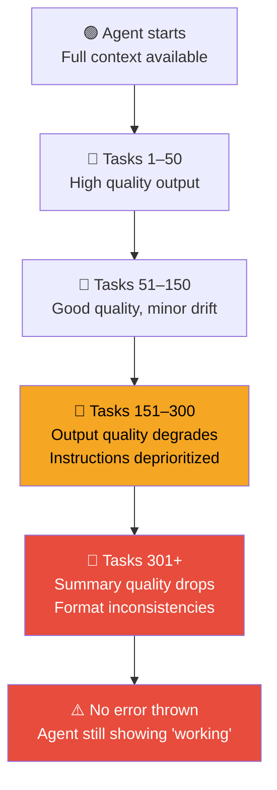

We had a research agent processing a backlog of 600 support tickets. Batch job, no real-time pressure. We kicked it off at 8am and checked back at 4pm.

The first 80 tickets: thorough summaries, accurate categorization, useful recommendations. Ticket 400: three-sentence summaries that missed the actual issue. Ticket 550: category mismatches. Nothing crashed. The agent kept running. We didn't notice until QA reviewed the batch.

That's context window degradation in production.

## What's Actually Happening

Every LLM has a maximum context window. Most current models handle 128k to 200k tokens. That sounds enormous until you realize a long-running agent isn't just processing one task — it's accumulating conversation history, tool outputs, previous decisions, error logs, and system prompts.

A research agent doing ticket classification might use 2,000 tokens per ticket for input, reasoning, and output. By ticket 100, it's carrying 200,000 tokens of history. That's not a problem if the model can handle it, until it can't.

What happens at the edges isn't a hard error. The model doesn't stop. It keeps responding. It just starts losing the thread. Instructions from the beginning of the session get deprioritized. Earlier context gets compressed or ignored. The output format drifts. Summaries get shorter. Categorizations get lazier.

The agent *looks* fine. Status: working. No errors. Latency normal. Output counts match expectations. You'd have no idea anything was wrong without reviewing the actual outputs.

## The Three Patterns We Saw

**Format drift.** The agent was asked to return structured JSON. By task 300, it was mixing JSON with prose, adding unsolicited commentary, omitting required fields. No schema validation failed because we weren't validating schema in the pipeline.

**Instruction decay.** The system prompt included specific rules about what to flag as high-priority. Those rules held through the first hundred tasks. By task 400, the agent was applying a much looser interpretation. It hadn't changed the rules. It had just buried them under 300 tasks of accumulated context.

**Silent quality drops.** The most dangerous pattern. Every output passed format checks. None triggered error counts. The degradation was in the substance: thinner analysis, missed nuances, safer (less useful) recommendations. This kind of failure won't show up in your latency charts or error rates. You only catch it by reading the outputs.

## What You Should Actually Do

The fix isn't a bigger context window. A 1M token window doesn't solve this. It just delays the problem.

Design agents to be **short-lived**. A job that processes 600 tickets should run as 12 agents, each handling 50 tickets. At the end of each batch, the agent stops, state is written to storage, and the next agent starts clean. No accumulated drift. No buried instructions.

This also means [agent monitoring](/features/agent-monitoring) matters at the batch level, not just the task level. Tracking whether output quality within a long batch is drifting is harder to set up than a simple error counter, but it's the signal that actually tells you something is wrong before QA finds it.

Three practical things to implement:

1. **Set a context budget per agent run.** Decide upfront how many tasks or how many tokens each agent session should handle. Stop the agent and restart clean when it hits that limit.

2. **Add output sampling to long batches.** Don't wait for QA. Sample 5% of outputs from each quartile of a long batch and compare them. If quality at task 400 looks different from task 20, you have a problem.

3. **Separate history from instruction.** Most agent frameworks let you control what gets added to the context window. Tool outputs and reasoning steps accumulate fast. Keep system instructions pinned or re-injected at regular intervals so they don't get buried.

## Who Hits This Most

Document processing and research automation teams are the most exposed. High-volume, sequential processing jobs where an agent runs for hours handling hundreds of similar inputs. If you're using agents for data extraction, classification, summarization, or compliance checks at scale, this is a real risk.

Solo devs prototyping an agent often don't see it because they're running 10 to 20 test cases, not 500. It shows up in production after the demo.

## Honest Assessment

Not every agent is affected equally. If your agents run short tasks with fresh sessions — answering a question, processing a single document, triggering one workflow action — this isn't your problem. The risk scales with session length and task count.

This also isn't a model bug. It's a design problem. You're asking a model to hold hundreds of prior decisions in active context while continuing to make good new ones. That degrades for humans too.

[AgentCenter's monitoring features](/features/agent-monitoring) help with visibility into batch jobs — you can track when output rates or patterns change over a long run. But it won't automatically catch quality degradation without you defining what quality looks like for your specific task. That part is on you.

## The Actual Takeaway

Long-running agents aren't free. Every task they complete makes the next task slightly harder to get right. The cost isn't compute. It's quality.

Design around this by treating agent sessions as disposable. Set limits. Sample outputs. Restart clean. The agent that handles tasks 1 to 50 doesn't need to remember tasks 51 to 500.

If you're seeing slow quality drift in batch outputs and can't find an obvious error, check how long your agents have been running without a reset.

---

*The dashboard won't fix a broken agent. But it will tell you which one is broken at 3am. [Try AgentCenter free](/pricing).*
