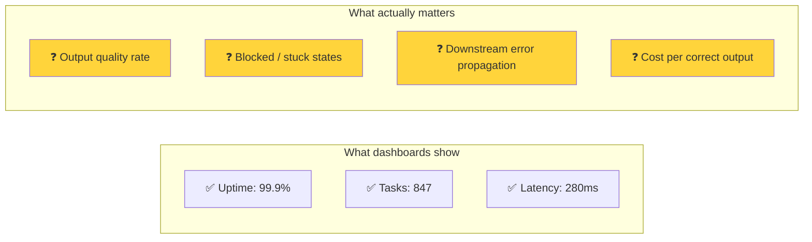

We had a monitoring setup we were proud of. Uptime charts. Task throughput. Average latency per agent. It looked like a real production dashboard.

Then one of our agents quietly produced wrong outputs for 11 days. The dashboard showed green the entire time. No downtime. No latency spikes. Task count ticking up as expected.

The agent was doing exactly what we measured — completing tasks fast. It just wasn't doing them correctly.

## The Metrics That Feel Right But Aren't

Most teams reach for the same metrics when they first instrument agents. Availability. Task count. Response time. These come naturally because they're borrowed from API and service monitoring, where they genuinely matter.

For an HTTP service, if it's up and fast, it's probably working. For an AI agent, those three metrics tell you almost nothing about whether the agent is doing its job.

An agent can be 100% available and producing garbage outputs. It can complete 1,000 tasks at 300ms each and get 40% of them wrong. Latency and uptime don't capture output quality, task correctness, or whether the agent is making decisions that make sense.

This isn't a tooling problem. It's a framing problem. The wrong mental model leads to the wrong instrumentation.

## What Most Dashboards Miss

Here's what tends to be absent from the first version of any team's agent monitoring:

**Output quality signals.** Did the agent produce what was asked? Teams rarely measure this directly because it requires defining what "correct" looks like for each task type. That's harder than logging response time, so it gets skipped. The result is a dashboard that can't tell you the most important thing.

**Blocked and waiting states.** An agent that can't proceed because it's waiting on another agent or a human approval shows as "running" in most monitoring setups. It's technically alive. It's also doing nothing useful. You need to distinguish between an agent that's actively working and one that's stuck.

**Downstream propagation.** If agent A produces an output that feeds agent B, and agent A's output was wrong, agent B is now working on bad input. Standard monitoring tracks each agent in isolation. It doesn't show you that a failure in one is infecting another two steps downstream.

**Cost per task outcome.** You can see cost per task easily. You can't see cost per correct task, or cost per task that actually reached completion without human intervention. That's the number that tells you whether the agent is worth running.

## The Silent Failure Pattern

The most expensive agent failures aren't crashes. They're the slow ones where the agent keeps completing tasks, the dashboard stays green, and nobody notices the outputs are wrong until the damage is done.

This happens because most dashboards are good at detecting absence — a process that stopped, a timeout that fired, a queue that backed up. They're not good at detecting presence of the wrong thing. An agent that runs and produces bad results looks identical to an agent that runs and produces good results.

The teams that catch silent failures early have one thing in common: they built a review layer on top of their monitoring. Not every output gets reviewed, but some do — enough to know if the error rate is climbing. The [agent monitoring features in AgentCenter](/features/agent-monitoring) surface deliverable status alongside task status for exactly this reason. A completed task and a reviewed deliverable are two different data points.

## What to Actually Measure

A few signals that turn out to be much more useful than uptime:

**Review rate and rejection rate.** What percentage of deliverables are being reviewed? Of those reviewed, how many are rejected? A rising rejection rate on a subset is an early warning that something has shifted.

**Handoff success rate.** When agent A passes work to agent B, does agent B proceed or stall? Stalls are a proxy for bad output quality — agent B can't do its job because what it received doesn't work.

**Time in blocked state.** How long are agents sitting in a waiting or blocked state vs. actively working? If an agent spends 60% of its time blocked, the bottleneck isn't the agent — it's whatever it's waiting on.

**Human intervention rate.** How often does a human step in to fix an agent's output before it moves downstream? If the rate is high, the agent isn't as reliable as the uptime number suggests.

The [task orchestration view in AgentCenter](/features/task-orchestration) shows per-agent state across a workflow, including how long each agent has been in each state. It's a different cut of the data than standard monitoring — focused on flow and outcome rather than uptime and speed.

## The Practical Step

You don't need to rebuild your monitoring stack. Start with one change: add a visible review step to your highest-stakes agent workflow and track the rejection rate. Give it two weeks. That single number will tell you more about the agent's actual reliability than a month of uptime charts.

If the rejection rate is low, great — you've confirmed the agent is working and you have the data to prove it. If it's higher than expected, you've just found a problem that would have been invisible to every metric you were already tracking.

## Who This Hits Hardest

Teams that scaled up before hardening their observability. If you went from 3 agents to 15 quickly, you probably brought your early monitoring setup with you and just added more agents to the same dashboard. The blind spots in the original setup scaled with you.

Also: teams running agents on consequential tasks — customer communications, financial summaries, decisions that get acted on — where a silent failure has real downstream cost.

## The Honest Caveat

No dashboard tells you everything. Adding output quality signals requires defining what correct looks like, which is specific to each task type and takes real work. There's no universal "agent health" score that removes that judgment call.

The goal isn't a dashboard that tells you the agent is fine. It's a dashboard that tells you quickly when it's not.

---

*The dashboard won't fix a broken agent. But it will tell you which one is broken at 3am. [Try AgentCenter free](/pricing).*
