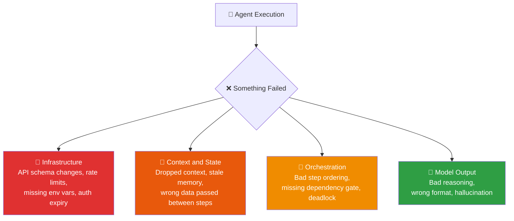

Something broke at 11pm on a Tuesday. A document-processing agent that had run without issues for six weeks stopped completing tasks. It was returning partial outputs, sometimes nothing at all.

First instinct: blame the model. Check for an outage. Try a different provider. Review the system prompt.

Two hours in, the actual cause surfaced: a third-party API this agent calls had quietly changed its response schema. One field renamed from `result` to `results`. The agent read an empty value every time, interpreted it as "no data found," and stopped. No error thrown. No alert fired. Just silence.

Zero model involvement. Pure scaffolding failure.

## Where Agent Failures Actually Come From

After running agents in production for a while, you start to see a pattern. Most failures don't come from the model at all. They cluster in the infrastructure around it.

Infrastructure problems are the most common. Context and state issues come second. Orchestration bugs third. The model is last.

This doesn't mean the model is flawless. It means the surrounding scaffolding breaks first, fails more quietly, and gets blamed on the wrong thing.

## Why Infrastructure Failures Are Hard to Spot

A genuine model failure is usually obvious. The output is garbled. It ignores your formatting instructions. It contradicts itself across runs. You notice fast.

Infrastructure failures are quieter. They look like the model failing.

An agent hitting a rate limit that returns no results looks like "the agent gave up." An API returning a 200 with an empty array looks like "no data" to the agent, not an error. A missing environment variable in production can let the agent run but silently return junk. None of these fail loudly.

Three categories we hit most often:

**External API problems.** Schema changes, rate limit hits, expired auth tokens. The agent makes a tool call, gets back something unexpected, and either tries to work with nothing or silently exits. If you're not capturing raw tool call outputs in your logs, this is invisible.

**Context getting cut or corrupted.** Agents running long tasks often hit context limits. When that happens, earlier turns get dropped. If your agent's core instructions live in the first few messages, it can lose them mid-run and start acting confused. It's not confused. It literally doesn't have its instructions anymore. This is especially common in pipelines where the same agent handles tasks across many user turns without a session reset.

**Ordering and dependency bugs.** Agent B needs Agent A's output before it starts. If A is slow or errored out, B gets empty input. If nothing validates A's output before passing it to B, B tries to process nothing and produces nothing. That looks like B malfunctioned. B was fine. The problem was a missing gate on A's output.

You can read more about how [task orchestration](/features/task-orchestration) fits into this in AgentCenter's pipeline setup.

## Where Teams Waste Time

The typical debugging sequence after an agent failure:

1. Check the model, swap providers, test in a playground
2. Rewrite the system prompt
3. Try again, still fails
4. Eventually look at actual tool call logs
5. Find the real problem in five minutes

Steps one through three are almost always wasted. Not always. But usually.

The faster path is to look at tool call inputs and outputs first. What did the agent receive? What did it return from each external call? Where in the chain did the data stop looking right?

With [agent monitoring](/features/agent-monitoring) that captures step-level state, this debugging loop collapses from hours to minutes. The model is ruled out quickly, and you focus on what actually broke.

## What to Check Before Touching the Prompt

When an agent fails in production:

- Look at the raw inputs and outputs for every tool call in that run
- Check whether external APIs returned the shape you expected, not just a 200 status
- Verify what context was actually passed to the model, not what you assumed was passed
- Confirm dependent agents completed before this one started
- Check environment variables and credentials specifically in the production environment

If all of that looks clean, then yes, check the model. But that's step five, not step one.

## Who Runs Into This

If you're still testing agents in a sandbox, this isn't urgent. But once agents touch external systems, hand off data to each other, or run on a schedule, infrastructure failures start dominating your incident list.

The teams that recover fastest have visibility into the scaffolding state, not just whether the agent "finished." What did it receive? What did each tool call return? Did any step produce output that was passed on empty?

That granularity is what separates debugging in five minutes from debugging across an entire evening.

## Honest Caveat

Models do fail. RAG pipelines return bad context. Prompts degrade as data drifts. These are real problems worth tracking.

But model failures tend to be systematic and reproducible. The same task fails the same way. You can usually reproduce it in a playground within a few tries.

Infrastructure failures are intermittent, environment-specific, and silent. They're harder to find, and they get misattributed constantly.

That's why blaming the model first slows you down. The scaffolding around the model breaks more quietly, and that's where most of the debugging time actually goes.

---

*The dashboard won't fix a broken agent. But it will tell you which one is broken at 3am. [Try AgentCenter free](/pricing).*
