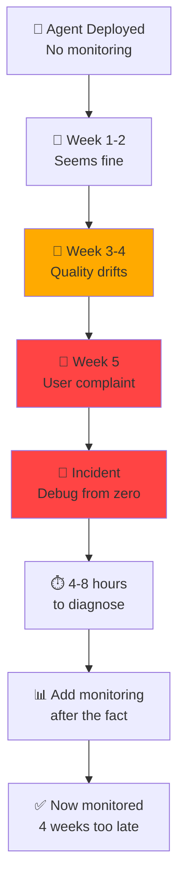
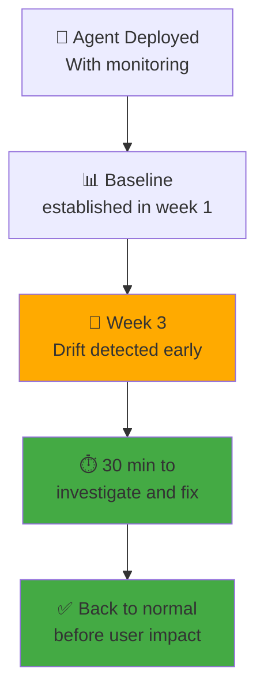

Every team I've talked to that's running agents in production has the same story. They shipped the agent. It ran for a while. Something went wrong. They couldn't tell what. Then they added monitoring.

Always after. Never before.

## Why This Keeps Happening

The pattern makes psychological sense. Monitoring isn't building something new. It feels like overhead. When you're trying to ship an agent that actually works, instrumentation feels like a distraction from the real work.

The prototype runs perfectly. You demo it to stakeholders. Everyone's excited. The pressure is to ship, not to instrument. So you ship.

The first few weeks in production go fine. The agent runs. Nobody's watching closely. A problem develops quietly — cost is creeping up, output quality is drifting, one task type is failing intermittently. Nobody knows because nobody's watching.

Then the failure becomes visible. A user complains. A downstream system breaks. The first hour of the incident is spent just figuring out what's happening. Without monitoring, you're starting from zero.

## The Real Cost of Late Instrumentation

The time cost is obvious. Debugging without monitoring is expensive. But there's a less obvious cost: you're debugging a production system while it's running. You can't freely test changes. You don't have historical data to compare against. You're operating on partial information.

We had an agent running for six weeks before we realized its output quality had been declining for the last four of those. Not crashed. Not erroring. Just gradually getting worse. By the time we caught it, we had four weeks of low-quality outputs that had already been processed and used.

Rewinding that was expensive. Not in money — in trust, and in manual cleanup work.

Compare that to the alternative:

## What "Monitoring Before Deployment" Actually Looks Like

It's not a big project. Three things, done before the agent sees production:

**1. Set a baseline.** Run 20-30 tasks in staging or pre-production. Record the average duration, average cost, and quality score for each. This is your baseline. You can't know what "wrong" looks like without knowing what "right" looks like.

**2. Connect status monitoring.** Hook up the agent to a dashboard that shows real-time state. AgentCenter's [agent monitoring](/features/agent-monitoring) gives you this out of the box — online, working, idle, blocked. At minimum, you need to know if the agent is running or not.

**3. Set two alerts.** One for cost (if a single task costs 3x the baseline, alert). One for duration (if a task runs 5x longer than expected, alert). These two alerts catch most production problems before they become incidents.

That's it. Two hours of setup before deployment. Not a full observability stack. Not a custom monitoring platform. Two hours.

## The Bias Toward Building

There's also a builder bias at play. Engineers want to build things. Monitoring is maintenance. The agent is the product. The dashboard that watches the agent is support infrastructure.

This is fine until the support infrastructure is missing and the product fails silently.

The frame that helps: monitoring is not overhead on the real work. Monitoring is the mechanism that tells you if the real work is actually working. An agent with no monitoring is an agent you're flying blind.

## Who This Matters Most For

This matters most for small teams or solo engineers deploying their first production agent. You don't have a dedicated MLOps person. Nobody else is watching the agent for you. If you don't monitor it, nobody does.

The bigger teams eventually build monitoring because incidents force it. Smaller teams can skip straight to "before" if they set the expectation early.

## Honest Caveat

Monitoring before deployment doesn't guarantee you'll catch everything. Some failure modes are only visible at production scale or with real user inputs that you can't perfectly simulate. But it dramatically narrows the gap between "something is wrong" and "I know what's wrong."

_The dashboard won't fix a broken agent. But it will tell you which one is broken at 3am. [Try AgentCenter free](/pricing)._
