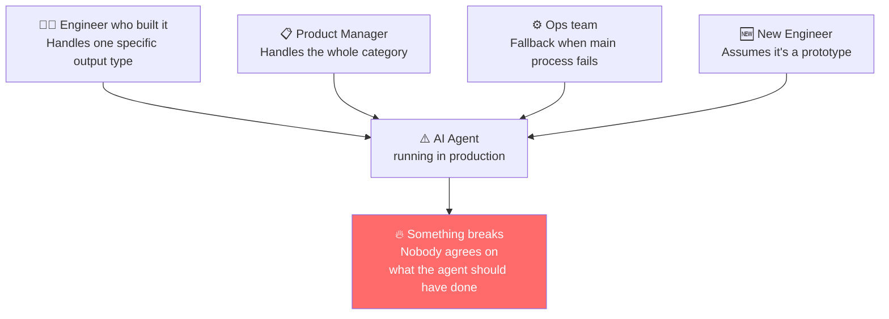

We ran a 30-minute meeting last spring to debug a failing AI agent. Twelve minutes in, someone asked a simple question: what is this agent actually supposed to deliver?

The room went quiet.

Four engineers on the call. Two product managers. One person from ops. We'd been running the agent for six weeks. Nobody could agree on what success looked like.

## The Misalignment You Don't Notice Until Something Breaks

Here's how it usually goes. Someone builds an agent, deploys it, and it starts doing useful things. Early on, everyone's impressed. The agent runs, output comes out, nobody complains.

Then something breaks. Or someone asks why a specific output looked the way it did. Or a new engineer joins and asks what the agent is responsible for.

That's when you find out your team has been operating with four different mental models of the same agent.

The engineer who built it thinks it handles one specific case. The product manager thinks it handles everything in that category. The ops person thinks it's a fallback for when the other process fails. The new engineer thinks it's a prototype that isn't in production yet.

They're all wrong. They're all right. Because nobody ever wrote it down.

## Why This Happens Across AI Agent Teams

Agents don't come with scope built in. You give them tools, a prompt, and a task queue. What they're "supposed to do" is a social agreement that lives only in the heads of the people who deployed them.

When you're moving fast, you don't write that down. You just ship.

The problem is agents don't stay small. Task volume grows. Edge cases appear. Someone extends the prompt. Someone adds a new tool. The agent's actual behavior drifts from whatever the original mental model was, and because nobody documented the starting point, nobody notices the drift.

By the time you have 8 agents running, you might have 8 different definitions of done, 8 different assumptions about failure handling, and 8 different opinions about who owns what.

That's not a scale problem. That's a definition problem that scale reveals.

## Three Things That Go Wrong When Definitions Are Missing

**Debugging becomes a debate.** When an agent produces unexpected output, the first question should be: did it behave correctly given its scope? If there's no scope, that question turns into a 20-minute argument about intent. You're debugging a social agreement, not a system.

**Changes break invisible assumptions.** You adjust the agent's prompt to improve one output type. Someone else assumed the agent also handled something adjacent. Now that adjacent thing is broken, and nobody warned you it was in scope. The [agent monitoring dashboard](/features/agent-monitoring) shows the task succeeded. The business effect was bad. You won't find that in the logs.

**Success metrics measure the wrong thing.** If five people on your team have five definitions of the agent's job, your completion rate is measuring five different expectations at once. You might be celebrating high throughput on tasks that were never the priority. You won't know until the downstream consequences show up somewhere else.

## The Fix Is Simpler Than You Think

The answer is not a long specification document. Nobody reads those.

Three things, written down somewhere visible:

- What the agent produces (the actual output, specifically)
- What the agent does NOT do (the explicit scope boundary)
- Who owns it when something goes wrong

The third point matters more than most teams think. An agent without an owner is an agent nobody will fix until it causes a visible problem.

[AgentCenter's task and agent views](/features/agent-dashboard) let you assign ownership to agents directly, with task-level tracking of what's been reviewed and what hasn't. But the tool only helps once the definition exists. The dashboard shows who's assigned. It can't create the shared understanding that should exist before you hit production.

## Who Feels This First

Teams on their second or third wave of agents. You shipped the first two carefully, with some planning. Then you got comfortable. The next eight went up faster, with less documentation, because "we know how to do this now."

You do know how to ship agents. What breaks at that point is knowing what each one is actually responsible for, fast enough to act on it when something goes wrong at 11pm.

Solo founders hit a different version. You built it, so you know exactly what it does. Three months pass. The business changes. The agent is still running, still producing output, solving a problem that no longer exists in the same shape.

## The Honest Caveat

A clear definition doesn't prevent agent failures. An agent with perfect documentation can still drift, hit edge cases, or produce wrong output.

What a definition does is reduce the time you spend arguing about what went wrong. It turns a chaotic incident into a testable question: did the agent behave within its stated scope? If yes, the scope needs updating. If no, the agent does.

Those are different problems to fix. Knowing which one you're dealing with makes the whole thing faster.

---

*The dashboard won't fix a broken agent. But it will tell you which one is broken at 3am. [Try AgentCenter free](/pricing).*
