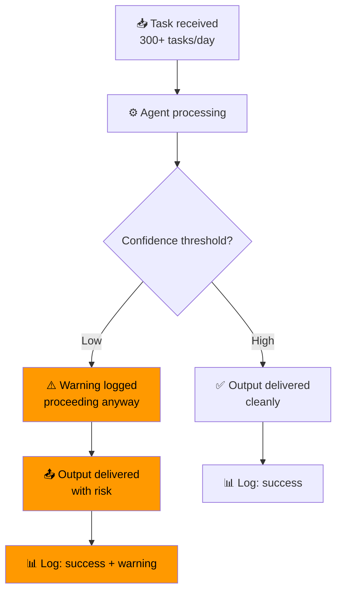
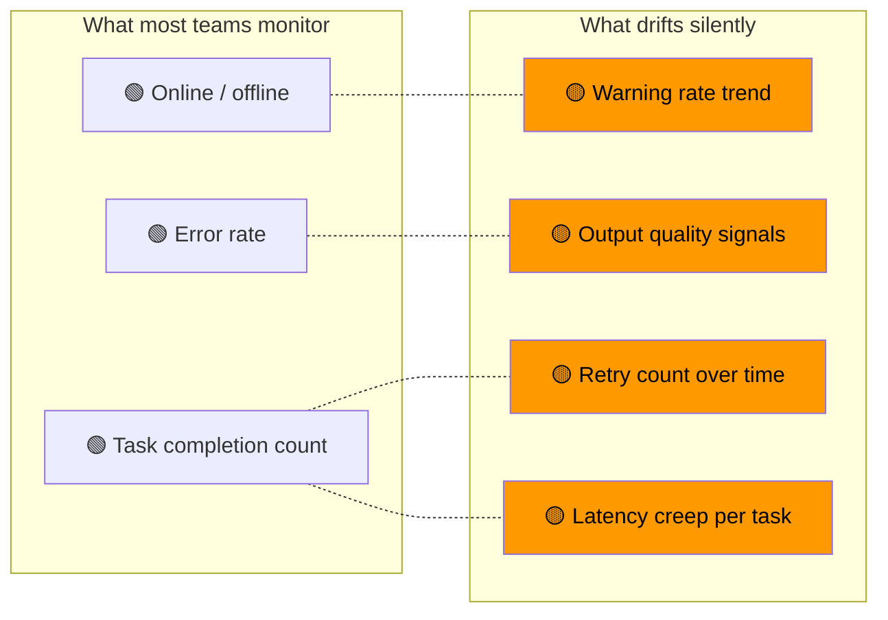

Six weeks after we deployed our content review agent, someone finally read the logs.

Not because they were curious. Because three clients complained on the same day that their content had gone out with obvious formatting errors. The kind a human reviewer would have caught in 30 seconds.

When we dug in, the errors were right there in the logs. Had been for five days. The agent was flagging its own uncertainty, emitting warning-level entries every time it hit an ambiguous case, and nobody had looked.

We had logs. We had a dashboard. We had alerts set up on crashes. What we didn't have was a habit.

## The gap between having monitoring and using it

This is one of the more uncomfortable patterns in agent operations. Teams spend real effort setting up observability. They instrument their agents, pipe logs somewhere, build dashboards. Then they open those dashboards twice: once to verify everything looks fine after deployment, and once when something breaks.

The stretch in between, where most of the signal lives, goes completely unread.

The reason isn't laziness. It's attention. Engineers have finite time. Agent logs don't page you. They sit there quietly accumulating warnings, anomalous output rates, and increasing retry counts while your team focuses on whatever is screaming loudest.

So the agent logs become like smoke detector batteries. You think about them when something happens, not before.

## What the logs were actually showing

Here's what our content review agent had been recording for five days before anyone looked:

The success rate looked fine at the dashboard level. 98% completion. No crashes. No errors. What the dashboard didn't surface prominently was that 18% of completed tasks had a warning entry attached, up from 4% the week before.

That shift from 4% to 18% over seven days was the real story. Nobody read it.

## Why good teams fall into this pattern

It's not that engineers don't care about agent quality. The problem is that most agent monitoring was originally designed around availability: is the agent running, is it completing tasks, is it crashing?

When you configure alerts for crashes and timeouts, you're asking the monitoring to tell you about catastrophic failure. It stays quiet on everything else.

Quality drift is different. It's gradual. An agent whose warning rate creeps from 4% to 18% over three weeks doesn't trip any threshold unless someone set one deliberately. And most teams don't set quality thresholds early, because early on they don't know what normal looks like for their specific agent.

So you end up in this situation: monitoring is working exactly as configured, and you're still missing what matters.

## The pattern at scale

One agent with unread logs is a problem. Ten agents running the same way is a different category entirely.

The left column is what most agent monitoring covers by default. The right column is where production quality actually lives and where problems appear first.

The gap between the two isn't a tooling problem — it's a review habit problem. You can have every signal available and still miss it if nobody is looking on a schedule.

## What actually changed for us

After the client complaints, we made two concrete changes.

First, we added explicit tracking on warning rates alongside error rates. If the ratio of "completed with warning" to "completed cleanly" shifted more than 5 percentage points in a rolling 48-hour window, someone got paged. Not a Slack message. A page.

Second, we added a 20-minute weekly review to the team calendar. Every Tuesday, one person pulled up the [agent activity feed](/features/agent-monitoring) and read through the previous week's flagged entries — not all logs, just the ones filtered by anomalous quality signals. We treated it like a standup: it happened on schedule, not on demand.

That review caught two more issues in the following three weeks before any client noticed. Both were visible in the logs for 48 to 72 hours before we looked.

## Who this matters most for

If your agents produce outputs that go directly to customers, clients, or downstream systems without human review at each step, unread logs are your highest operational risk right now. Not crashes. Not outages. Gradual degradation that nobody caught because nobody was scheduled to look.

This hits hardest for solo founders and small teams running 5 to 15 agents. You deploy, things work, you move on to the next problem. That's exactly when drift starts.

It also matters for any team using [multi-agent workflows](/features/multi-agent-workflows) where one agent feeds output to another. A 10% quality drop in agent one becomes a 10% quality drop in agent two's inputs, and the second agent often has no way to signal that its inputs are worse than expected. The warning entries stay in the logs. Unread.

## The habit that actually works

We tried a lot of things that didn't stick — automated summary emails, Slack digests of warning counts, weekly OKR-style reviews of agent health. Most of them got ignored within two weeks.

What stuck was the combination of a specific alert threshold on warning rate trends and a fixed calendar event with one owner each week. Small team, low overhead, hard to skip.

The alert tells you when something is definitely wrong. The weekly review tells you what was almost wrong. Both matter.

## The honest caveat

A dashboard won't fix this on its own. You can have the best [agent monitoring](/features/agent-monitoring) tooling available and still ignore it for six weeks if there's no habit attached. The tooling makes it easier to catch things when you look. The discipline to actually look is entirely on your team.

The shift that worked wasn't better alerting in isolation. It was treating the log review like infrastructure maintenance — something that happens on a schedule because things that only happen after incidents are too late.

---

*The dashboard won't fix a broken agent. But it will tell you which one is broken at 3am. [Try AgentCenter free](/pricing).*
