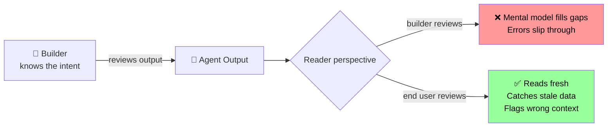

We ran a competitive research agent for six weeks before anyone outside the engineering team looked at its outputs. The agent pulled data, structured summaries, and delivered clean-looking documents. Our internal error rate was 7%. Acceptable, by our own measure.

Then a product manager reviewed a batch for a launch she was planning. She flagged eleven errors in thirty summaries. Not formatting issues. Not typos. Substantive errors: "This product description is based on their 2024 roadmap — they shipped a completely different version in January."

We had reviewed those outputs. We just hadn't caught what she caught.

## The Problem With Building and Reviewing

When you write the prompt, structure the output schema, and know what data the agent pulls from, you carry a mental model of what a good output looks like. That model runs in the background every time you review.

It fills in gaps. It interprets "close enough" as correct. It reads what you expected to see, not what's actually there.

This isn't unique to engineering. It shows up in software QA, manufacturing quality control, and aviation safety — the people closest to building something are systematically worse at catching its errors than people seeing it fresh.

For AI agents, the problem is sharper than usual. Agent outputs look right even when they're wrong. There are no stack traces. No syntax errors. The document arrives formatted, structured, and confident. If you're expecting a good output, you'll see a good output.

## What Fresh Eyes Actually Catch

When we switched to having end users review outputs — the people who actually act on the research summaries in their work — the error pattern became clear fast.

The errors builders missed fell into three categories:

**Stale data presented as current.** The agent had no way to know a competitor had rebranded. We knew the data source had limitations. Readers didn't.

**Correct format, wrong context.** Summaries were technically accurate but missing the framing that made them useful for decisions. We knew what we meant. Users didn't.

**Scope creep, unnoticed.** The agent had gradually started including sources we'd never intended. We'd never tightened the scope after the first few runs. It wasn't visible to us because the outputs still looked reasonable.

None of these appeared in our internal review. We were grading on whether the output matched our expectations, not whether it served the person receiving it.

## Three Things That Closed the Gap

**Assign reviewers who use the output, not who built it.**

For a research agent, the reviewer should be whoever acts on the research. For a support agent, someone from support. For a financial reporting agent, someone from finance.

This sounds obvious. In practice it rarely happens. Engineering owns the agent, so engineering reviews it. The fix is changing who gets assigned the review task. The [AgentCenter deliverable review workflow](/features/agent-monitoring) makes this explicit — you assign a named reviewer per output batch instead of leaving it to whoever has time on the build team.

**Run a monthly "cold read" with someone who hasn't seen the agent's outputs before.**

The first read is always the most honest. Someone with no context about what the agent was supposed to produce reads what's actually there.

Rotate this across your team. One person, thirty minutes, a fresh sample. Ask them to note anything that seems off or incomplete. You will reliably find the same class of errors that fresh eyes catch in the first week after any agent ships.

**Track errors by who caught them, not just what they were.**

If 90% of flagged errors come from people outside the build team, that's a signal about your review process, not your agent. Fix the review process first.

We started logging who surfaced each error inside our [agent monitoring dashboard](/features/agent-monitoring). Within a month the pattern was obvious: builders caught formatting issues and obvious failures. End users caught everything substantive.

## What This Changes in Practice

The shift is smaller than it sounds: separate who builds from who reviews.

You don't need a dedicated QA team. You don't need to restructure how the agent works. You need to make sure that for every production agent producing outputs other people act on, at least one non-builder is looking at those outputs regularly.

Frequency matters less than the separation. Weekly reviews from end users catch more than daily reviews from builders.

One framing that helps: builders are good at detecting whether the agent ran correctly. They are not good at detecting whether the output is correct for the person receiving it. Both things matter. Only one of them requires a builder.

## Who This Matters Most For

Teams where agents produce content that others act on without checking: research summaries, compliance reports, data exports, customer communication drafts. If someone downstream is making decisions based on what your agent produced, and they're not reviewing it themselves, your review process has a gap.

Solo developers running agents for their own use face a different version of this problem. You're the builder and the consumer. You can calibrate your own trust over time. The risk is that familiarity makes you stop reading outputs closely. Different setup, same blind spot.

## The Honest Caveat

Rotating reviewers doesn't make bad agents good. If your agent is pulling from outdated data or its prompt is miscalibrated for the task, better reviewers will surface the problem faster. They won't prevent it.

What review separation does is reduce the time between "something is wrong" and "someone notices." In production, that gap usually determines whether a problem costs you an afternoon or a month. And most teams find that once non-builders start catching things regularly, engineers write tighter prompts. When you know someone else is reading the output, you write differently.

---

*The dashboard won't fix a broken agent. But it will tell you which one is broken at 3am. [Try AgentCenter free](/pricing).*
