Every engineer thinks about deployment. What model to use. How to version the prompt. How to push it to production safely.

Almost nobody thinks about rollback until they're in the middle of an incident trying to undo something they just deployed.

That's backwards. Rollback is not the backup plan. It's the foundation that makes deployment safe.

## The Incident That Changes How You Think

I've seen this pattern enough times to recognize it. A team deploys a prompt change. Production looks fine for the first two hours. Then something surfaces — the quality rejection rate climbs from 8% to 40% over the next four hours. Slowly enough that it's not immediately obvious, fast enough that it matters.

The team wants to roll back. To what? The "previous prompt" is on someone's laptop. Someone else edited it last week. There's no canonical previous version.

They spend an hour reconstructing the last good state from Slack messages and Git blame. In the meantime, 4 hours of degraded outputs have gone through the pipeline.

That hour of reconstruction is what rollback infrastructure prevents.

## What Rollback Actually Requires

Good rollback for AI agents means being able to answer: "What was the exact configuration of Agent X at 3pm on Tuesday?"

Configuration includes:

- Prompt version (exact text, not "the one before this one")
- Model version (pinned, not "latest")
- Tool configurations
- Any agent parameters (temperature, max tokens, etc.)

If you can answer that question for any point in the last 30 days, you can roll back. If you can't, you're rebuilding from memory.

```mermaid
graph TD
    subgraph "Without Rollback Infrastructure"
        A["🔴 Regression<br/>Detected"] --> B["🔍 Find Previous<br/>Config"]
        B --> C["Slack messages<br/>? Git blame<br/>? Someone's memory"]
        C --> D["⏱️ 1-2 hours<br/>Reconstruction"]
        D --> E["🚀 Deploy<br/>Reconstructed Config"]
        E --> F["🤞 Hope it's<br/>the right one"]
    end
    subgraph "With Rollback Infrastructure"
        G["🔴 Regression<br/>Detected"] --> H["📋 Pull Config<br/>Snapshot from History"]
        H --> I["⏱️ 10 minutes<br/>to identify"]
        I --> J["🚀 Deploy<br/>Known-Good Config"]
        J --> K["✅ Confirmed<br/>Recovery"]
    end
```

## Why This Is Underrated

Deployment is visible. You demo a new feature. The team sees it. The prompt change makes outputs better. Everyone notices.

Rollback is invisible until you need it. Nobody celebrates "we deployed the ability to roll back." Nobody demos it. It looks like overhead until 3am when something breaks.

The same cognitive bias that causes teams to skip monitoring setup causes them to skip rollback infrastructure. Both become visible at the worst possible time.

## Building Rollback Infrastructure Before You Need It

Three things to do now, while nothing is on fire:

**1. Version everything that defines agent behavior.** Prompts in Git. Model versions pinned. Tool configurations documented. Every variable that changes agent output gets tracked.

**2. Create a configuration snapshot per deployment.** When you deploy a new agent configuration, record the full snapshot: timestamp, what changed, the exact config that was deployed. This is your rollback target list.

**3. Test rollback as part of deployment.** When you push a new config, also verify that the rollback procedure works. "Roll back to previous config" should be a step you can execute in under 15 minutes. If it takes longer, fix the process now.

## What Fast Rollback Actually Looks Like

In a well-structured setup:

- Detection: quality rejection rate alert fires
- Diagnosis: 10 minutes to identify that the rate jumped at 2:14pm, correlating with the prompt deploy at 2pm
- Decision: roll back to the 1:45pm snapshot
- Execution: update agent config to previous version, restart task processing
- Verification: rejection rate drops back to baseline within 30 minutes of the rollback

Total incident duration: under 1 hour.

Without rollback infrastructure, the same incident commonly takes 3-6 hours because most of the time is spent figuring out what to roll back to.

## The Interaction With AgentCenter

AgentCenter's task history stores the agent configuration associated with each run. If you need to know what config was running when a specific task succeeded, you pull that task's history and see the config snapshot.

This gives you the rollback target without manual tracking. The task record is the configuration record. When you find the last good task, you find the last good config.

## Who This Matters Most For

Rollback infrastructure matters most for teams that are actively iterating on their agents. Teams in the early stages of production, running experiments, changing prompts weekly. The more you change, the more important it is to be able to undo.

Teams that deployed once and haven't touched their agents in 6 months don't need rollback as urgently. But those teams are rare.

## Honest Caveat

Rollback infrastructure doesn't prevent you from deploying bad changes. It just makes recovery faster. Combine it with staged deployment — test changes on a subset of traffic before full deployment — and you reduce both the frequency and severity of incidents.

_The dashboard won't fix a broken agent. But it will tell you which one is broken at 3am. [Try AgentCenter free](/pricing)._
