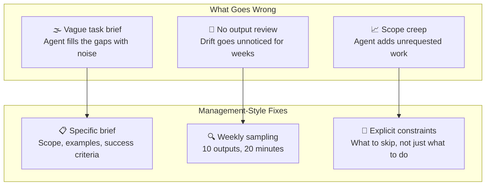

By Q2, we had 11 AI agents running in production. Two were doing genuinely useful work. Three were completing tasks that nobody could verify were correct. The other six were running, finishing, consuming tokens, and generating outputs that sat in a folder nobody reviewed.

The problem wasn't our monitoring. We had logs. We had run counts. We had cost dashboards. The problem was how we were thinking about the agents.

We kept asking: "Is it running?" We should have been asking: "Does it know what it's supposed to do?"

## The Mental Model That Breaks at Scale

Code either works or it doesn't. A broken function throws an exception. A bad API call returns a 500. The failure is visible, immediate, and usually points at a root cause.

Agents don't fail that way. They complete runs and return results, even when those results are wrong. A content agent that drifts off-topic still reports success. A summarization agent that skips key details still marks the task done. There's no stack trace. There's just output.

That silence changes what "production" means for agents. You can't rely on error rates alone. You need something closer to the systems you'd build for a team of people: clear direction, regular check-ins, and someone who reviews the work.

## Three Failure Modes We Actually Hit

### Failure Mode 1: The Vague Brief

We had a research agent briefed to "find relevant articles on AI in healthcare." It ran. It returned articles. About 40% of them were marginally relevant at best.

We rewrote the task the way you'd brief a new hire: what sources to prioritize, what "relevant" meant in concrete terms, examples of articles that should and shouldn't be included, and a hard cap on output count. Quality went from 40% useful to roughly 80%, without touching the model or the underlying prompt template.

The agent didn't change. The brief did.

### Failure Mode 2: No Review Cadence

With code, feedback is built in. Tests fail, linters flag issues, CI catches regressions. With agents, feedback requires deliberate effort. Someone has to read the outputs.

We were reviewing maybe 2% of outputs ad hoc, whenever something looked off. That meant a content agent could drift for weeks before anyone caught it. We shifted to weekly random sampling: 10 outputs per agent, reviewed in about 20 minutes total. That cadence caught three separate quality drifts before they became production problems.

Not because we added [agent monitoring](/features/agent-monitoring). Because we scheduled actual review.

### Failure Mode 3: Scope Creep From Inside the Agent

One of our writing agents would expand its scope mid-run. Asked to write a product description, it would also add a comparison section, a use-case breakdown, and suggested meta tags. None of those were requested. Every output was longer and more expensive than it needed to be.

The fix was constraints in the task definition: explicit guidance on what to produce and, critically, what to skip. Output length dropped by 60%. Downstream processing got faster. Total token cost on that agent fell by around 40% within two weeks.

## What Monitoring Gets Right, and Where It Falls Short

Monitoring tracks the right operational signals: run counts, latency, cost per task, error rates. That data is genuinely useful for spotting infrastructure problems and catching outright crashes. [AgentCenter's monitoring layer](/features/agent-monitoring) captures this, and it matters.

But it won't tell you if the outputs are good. It won't tell you if the agent's definition of done matches yours. And it won't catch the slow drift that happens when nobody reads the work.

That's not a criticism of monitoring. It's a criticism of treating monitoring as the complete answer. Observability tells you an agent ran. It doesn't tell you if it did the right thing.

## The Three Habits That Help

**Write task definitions like job descriptions.** Be specific about what done looks like, what inputs to prioritize, and what to leave out. Vague prompts produce vague outputs, every time.

**Build a review schedule, not just alerts.** Weekly sampling on a rotating set of tasks catches more than reactive monitoring. Pick 10 outputs at random, spend 20 minutes, and note anything that looks off. That's it.

**When an agent underperforms, start with the brief.** Before adjusting the model or rewriting the prompt, ask whether the task definition was clear enough. Most of the time, it wasn't.

## Who This Matters Most For

This shift matters most for teams moving from 3 to 5 agents to 10 or more. At small scale, you can stay close to every agent, review most outputs, and course-correct fast. At 10 or 15 agents, that doesn't scale. You need a management layer for directing agents and reviewing their work, not just [infrastructure for running them](/features/agent-dashboard).

If every agent you run handles deterministic, fixed-format inputs and produces binary pass/fail outputs, the people-management frame may not apply. Agents that behave like scripts need scripting discipline, not management. But the more judgment an agent needs, the more this frame helps.

## The Honest Caveat

This comparison doesn't hold in every direction. People can push back, ask for clarification, and escalate when something feels wrong. Agents can't. That gap still matters, and it's real.

But for the quality and reliability problems most teams hit between agent number 5 and agent number 20, the mental model shift is worth making. You stop expecting agents to just "work" and start building the systems that help them work consistently.

---

*The dashboard won't fix a broken agent. But it will tell you which one is broken at 3am. [Try AgentCenter free](/pricing).*
