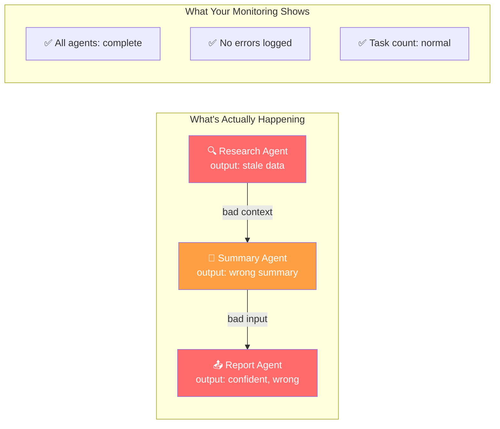

Our research agent ran for nine days without a single error. No crashes, no timeout alerts, green status the whole time. We found out on day nine that it had been summarizing competitor pages by pulling from a cached version of the site that was eight months old.

Nine days of outputs. Every one of them wrong. That's a silent failure, and it's harder to manage than any crash we've had.

## The Dashboard Lies When Everything Looks Fine

A crash is actually a kindness. You get an error, a timestamp, something to act on. The agent is visibly broken, someone notices, you fix it.

A silent failure gives you nothing. The agent picks up tasks, completes them, marks them done, moves to the next one. All the metrics look normal. The logs are clean. If your monitoring only asks "did the agent finish?" the answer is yes, every time, and that answer tells you nothing useful.

This is the trap most teams fall into when they first move agents to production. They build status monitoring: online/offline, task count, error rate. That catches crashes. It doesn't catch an agent that's running and producing garbage.

## What Silent Failure Actually Looks Like

There are three versions of this problem, and they get progressively worse.

**Type 1 — Wrong output, isolated.** The agent completes a task and the output is wrong or incomplete. If a human reviews the deliverable, they catch it. If not, one bad output gets used downstream. Recoverable, but only if you're reviewing outputs.

**Type 2 — Wrong output, accumulated.** The agent runs on a schedule: every hour, every day, every Monday morning. Each run produces subtly wrong output. No single output is obviously broken, but the error compounds. By the time someone notices, you have weeks of bad data to audit and possibly undo.

**Type 3 — Wrong output, propagated.** In a multi-agent pipeline, one agent's output is another agent's input. The first agent silently fails. The second agent gets bad input and processes it as if it were correct, producing a confident but wrong answer. The third agent builds on that. By the time a human sees the final output, the failure is three steps removed from its source and nearly impossible to trace without a full audit trail.

The third type is the one that breaks teams. It's the one that sends a report to a stakeholder with confidently wrong numbers, or posts a customer-facing summary based on a competitor's old pricing.

## Why Teams Don't Catch This

Most monitoring is built around the question "is the agent up?" That's the right question for infrastructure. It's the wrong question for agents.

Agents aren't just moving data from A to B. They're making decisions, synthesizing information, extracting meaning. The fact that they ran doesn't tell you whether the output was any good.

A few patterns that make this worse:

- **No output review gate.** If nobody has to approve or check an agent's output before it's used, silent failures run indefinitely.
- **Async pipelines.** When agents hand off to other agents automatically, a human may never see the intermediate output that went wrong.
- **Optimistic completion logic.** Some agents mark tasks "done" even when the output is partial or malformed, especially if they weren't given clear failure criteria.

## What Actually Helps

You can't fix this by watching logs more carefully. The logs show success because the agent ran successfully. The problem is in the output.

Three things that make a real difference:

**Instrument output quality, not just completion.** Sample agent outputs and check them against expected patterns. Not AI-generated checks — simple, specific assertions. "Does this summary mention a source URL?" "Is this JSON parseable?" "Is the output longer than 50 characters?" These are cheap and catch a large fraction of silent failures before they propagate.

**Add a review step before propagation.** In multi-agent pipelines, add a human-review gate or an automated validation step between agents doing materially different things. This is exactly what the [deliverable review workflow in AgentCenter](/features/agent-monitoring) is built for: agents submit outputs, someone approves before downstream work starts. It slows the pipeline slightly and saves hours of cleanup.

**Track output shape over time.** If your agent normally produces 300-word summaries and this week's outputs are 40 words, that's a signal worth catching. You don't need semantic understanding — just baseline statistics on what "normal" looks like. A sudden shift in output length, structure, or format is worth a look.

## Who This Matters Most For

If you're running a single agent for a single task with a human reviewing the output every time, you're fine. Silent failures become a real risk when:

- You have **automated multi-agent pipelines** where agent outputs feed directly into other agents without human review
- You're running **scheduled agents** (daily reports, weekly summaries) where failures can compound before anyone checks
- You **scaled quickly** from 2-3 agents to 10+ and haven't updated your monitoring assumptions since the early days

If you built your monitoring when you had three agents, it probably wasn't designed around silent failure detection. Most teams don't revisit that until something goes wrong.

## The Honest Caveat

Using a control plane like [AgentCenter](/features/agent-dashboard) helps because it gives you visibility into what agents are producing, lets you set up review gates before outputs propagate, and keeps an audit trail of what ran and when. That makes silent failures findable faster.

But it won't automatically catch a bad output unless you've defined what bad looks like. Deliverable review only helps if someone is doing the reviewing, or you've built assertions that do it automatically. The tooling creates the structure. You have to fill it.

The deeper shift is treating agent output quality as a metric worth tracking. Uptime is easy to measure and easy to be wrong about. An agent that runs clean and produces wrong output is failing. If you're only watching whether agents run, you're watching the wrong thing.

---

*The dashboard won't fix a broken agent. But it will tell you which one is broken at 3am. [Try AgentCenter free](/pricing).*
