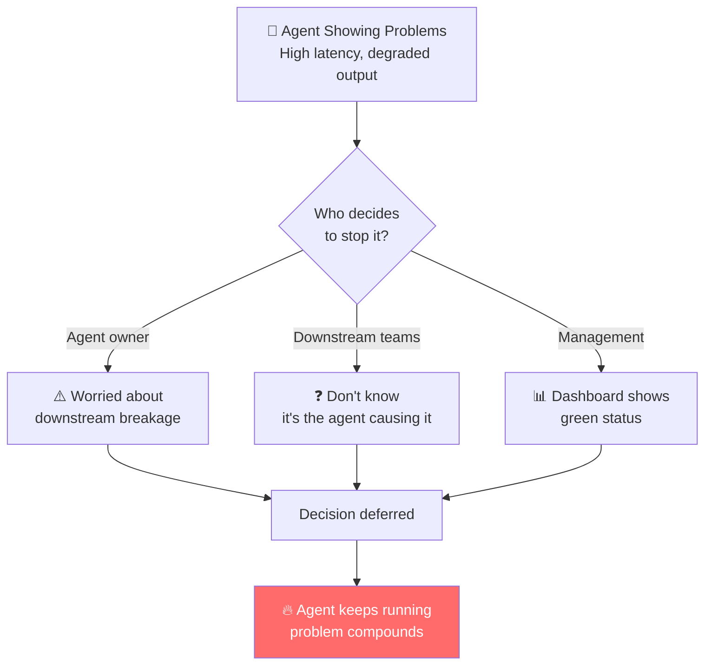

Last quarter we had an agent that was clearly struggling. Latency had climbed from 4 seconds per task to 22. Error rate was up. Outputs were getting shorter and less specific. We knew the agent was getting worse for about three weeks before we stopped it.

Not because the problem was hard to diagnose. It wasn't.

The issue was that seven other workflows depended on this agent's output. Three of those workflows were owned by different teams. Stopping the agent meant those pipelines would break, and we'd own that breakage. So it kept running. Slower every week. Worse every day.

## The Asymmetry Nobody Talks About

Deploying a new agent is almost always easy. You scope the task, write the prompt, wire up the integration, and ship it. If it breaks, nothing depends on it yet. The blast radius is zero.

Stopping an agent that's been running for three months is a completely different problem. By then, three teams might depend on its output. A dashboard somewhere is tracking its throughput. Someone's weekly report has a metric that pulls from its results. You don't really know all of this. You just know it's there.

That asymmetry is the actual challenge of agent operations. Starting is low-risk. Stopping is high-risk. And the longer you wait to stop a failing agent, the higher the risk gets.

## Why Teams Wait Too Long

There are four reasons a team knows an agent is failing and does nothing about it.

**No one has clear authority.** The person who built the agent feels responsible for its uptime, not for the downstream damage it's causing. The teams consuming its output don't feel they have the right to pull the plug on someone else's system. Management only sees that the agent is "running" and reports no error rate. The stop decision falls through the gap between all three.

**The blast radius is unknown.** When an agent's output feeds three other workflows, and those workflows evolved independently over months, no one has a full picture of what actually breaks if the agent stops. You suspect things will break. You don't know which things. That uncertainty is enough to make inertia feel rational.

**Your monitoring isn't measuring what matters.** Most teams instrument agent uptime and request volume. The agent is "healthy" if it's accepting tasks and returning responses. But an agent can be returning wrong answers at scale and your monitoring dashboard will stay green.

**Stopping feels riskier than leaving it running.** The sunk cost of downstream integrations makes inertia look safe. Better to have a slow, degraded agent than to break everything trying to fix it. This logic usually holds for about two weeks, then the damage becomes visible and the incident is twice as bad as it would have been.

## What Good Teams Do Differently

Teams that handle this well make stopping a first-class operation, not a crisis response.

**They map dependencies at deployment, not at incident time.** When you add an agent to production, you document what downstream workflows consume its output. Not because you're planning to stop it, but because you'll need that map eventually. The time to build it is when you still have full context, not at 2am during an incident.

**They separate "agent running" from "agent healthy."** Running and healthy are different states. An agent can be up, accepting requests, and producing garbage. [Agent monitoring](/features/agent-monitoring) needs to track output quality signals alongside uptime metrics. Latency trends, output length drift, downstream error rates — these tell you things your uptime check never will.

**They define the stop decision in advance.** Someone owns it. There's a threshold that triggers it. There's a fallback path if it stops. The teams who handle agent failures well aren't smarter about debugging. They made the decision explicit before they needed it.

This is where the [multi-agent workflow](/features/multi-agent-workflows) view matters: when you can see which tasks depend on which agents, the blast radius of stopping any one of them becomes visible before you're forced to act.

## What the Reader Should Take Away

If you have agents running in production and haven't written down who gets to stop each one, do it now. Not a process document. One sentence per agent: who owns the stop decision, what triggers it, and what the fallback is.

If the answer is "we'd figure it out when the time comes," you'll find out exactly what that costs when the time actually comes.

## Who This Matters Most For

Teams running more than five agents, especially where agents feed into each other or into human-facing workflows. Solo developers running a single, isolated agent won't hit this. Teams with 15 agents across multiple projects absolutely will, and usually around month three or four when the dependency graph has gotten complex enough to feel risky to touch.

## An Honest Caveat

A better dashboard won't make this easy. The hard part is organizational: who owns the stop decision, what happens to downstream consumers, and whether you've mapped your dependencies before you need them. No tool fixes a governance gap. But a tool that makes your agent dependency graph visible and your output quality trends legible at least gives you the information you need to make the call.

---

*The dashboard won't fix a broken agent. But it will tell you which one is broken at 3am. [Try AgentCenter free](/pricing).*
